.. _table_form_component:

Table form
===========

.. contents::
   :depth: 4

Компонент **Table Form** позволяет отображать выбранные значения в виде таблицы. Созданные записи являются временными и хранятся в памяти браузера. Отправляются на сервер вместе с родительской формой.

Создание компонента
---------------------

Компонент **Table Form** позволяет отображать выбранные значения в виде таблицы.

Созданные записи являются временными и хранятся в памяти браузера. Отправляются на сервер вместе с родительской формой.

Для отображения кнопки :guilabel:`Создать` и возможности вызова формы создания используется ``formKey*``, который может быть вычислен в зависимости от настройки **Типа данных** на вкладке :guilabel:`Данные`:

* **Журнал** - варианты создания вычисляются с помощью настройки **ID журнала**, либо на основе типа ассоциации, которая указана в атрибуте (при этом **ID журнала** заполнять не нужно). Есть возможность выбрать колонки для отображения в таблице.

.. list-table::
      :widths: 20 20
      :align: center

      * - |

            .. image:: _static/table_form/Table_form_1.png
                  :width: 400
                  :align: center

        - |

            .. image:: _static/table_form/Table_form_2.png
                  :width: 400
                  :align: center

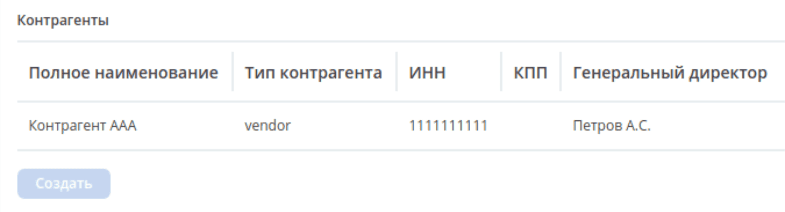

* **Пользовательские** - варианты создания вычисляются на основе типа ассоциации, которая указана в атрибуте. При этом требуется добавить вручную колонки для отображения в таблице (соответствуют названиям полей в форме создания).

.. list-table::
      :widths: 20 20
      :align: center

      * - |

            .. image:: _static/table_form/Table_form_4.png
                  :width: 400
                  :align: center

        - |

            .. image:: _static/table_form/Table_form_5.png
                  :width: 400
                  :align: center

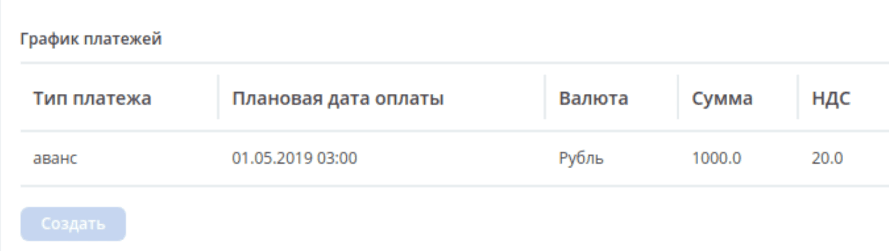

Варианты создания определяются из указанного аттрибута на вкладке :guilabel:`API`, либо из настройки **Пользовательские варианты создания** на вкладке :guilabel:`Данные`. Настройки колонок берутся из первого по списку полученного варианта создания. Если нет ни одного доступного варианта создания, кнопка :guilabel:`Создать` будет скрыта.

Для каждой колонки можно задать настройки вручную. Для этого нужно отметить галочкой пункт **Установить атрибуты вручную**:

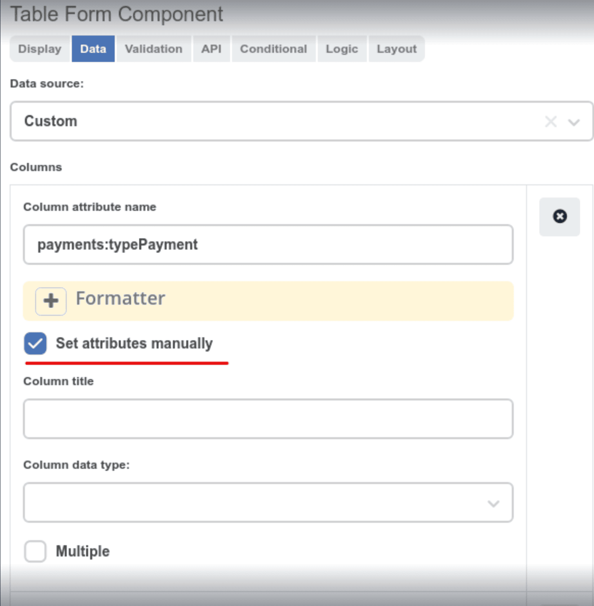

Таким образом можно установить **заголовок колонки** (может быть задан в двух локализация), **тип данных** и признак **Выбор нескольких**.

Предусмотрена возможность применения к колонке форматтера вручную. Опция **Установить атрибуты вручную** не влияет на настройку форматтера.  Поле настройки форматтера принимает значение вида:

.. code-block::

  value = { 
   type: 'script', 
   config: {
     fn: function(...params) {
       const linkHtml = `<a href="${params[0].cell}">${params[0].cell}</a>`
       return {
         type: 'html',
         config: {html: linkHtml}
       }
     }
   }
 };

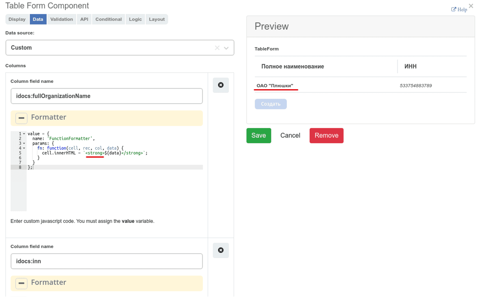

Привязка к атрибуту родительского типа
-----------------------------------------

Для корректной связи tableForm с родительской записью необходимо указать атрибут-ассоциацию на вкладке :guilabel:`API` в поле **Свойство (Property Name)**, либо в блоке **Свойства (Properties)** задать ключ ``attribute`` со значением — именем атрибута на родительском типе.

Например, если на родительском типе определён атрибут:

.. code-block:: yaml

   - id: risks
     type: ASSOC
     config:
       typeRef: emodel/type@project-risk-item
       child: true
     multiple: true

То в настройках tableForm:

- **key** компонента = ``risks`` (совпадает с id атрибута), или
- в блоке **Properties** указать ``attribute`` = ``risks``

Без этой привязки tableForm не сможет сохранить дочерние записи при отправке родительской формы.

Кнопки "Создать" и "Выбрать"
-------------------------------

Компонент Table Form поддерживает два способа добавления записей:

* **Создать** — открывает пустую форму создания новой записи. Запись создаётся с нуля как дочерний элемент родительской сущности. Варианты создания определяются из журнала, указанного в **source.journal.journalId**, или из типа ассоциации атрибута.

* **Выбрать** — открывает журнал-справочник, из которого можно выбрать существующую запись. Выбранная запись используется как **шаблон**: она копируется (клонируется) в таблицу как новая дочерняя запись. Оригинал в справочнике не изменяется.

Кнопка **"Выбрать"** отображается при установленном флаге **Кнопка "Выбрать"** (``enableSelectButton``), наличии вариантов создания и разрешённом действии ``select`` в настройке элементов отображения. В режиме чтения кнопка скрыта. При ``disabled`` или в одиночном режиме с уже добавленной строкой она заблокирована.

Для открытия окна выбора обязательно задайте ``selectJournalId`` — идентификатор журнала шаблонов. При пустом ID кнопка может отображаться, но окно выбора не откроется.

.. note::

   Журнал для кнопки "Создать" (``source.journal.journalId``) и журнал для кнопки "Выбрать" (``selectJournalId``) — это, как правило, **разные** журналы. Первый отображает дочерние элементы в таблице, второй — справочник шаблонов для копирования.

Выбор значения из справочника
------------------------------------

Чтобы на форме отображалась кнопка **"Выбрать"** для копирования существующих объектов, установите флаг **Кнопка "Выбрать"**:

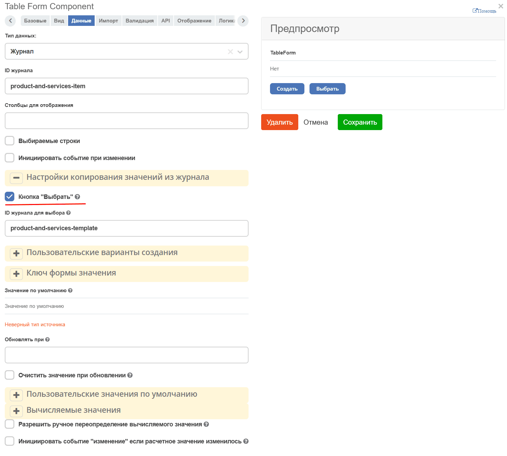

Укажите **идентификатор журнала** для выбора объектов (``selectJournalId``). Автоматической подстановки журнала из первого варианта создания для этой кнопки нет.

1. На форме нажмите кнопку **"Выбрать"**.
2. Выберите необходимый **объект** для копирования. Выбираемое значение используется как шаблон для копируемого объекта.

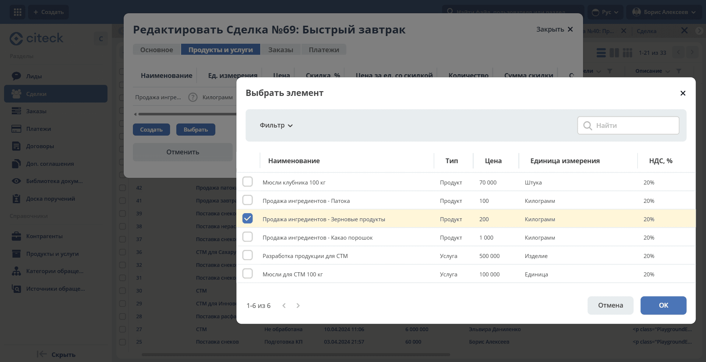

3. Открывается форма редактирования объекта, если необходимо, то можно изменить значения. 

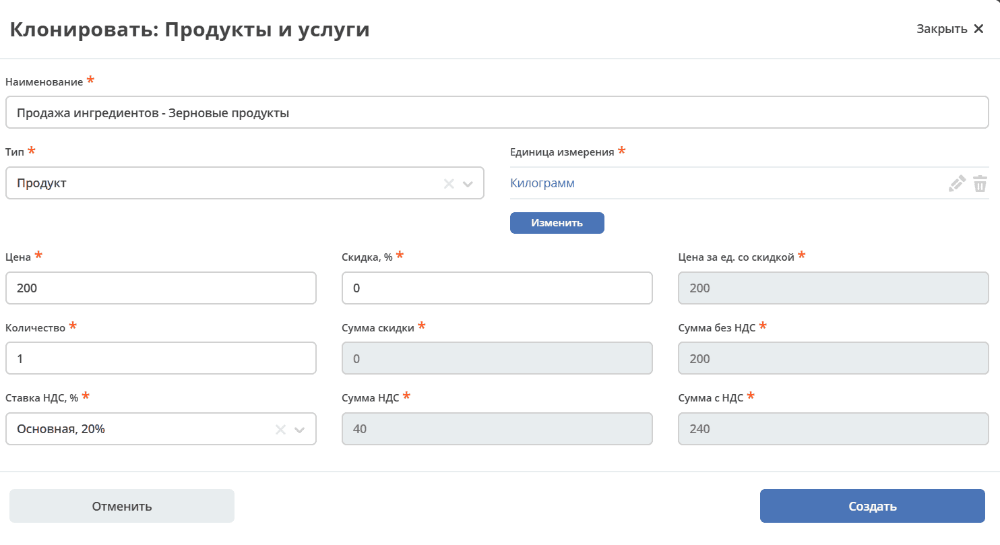

4. Подтвердите выбор, объект будет скопирован в table form.

Пример структуры типов для копирования
~~~~~~~~~~~~~~~~~~~~~~~~~~~~~~~~~~~~~~~~~~~~~~~~~~

Для разделения справочника шаблонов и дочерних записей можно использовать следующую иерархию типов:

.. code-block::

   data-list
     └── <тип-справочник>            ← справочник (шаблоны для выбора)
           └── <тип-элемент>         ← дочерний тип (создаётся при копировании)

Пример из CRM (продукты и услуги):

.. code-block:: yaml

   # Тип-справочник (глобальный каталог шаблонов)
   id: product-and-services
   parentRef: emodel/type@data-list

   # Тип-элемент (дочерняя запись сделки/заказа)
   id: product-and-services-item
   parentRef: emodel/type@product-and-services

Конфигурация ассоциации на родительском типе (сделка/заказ):

.. code-block:: yaml

   - id: product-and-services
     type: ASSOC
     config:
       typeRef: emodel/type@product-and-services-item  # ← тип-элемент, не справочник
       child: true
     multiple: true

Конфигурация компонента Table Form на форме:

.. code-block:: json

   {
     "key": "has-pas:product-and-services",
     "type": "tableForm",
     "source": {
       "type": "journal",
       "journal": {
         "journalId": "product-and-services-item"
       }
     },
     "enableSelectButton": true,
     "selectJournalId": "product-and-services-template",
     "properties": {
       "attribute": "has-pas:product-and-services"
     }
   }

Где:

- ``source.journal.journalId`` — журнал типа-элемента (для отображения строк в таблице)
- ``selectJournalId`` — журнал типа-справочника (для выбора шаблонов при нажатии кнопки "Выбрать")
- ``properties.attribute`` — атрибут-ассоциация на родительском типе

.. important::

   Эта иерархия — пример конфигурации. Table Form использует доступные варианты создания и не требует определённого наследования от ``data-list``. Состав записей глобального справочника зависит от серверной модели и фильтров журнала; настройте их так, чтобы дочерние записи не попадали в список шаблонов.

Наполнение данных в таблице
-----------------------------

Использование Массив записей
~~~~~~~~~~~~~~~~~~~~~~~~~~~~

Для этого можно использовать компонент :ref:`Async Data<async_data_component>` с типом данных **Массив записей (Records Array)**.

В поле **Массив записей (Records Array)** указывается имя таблицы, заключенное в двойные фигурные скобки, в аттрибутах - поля этой таблицы и ключи, по которым они будут доступны.

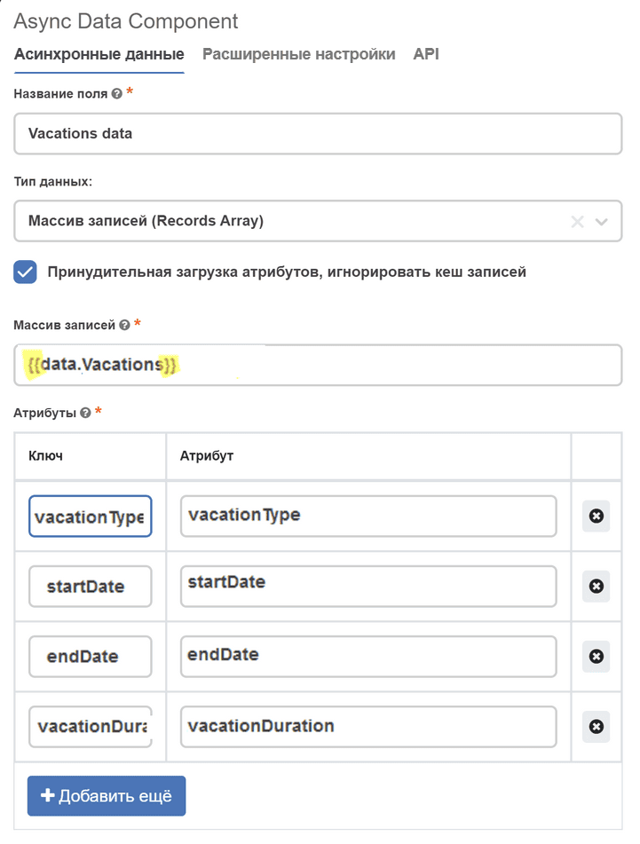

Ручное заполнение
~~~~~~~~~~~~~~~~~~

Table form ожидает, что value в нем будет массивом recordRef. Данные по рекордам будут подтянуты автоматически.

Таким образом, можем в async data получить какие-то данные, например, через recordsQuery, а в table form (вкладка Данные -> Вычисляемые значения) преобразовать их в массив recordRef и назначить в value:

.. code-block:: javascript

       const uncompletedIssues = _.get(data, 'uncompletedIssues.records') || [];
       const issueIds = uncompletedIssues.map(issue => issue.id);

       value = issueIds;

Как получить доступ к родительской форме?
------------------------------------------

Чтобы получить доступ к родительской форме из компонента формы создания/редактирования записи, используйте ``instance.root.parentForm``.
Например, если требуется установить значение по умолчанию полю дочерней формы, опираясь на значение из поля родительской формы, можно установить этому полю настройку **Пользовательские значения по умолчанию**:

.. code-block:: javascript

    const parentForm = instance.root.parentForm;
    if (parentForm) {
      value = parentForm.getValue().data.someParentFormFieldName;
    }

Родительская форма определяется по ``options.parentId``, если он задан, иначе — по порядку открытых форм в ``Formio.forms``. При нескольких одновременно открытых формах учитывайте этот способ определения родителя.

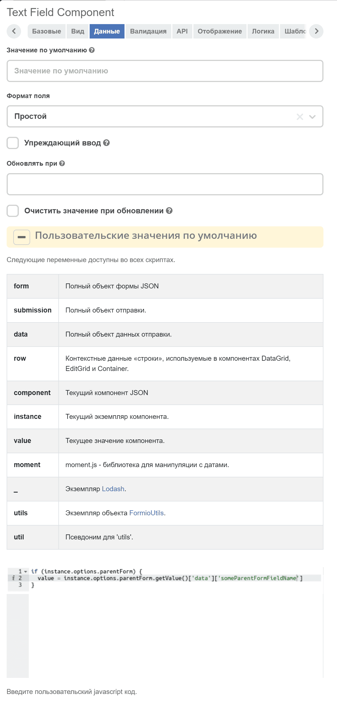

Отображение действий
----------------------

На вкладке :guilabel:`Условия` группа **Отображение действий (Display Actions)** содержит настройки журнальных и стандартных действий.

Есть два варианта установки действий:

1. **Использовать действия журнала** (``isUsedJournalActions``) — флаг на вкладке :guilabel:`Условия`. При включении в строках таблицы используются действия журнала, доступные для соответствующей записи. Например, это могут быть действия редактирования и удаления. Используйте этот режим, когда источник данных — **Журнал**.

2. Если флаг выключен, отображаются стандартные действия. Поле **Действия компонентов** (``displayElementsJS``) позволяет переопределить их видимость. Незаданные свойства используют значения по умолчанию из таблицы ниже.

При включённых журнальных действиях поле ``displayElementsJS`` не управляет действиями строк. При этом ключ ``create`` продолжает влиять на кнопки создания и импорта, а ``select`` — на кнопку выбора из справочника.
     

.. list-table:: 
      :widths: 10 10 10 10
      :header-rows: 1

      * - Наименование действия 
        - Ключ 
        - По умолчанию
        - disabled / режим просмотра
      * - **Создать**
        - create 
        - true
        - заблокировано при disabled; скрыто в режиме чтения
      * - **Редактировать**
        - edit 
        - true
        - скрыто
      * - **Удалить**
        - delete
        - true
        - скрыто
      * - **Просмотр**
        - view 
        - true
        -  
      * - **Предпросмотр документа**
        - preview 
        - false
        -  
      * - **Клонировать**
        - clone
        - false
        - скрыто

Поле принимает JavaScript-выражение, в котором переменной ``value`` присваивается объект с необязательными свойствами ``create``, ``view``, ``preview``, ``edit``, ``delete`` и ``clone``. Дополнительное свойство ``select`` управляет видимостью кнопки **Выбрать**; при его отсутствии показ разрешён, если выполнены остальные условия для этой кнопки.

Если свойство не указано, используются стандартные настройки действия с учётом состояния компонента.

Ограничения в таблице относятся к стандартным действиям. При включённых журнальных действиях доступность определяется конфигурацией действий и правами на записи; флаги ``disabled`` и режима чтения не являются общим запретом на выполнение всех журнальных действий.

.. code-block::

	value = {
	  create: false,
	  view: false, 
	  edit: false, 
	  delete: true,
	  preview: true
	} 

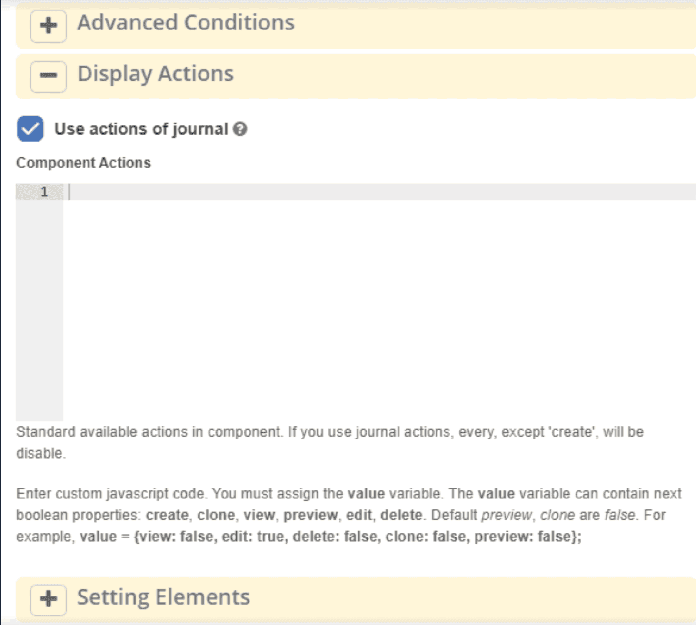

Настройки элементов
----------------------

На вкладке :guilabel:`Условия` группа **Настройка элементов (Setting Elements)** содержит настройку клонирования.

* **Мгновенный клон (Instant Clone)** — ``isInstantClone``.

Если флаг установлен, при выборе из справочника запись сразу копируется в таблицу без открытия формы редактирования. Если флаг снят, сначала открывается форма, в которой можно изменить значения перед добавлением.

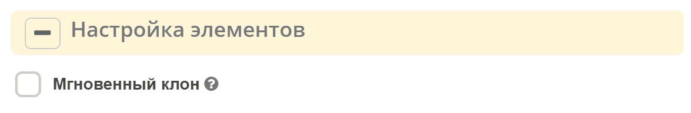

Выбор строк в таблице и выполнение действий с выбранными строками
------------------------------------------------------------------
Для включения возможности выбора строки в таблице нужно отметить галочкой пункт **Выбираемые строки** на вкладке :guilabel:`Данные`.

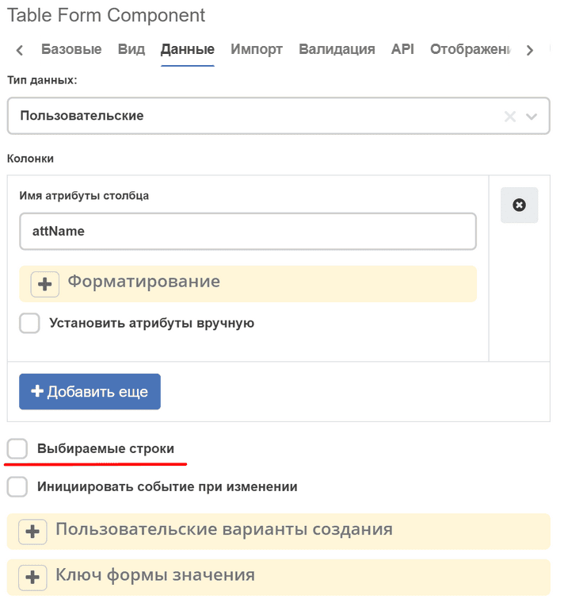

Для получения списка выбранных строк в таблице у компонента предусмотрен метод ``getSelectedRows()``.

Например, чтобы выполнить какое-нибудь действие с выбранными строками в таблице при нажатии на кнопку, в компоненте **Button** выберем **Действия: Custom** и укажем **Button Custom Logic**:

.. code-block::

    const tableFormComponent = utils.getComponent(form.components, 'tableFormComponentKey');
    if (!tableFormComponent) {
        return;
    }

    const selectedRows = tableFormComponent.getSelectedRows();

    // some actions with selectedRows

Запрет выбора некоторых строк в таблице
----------------------------------------

На вкладке :guilabel:`Данные` в поле **Указать невыбираемые строки** можно запретить выбор определенных строк в таблице:

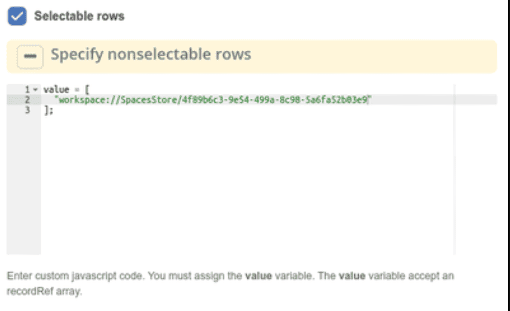

Установка выбранных строк по умолчанию
----------------------------------------

На вкладке :guilabel:`Данные` в поле **Указать выбираемые строки** можно указать, какие строки должны быть выбраны по умолчанию:

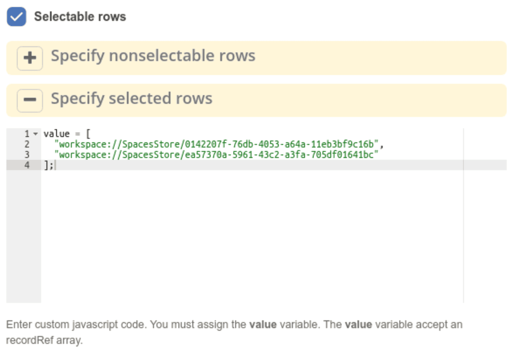

Флаг "Разрешить ручное переопределение вычисляемого значения"/ "Allow Manual Override of Calculated Value"
--------------------------------------------------------------------------------------------------------------

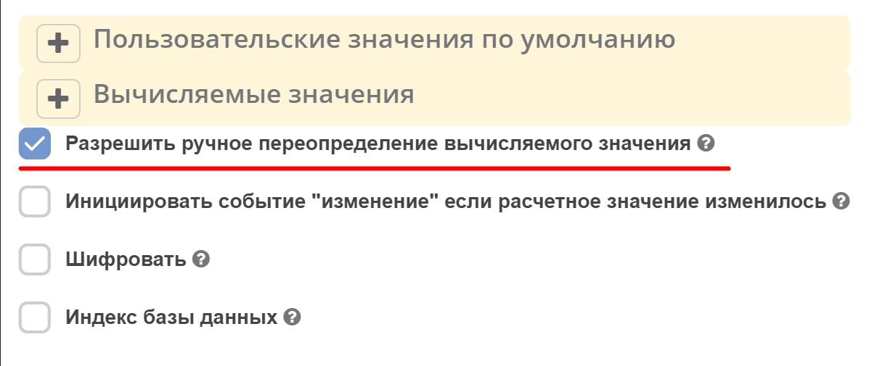

На вкладке :guilabel:`Данные` выставленный флаг разрешает принудительно перезаписать пользователю поле, где уже введено вычисляемое значение.

См. :ref:`подробно<manual_override>`

Статические заголовки
----------------------

Для включения статического заголовка необходимо в родительской форме проставить чекбокс **Скрыть имя записи в модальном заголовке/ Hide record name in modal title**. В данном случае произойдет скрытие имени ноды.

Так же, есть возможность задать свой локализованный статический заголовок. Для этого необходимо:

1. Создать в **Локализация/Localization** бандл с необходимой локализацией

2. Вставить ключ локализации в поле **Укажите пользовательское статическое название поля для объединения с основным/ Enter custom static label for concat with basic**. Если данный ключ не будет найден, то в заголовок добавится тот текст, что лежит в поле **Укажите пользовательское статическое название поля для объединения с основным/ Enter custom static label for concat with basic**

Импорт из файла
----------------

Для импорта данных из файла (например, xlsx) откройте раздел :guilabel:`Импорт` и включите **Добавить кнопку Импорт** (``import.enable``). По умолчанию этот флаг выключен.

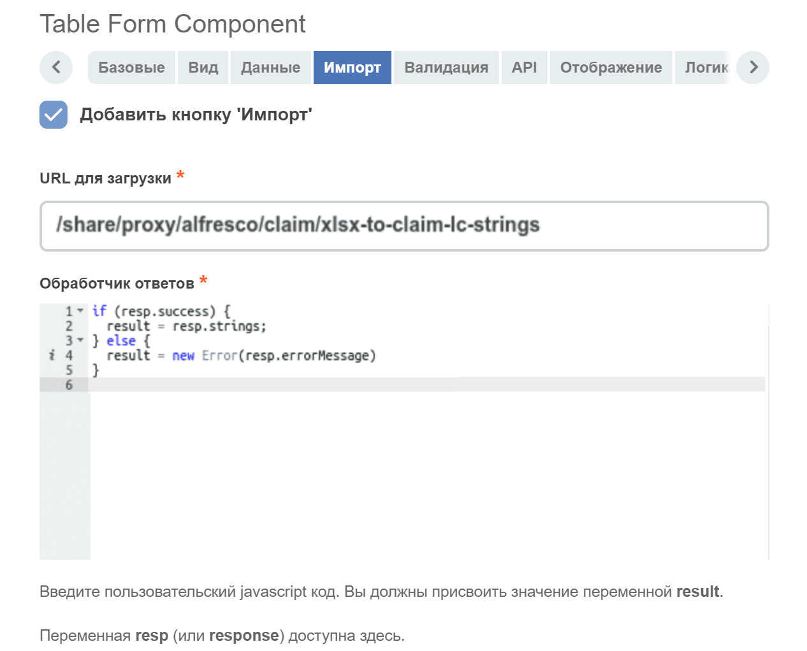

Поле **URL для загрузки** задаёт адрес обработки файлов. Каждый выбранный файл отправляется отдельным POST-запросом с одним файлом в FormData. Поле обязательно к заполнению.

Поле **Обработчик ответов** предназначено для обработки результата ответа сервера после загрузки файла. Обязательно к заполнению. 
Принимает javascript-выражение, в котором необходимо присвоить переменной **result строку (recordRef), массив строк (массив recordRef) или ошибку (result = new Error('текст ошибки'))**.

В javascript-выражении помимо стандартных объектов **formio (data, instance, _, moment, и т.д.)** доступна переменная **response** (или resp), которая содержит результат ответа сервера после загрузки файла. 

После включения импорта и заполнения настроек появляется кнопка **Импорт**, если действие ``create`` разрешено и форма не находится в режиме чтения. При ``disabled`` кнопка заблокирована. Обработанные результаты каждого ответа добавляются к текущему массиву значений таблицы.

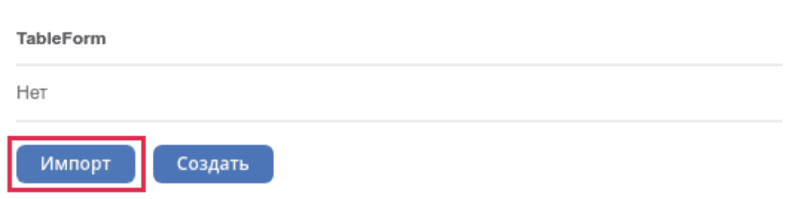

Примеры
---------

Импортирование данных
~~~~~~~~~~~~~~~~~~~~~~

Работа с файлами обычно делегируется бэкенду. 

Создадим новый тип для импортирования данных :download:`excel-files-import.yml <../files/excel-files-import.yml>` и форму :download:`excel-files-inport-form.json <../files/excel-files-inport-form.json>` 

Для отображения строк используем дочерний тип :download:`excel-files-import-line.yml <../files/excel-files-import-line.yml>`

:download:`ecos-app архив со всеми артефактами <../files/import-from-excel-example.zip>`, который можно загрузить целиком по адресу ``v2/journals?journalId=ecos-apps&viewMode=table&ws=admin$workspace``

Далее необходимо добавить основной тип в меню, открыть журнал, нажать "Создать", добавить файлы для импорта и нажать "Создать". На бэкенде ловится событие создания, обрабатываются файлы и заполняются строки.

Примерный вид, того как это будет выглядеть:

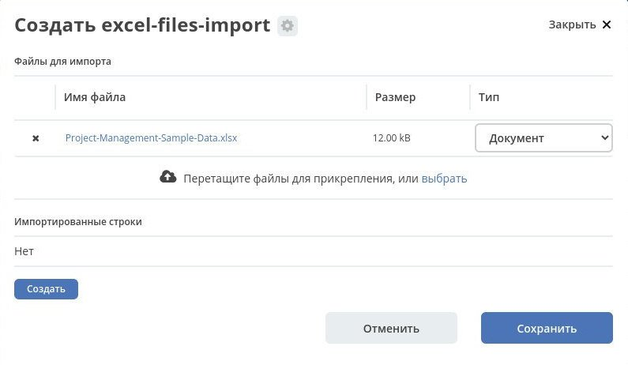

|

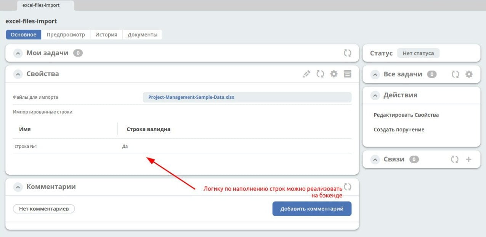

Для произвольной логики на бэкенде в Citeck есть возможность создания дополнительных микросервисов. Демо микросервис, который можно посмотреть для примера -  https://github.com/Citeck/ecos-demo-app 

Изменение стиля строки
~~~~~~~~~~~~~~~~~~~~~~~

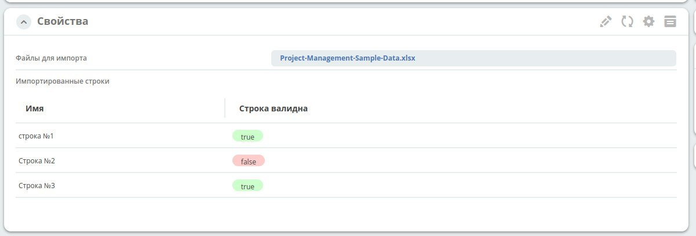

У каждой строки можно заполнять флаг "совпадения" и повесить на этот атрибут :ref:`форматтер<formatters>`

Пример формы :download:`excel-files-inport-form.json <../files/excel-files-inport-form_1.json>` 

Добавление строк
~~~~~~~~~~~~~~~~~~

Таблицы на формах - способ представления дочерних сущностей.

Добавлять новые строки на бэкенде можно, указав корректные атрибуты **_parent** (ссылка на родителя) и **_parentAtt** (ассоциация родителя для связи с дочерней сущностью).

.. code-block::

        recordsService.create("type@excel-files-import-line", ObjectData.create()
            .set("name", "custom-name")
            .set("validLine", true)
            .set(RecordConstants.ATT_PARENT, "emodel/excel-files-import@0fd3353c-8a9f-47bc-b3f9-26ec92b1245c")
            .set(RecordConstants.ATT_PARENT_ATT, "importedLines")
        );
