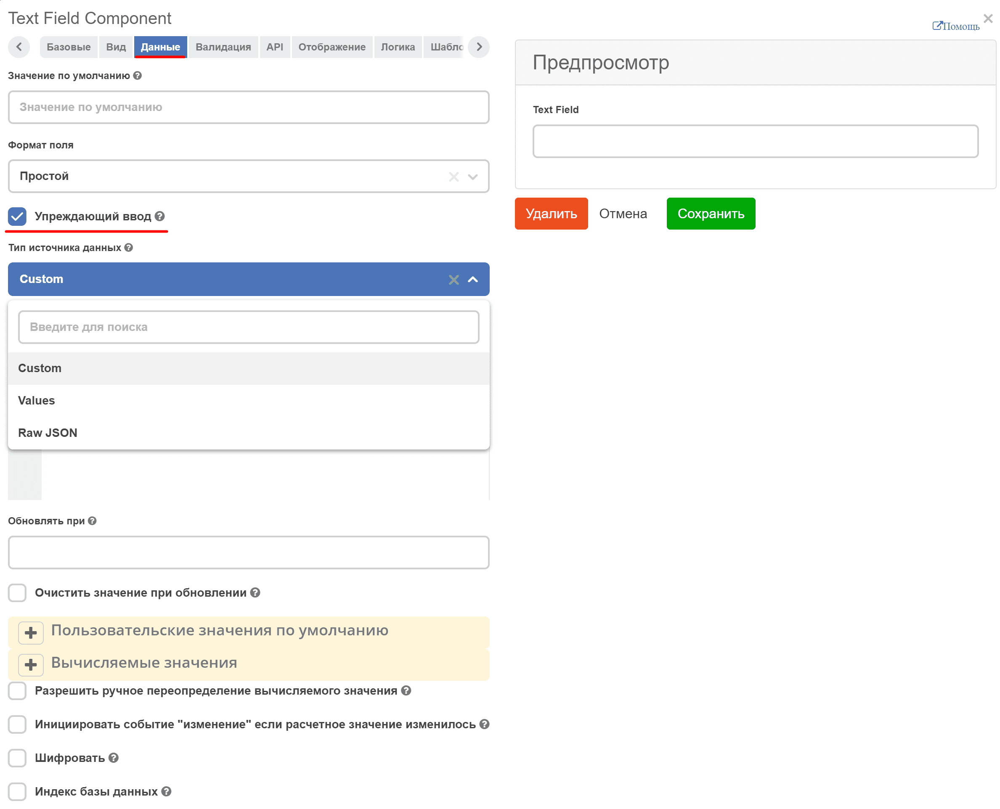
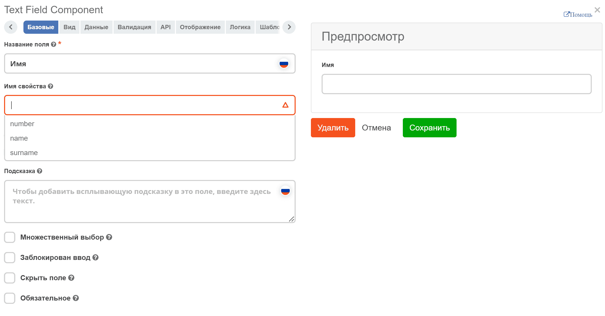
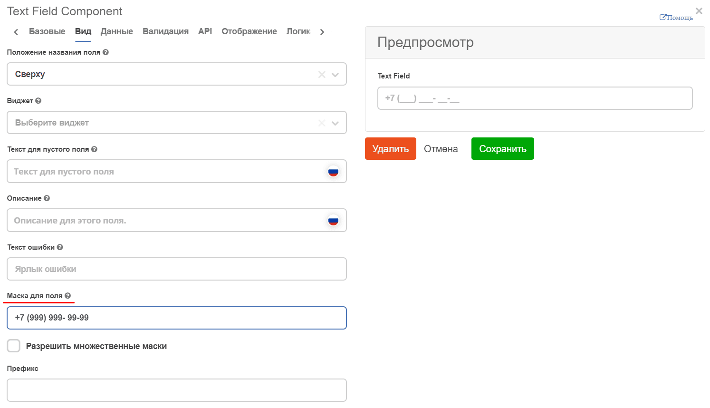

.. _text_field_component:

Text Field
===========

Компонент **Text Field** — однострочное текстовое поле для ввода произвольных данных. Поддерживает упреждающий ввод с автодополнением из статического списка или асинхронного источника, а также маски ввода для принудительного форматирования данных.

Упреждающий ввод
~~~~~~~~~~~~~~~~~~

Во вкладке **Данные (Data)** появился чекбокс **Упреждающий ввод (Typeahead)**, активировав который, появляется возможность выбора способа формирования списка и текстовое поле для ввода соответствующего списка:

.. tab-set::

   .. tab-item:: Custom

      Вводим код в формате:

      .. code-block:: javascript

         values = ['one', 'two'];

   .. tab-item:: Values

      Инпут, в котором вводятся значения и добавляются по Enter (используется компонент Tags):

      .. image:: _static/text_field/text_field_2.png
         :width: 400
         :align: center

   .. tab-item:: Raw JSON

      В текстовое поле вводим JSON-массив без дополнительного преобразования в строковый литерал:

      .. code-block:: json

         ["one", "two", "three", 4, 5, "six"]

Для асинхронного источника **Custom** переменной ``values`` нужно присвоить Promise, возвращающий массив строк. Если запрос возвращает объекты, извлеките из них текстовые значения:

.. code-block:: javascript

    values = window.Records.get('emodel/type@type')
      .load('model.attributes[]{id}')
      .then(attributes => attributes.map(attribute => attribute.id));

В редакторе форм у поля **Имя свойства (Property Name)** также есть автодополнение. Подсказки берутся из атрибутов модели родительской формы, а при их отсутствии — из типа редактируемой формы, если он определён. Этот список помогает выбрать атрибут модели; он не является списком уже занятых ключей компонентов.

Ввод маски
~~~~~~~~~~~~

На вкладке **Вид (View)** можно предопределить формат ввода. Маска полезна для принудительного использования форматов ввода, таких как номера телефонов, почтовые индексы и т. д.

В поле **Маска для поля (Input Mask)** введите маску с использованием:

  - ``9`` — цифра;
  - ``a`` — буква;
  - ``*`` — буква или цифра.

Например:

