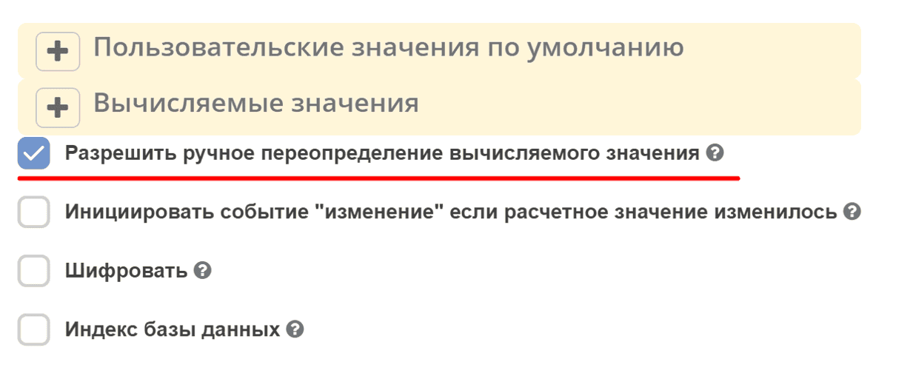
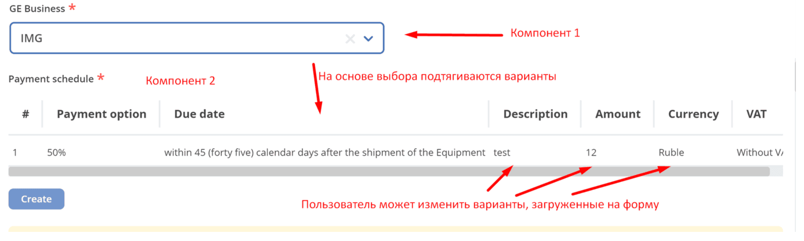

.. _form_component_settings:

Настройка компонента
======================

.. contents::
   :depth: 3

.. _manual_override:

Allow Manual Override of Calculated Value / Разрешить ручное переопределение вычисляемого значения
---------------------------------------------------------------------------------------------------

Настройка расположена на вкладке **"Данные"**.

Настройка **Allow Manual Override of Calculated Value** (``allowCalculateOverride``) позволяет сохранить вручную заданное значение поля, для которого настроено **Вычисляемое значение** (``calculateValue``). Пока текущее значение совпадает с последним вычисленным, автоматическое обновление продолжается. Если значения различаются, новый результат автоматически не записывается в поле.

Описание работы
~~~~~~~~~~~~~~~~~~

.. tab-set::

   .. tab-item:: Режим создания

      При первом расчёте пустое поле может получить вычисленное значение. Если поле уже заполнено и его значение отличается от результата расчёта, оно сохраняется.

      После ручного переопределения очистка поля не гарантирует возврата к автоматическому расчёту: пустое значение также может отличаться от последнего вычисленного. Для явного обновления предусмотрите отдельное действие пользователя, например кнопку из примера ниже.

   .. tab-item:: Режим редактирования

      Загруженное значение, отличающееся от результата расчёта, сохраняется и без нового пользовательского ввода. Если оно совпадает с вычисленным, автоматическое обновление может продолжаться.

      Очистка поля сама по себе не сбрасывает состояние расчёта. При первом проходе есть дополнительное правило: если поле непустое, а вычисленный результат пуст, исходное значение сохраняется и первый расчёт откладывается. В этом режиме логические значения не считаются пустыми.

Описание полей и логики
~~~~~~~~~~~~~~~~~~~~~~~~~

.. list-table::
      :widths: 10 30
      :header-rows: 1
      :class: tight-table 

      * - Имя
        - Описание
      * - ``component.calculateValue``
        - Выражение расчёта. Результат присваивается переменной ``value``.
      * - ``component.allowCalculateOverride``
        - Разрешает сохранение значения, отличающегося от последнего вычисленного.
      * - **calculatedValue**
        - Внутреннее поле экземпляра компонента, хранящее последнее вычисленное значение. Первый проход определяется по ``undefined``, затем временно используется внутренний символ-маркер.
      * - **dataValue**
        - Текущее значение поля: из загруженной записи, значения по умолчанию, расчёта или пользовательского ввода.
      * - ``options.formMode``
        - Режим формы, передаваемый в её options. Поддерживаются ``CREATE``, ``EDIT``, ``CLONE`` и ``VIEW``. В описанном алгоритме режим создания проверяется строгим сравнением с ``CREATE``; общего значения по умолчанию ``CREATE`` нет.
      * - **valueChangedByUser**
        - Служебный флаг изменения пользователем, изначально ``false``. Обновляется по флагам событий; сам по себе не управляет базовым алгоритмом ручного переопределения.

Базовый алгоритм применения вычисленного значения:

1. Если выражение ``calculateValue`` отсутствует либо поле скрыто и настроено на очистку при скрытии (``clearOnHide``), автоматическая запись значения пропускается. Для компонента Hidden предусмотрено исключение из проверки скрытия.
2. При включённом ``allowCalculateOverride`` после первого прохода сравниваются ``dataValue`` и последнее ``calculatedValue``. Если они различаются, запись нового результата пропускается.
3. Вычисляется выражение ``calculateValue``. На первом проходе при включённом ручном переопределении сохраняется уже заполненное значение, отличающееся от результата.
4. Если запись разрешена, результат передаётся в ``setValue()``, а полученное значение поля сохраняется в ``calculatedValue``.

Сравнение выполняется через ``customIsEqual``: если хотя бы один аргумент — число, сравниваются значения после ``parseFloat``; иначе используется ``lodash.isEqual``.

Само выражение может выполняться и при пропуске записи: базовый метод ``calculateValue`` предварительно вычисляет его для проверки изменения. Поэтому выражение расчёта должно возвращать значение без побочных действий, рассчитанных на однократный запуск.

Флаг ``calculatedValueWasCalculated`` не определяет первый проход в этом алгоритме и не устанавливается им в ``true``. Отдельные компоненты могут иметь дополнительные правила: например, Data Map прекращает расчёт при ``valueChangedByUser === true``.

При подготовке вычислений учитывайте, что исходные данные формы могут быть ещё не заполнены. Формирование компонентов и последующая установка загруженных данных не дают общего запрета на выполнение любой логики до заполнения всех полей.

Пример работы с компонентом TableForm
~~~~~~~~~~~~~~~~~~~~~~~~~~~~~~~~~~~~~~

Задача
"""""""

Выбранные записи нужно загрузить в Table Form, после чего пользователь должен иметь возможность изменять таблицу. Повторная загрузка должна выполняться только по его запросу.

Для этого добавьте кнопку, которая явно записывает в Table Form массив recordRef. Изменение исходного выбора само по себе не перезаписывает таблицу.

.. dropdown:: Реализация
   :color: secondary

   1. Добавьте Select Journal с ключом ``sourceRecords`` и включённым множественным выбором. Его значение должно быть массивом ссылок на записи.
   2. Добавьте Table Form с ключом ``targetRows``. Настройте источник и колонки для выбранных записей. Поле **Вычисляемое значение** оставьте пустым: загрузка будет запускаться кнопкой.
   3. Добавьте Button, выберите **Действия: Custom** и в поле **Button Custom Logic** укажите:

   .. code-block:: javascript

      const table = instance.root.getComponent('targetRows');
      if (table) {
        const selected = instance.root.getValue().data.sourceRecords;
        const recordRefs = Array.isArray(selected)
          ? selected
          : selected ? [selected] : [];

        table.setValue(recordRefs);
      }

   В таблицу передаются ссылки на выбранные записи. Повторное нажатие заменяет её значение текущим выбором; при пустом выборе передаётся пустой массив. Пользовательские изменения таблицы сохраняются до следующего нажатия кнопки.

Для прямого вызова ``setValue()`` флаг ``allowCalculateOverride`` не требуется. Этот вызов не сбрасывает автоматически состояние других настроенных вычислений; в данном примере автоматическое ``calculateValue`` у таблицы отсутствует.

.. _custom_default_value:

Custom Default Value / Пользовательское значение по умолчанию
--------------------------------------------------------------

Настройка расположена на вкладке **"Данные"**.

Свойство **customDefaultValue** позволяет задать динамическое значение по умолчанию при помощи JavaScript-выражения. Результат присваивается переменной ``value``. Условия применения результата зависят от компонента, заполненности поля и режима формы.

Вычисление значения по умолчанию не ограничено универсальным правилом «один раз при создании»: компонент может обращаться к нему повторно, в том числе при подготовке вычисляемого значения. Поэтому выражение должно возвращать значение без побочных действий, рассчитанных на однократный запуск.

.. note::

   Статическое свойство ``defaultValue`` предназначено только для фиксированных значений. Для динамических (текущая дата, текущий пользователь и т.д.) используйте ``customDefaultValue``.

Примеры
~~~~~~~~

Текущая дата для компонента Date/Time:

.. code-block:: javascript

   value = new Date();

Фиксированная строка для текстового поля:

.. code-block:: javascript

   value = "значение по умолчанию";

Пример JSON-конфигурации компонента Date/Time с текущей датой:

.. code-block:: json

   {
     "key": "startDate",
     "type": "datetime",
     "input": true,
     "format": "yyyy-MM-dd",
     "enableTime": false,
     "customDefaultValue": "value = new Date();",
     "defaultValue": ""
   }

.. _current_user_by_default:

Current User by Default / Текущий пользователь по умолчанию (selectOrgstruct)
-------------------------------------------------------------------------------

Настройка расположена на вкладке **"Кастомные"** компонента **selectOrgstruct**.

Свойство **currentUserByDefault** автоматически подставляет текущего пользователя в компонент ``selectOrgstruct``, если одновременно выполнены условия:

* включена настройка ``currentUserByDefault``;
* передан режим формы ``options.formMode = 'CREATE'``;
* поле ещё не изменено пользователем (``pristine``);
* входное значение равно пустому значению компонента: ``''`` для одиночного поля или ``[]`` для множественного;
* компонент не находится в режиме чтения (``viewOnly``).

Непустое значение не перезаписывается. Логин текущего пользователя приводится к нижнему регистру и нормализуется в ссылку на запись; для множественного поля используется массив. По умолчанию настройка выключена.

Пример JSON-конфигурации компонента:

.. code-block:: json

   {
     "key": "responsible",
     "type": "selectOrgstruct",
     "input": true,
     "allowedAuthorityType": "USER",
     "currentUserByDefault": true,
     "defaultValue": ""
   }

Режим ``formMode`` задаётся в options самой формы. Приведённая конфигурация компонента не устанавливает режим ``CREATE``.

.. note::

   Для динамических значений по умолчанию в других типах компонентов используйте ``customDefaultValue`` (см. :ref:`Custom Default Value <custom_default_value>`).

