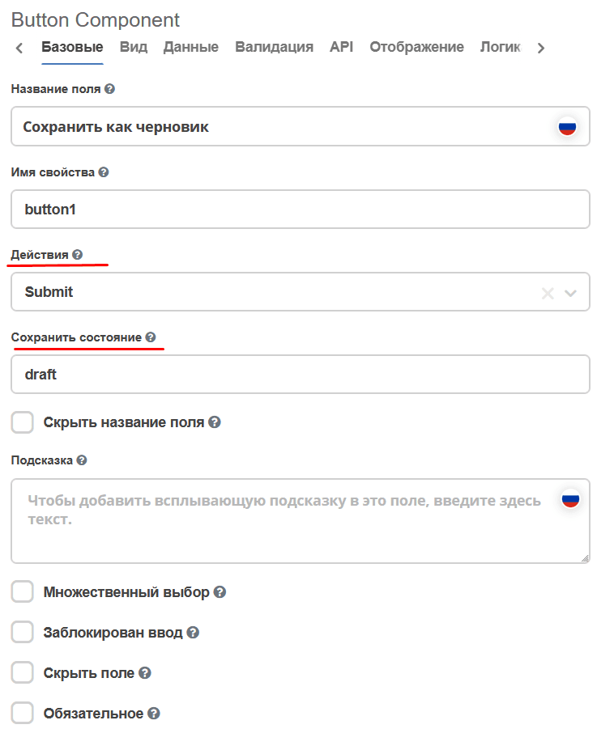

.. _form_draft:

Сохранение документа в качестве черновика
===========================================

.. contents::
   :depth: 2
   :local:

Для промежуточного сохранения записи в Citeck используется состояние **«Черновик»**. Оно позволяет отделить сохранение незавершённых данных от обычной отправки формы.

.. note::

    Состояние черновика и статус типа данных — разные настройки. Условия запуска бизнес-процесса задаются серверной моделью и процессом; передача состояния формы сама по себе не гарантирует запуск или отсутствие запуска процесса.

Настройка через интерфейс
---------------------------

Для того чтобы создать запись в состоянии **"Черновик"** на форме нужно добавить кнопку с действием **Submit** и в поле **"Сохранить состояние"** написать **draft** (без кавычек).

При отправке передаётся состояние ``draft``. Режим черновика предназначен для промежуточного сохранения, в том числе без полного заполнения формы. Возможность сохранить конкретные данные зависит также от компонента, источника записи и серверной валидации.

Для обычной отправки используйте кнопку с действием **Submit** без заполненной настройки **«Сохранить состояние»**. Такая кнопка передаёт состояние ``submitted``. Запуск процесса при этом определяется его серверными условиями.

Работа с флагом программно
-----------------------------

Клиент записывает непустое состояние отправки формы в атрибут ``_state``. Для описанных кнопок используются следующие значения:

.. list-table::
   :header-rows: 1
   :class: tight-table

   * - Действие
     - Значение ``_state``
   * - Перевести в черновик
     - ``draft``
   * - Обычная отправка формы
     - ``submitted``

Пустая настройка состояния кнопки не означает мутацию ``_state: ''``: кнопка подставляет ``submitted``. При прямой мутации записи используйте значения, поддерживаемые её серверным источником.

Для чтения флага черновика у записей нового источника используется ``_isDraft?bool``. Для legacy-записей Alfresco клиент читает ``invariants:isDraft?bool``.
