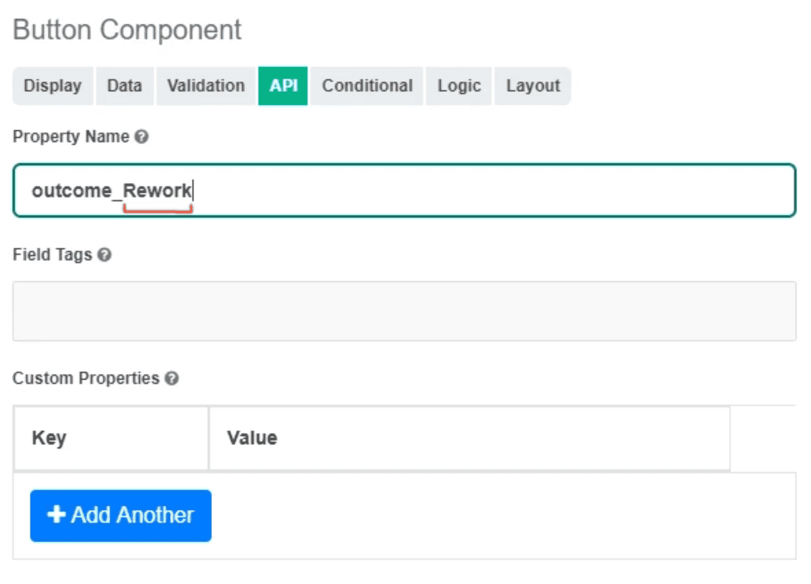

.. _form_to_task:

Связь формы с задачей
=====================

.. contents::
   :depth: 3

Завершение задачи (outcome)
---------------------------

Для ручной кнопки завершения задачи используйте компонент **Button**, действие **Submit** и **Имя свойства/Property Name** по следующему формату:

``outcome_******``

где ``******`` — идентификатор результата задачи. Префикс ``outcome_`` помечает кнопку результата; для завершения задачи также нужны отправка формы и серверная обработка этого результата.

В процессе можно добавлять **exclusive gateway** с несколькими выходами по условию нажатой кнопки.

В legacy-процессах могут использоваться переменные ``form_{{FORM_KEY}}_outcome`` или ``outcome``. Например:

.. code-block::

    form_testkey_outcome == 'Rework'

Имя переменной и способ передачи результата зависят от движка и серверной конфигурации процесса. Этот пример нельзя переносить на другие виды задач без проверки их контракта.

Автоматическое создание кнопок
~~~~~~~~~~~~~~~~~~~~~~~~~~~~~~~~

Для автоматической генерации кнопок добавьте компонент **Task Outcome**. Для современных задач он загружает ``possibleOutcomes[]?json``, создаёт кнопки ``outcome_<id>`` и применяет названия, темы и настройку обязательного комментария ``config.commentRequired``. Порядок кнопок берётся из списка результатов.

Legacy-ветка поддерживает строковый шаблон с разделителем ``#alf#`` и сортирует кнопки по теме. Пример использования см. в :ref:`форме согласования<approve_form_bpmn>`.

Атрибуты задачи
------------------

Комментарий
~~~~~~~~~~~

У поля комментария ключ **Имя свойства/Property Name** должен быть ``comment``. Task Outcome ищет компонент через ``root.getComponent('comment')``, в том числе для проверки обязательности комментария при выборе результата.

.. note::

   При миграции формы измените ключ поля комментария на ``comment`` либо предусмотрите синхронизацию существующего поля с компонентом с этим ключом. Одного ``properties.attribute: comment`` у компонента с другим ключом недостаточно для поиска поля в Task Outcome.

Атрибуты из привязанного документа
~~~~~~~~~~~~~~~~~~~~~~~~~~~~~~~~~~

Для источников задач, которые зеркалируют атрибуты связанного документа с префиксом ``_ECM_``, используйте это имя атрибута на форме. Совместимость с таким префиксом поддерживается Records API.

Пример:

.. code-block::

    _ECM_title

Атрибуты, хранящиеся в задаче
~~~~~~~~~~~~~~~~~~~~~~~~~~~~~

Атрибуты задачи можно привязать по их точному имени через ключ компонента или ``properties.attribute``. Набор доступных атрибутов, включая атрибуты связанного документа, зависит от источника записи задачи и серверных прав.

Вид формы задачи
------------------

Рекомендации для ручной компоновки кнопок:

1. Располагайте кнопки с левого края под полем комментария.
2. Отрицательные решения размещайте слева от положительных.
3. Если кнопок 3, то располагать в соответствии со смыслом: от отрицательного к положительному решению.
4. По ширине кнопки и отступы между кнопками не должны быть слишком большими.

Примеры:

.. grid:: 2
   :gutter: 2

   .. grid-item::

      .. image:: _static/for_task/for_task_4.png
         :width: 500
         :align: left

   .. grid-item::

      .. image:: _static/for_task/for_task_5.png
         :width: 500
         :align: left

