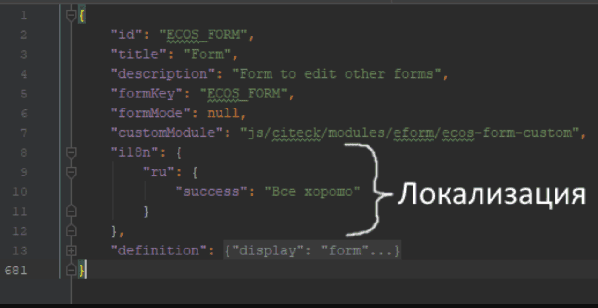

.. _form_localisation:

Локализация
============

.. contents::
   :depth: 3

Все **Label** у полей на форме перед рендером проходят через этап локализации. Если ключа локализации не найдено, то рендерится строка, которая записана в поле **Label**.

Глобальная локализация
------------------------

Вся локализация, которая имеет префикс **ecos.forms**, попадает в формы. Например: ``ecos.forms.someTitle="123"`` попадёт в формы в виде ``{"someTitle":"123"}``.

Глобальный словарь объединяет локальные переводы интерфейса (``src/i18n/<lang>.json``) и серверные переводы, получаемые через ``messages/locale``. При совпадении ключей серверные значения перекрывают локальные. Из объединённого словаря выбираются ключи ``ecos.forms.*``; при передаче в форму префикс ``ecos.forms.`` снимается.

Заголовки атрибутов и локализация конкретной формы дополняют этот словарь. При совпадении ключей локализация формы имеет приоритет над глобальными переводами и заголовками атрибутов.

Локализация атрибутов
-----------------------

Если **Название поля** совпадает с редактируемым атрибутом, то происходит запрос на сервер за заголовком для такого поля. Если заголовок найден, то поле будет локализовано.

.. grid:: 2
   :gutter: 2

   .. grid-item::

      .. image:: _static/form_localisation/Forms_local_1.png
         :width: 400
         :align: left

   .. grid-item::

      .. image:: _static/form_localisation/Forms_local_2.png
         :width: 400
         :align: left

Локализация формы
--------------------

В ``json`` конфигурации формы можно задать локализацию, которая будет действовать только в пределах данной формы. Пример:

Такой вариант подходит, если требуется добавить пользовательскую локализацию для сообщений об ошибке, подсказок и т. д. Чтобы установить локализацию, необходимо перейти на форму :guilabel:`Локализация` и поместить свою локализацию туда. После чего её можно будет использовать на самой форме по ключу. Для именования ключей лучше всего использовать символы латиницы.

.. grid:: 2
   :gutter: 2

   .. grid-item::

      .. image:: _static/form_localisation/Forms_local_4.png
         :width: 500
         :align: left

   .. grid-item::

      .. image:: _static/form_localisation/Forms_local_5.png
         :width: 500
         :align: left

Локализация текста полей компонента формы
--------------------------------------------

В базовых настройках названия поля (``label``), текста пустого поля (``placeholder``) и описания (``description``) используется :ref:`ML Text<ML_Text>`. Для подсказки (``tooltip``) применяется многострочный ML Textarea. Переключатель языка позволяет заполнить текст на русском и английском.

.. grid:: 2
   :gutter: 2

   .. grid-item::

      .. image:: _static/form_localisation/Forms_local_11.png
         :width: 500
         :align: left

   .. grid-item::

      .. image:: _static/form_localisation/Forms_local_12.png
         :width: 500
         :align: left

Переводы сохраняются в объекте со строчными ключами языков, например ``{"ru": "Название", "en": "Title"}``. Можно заполнить один или оба перевода.
