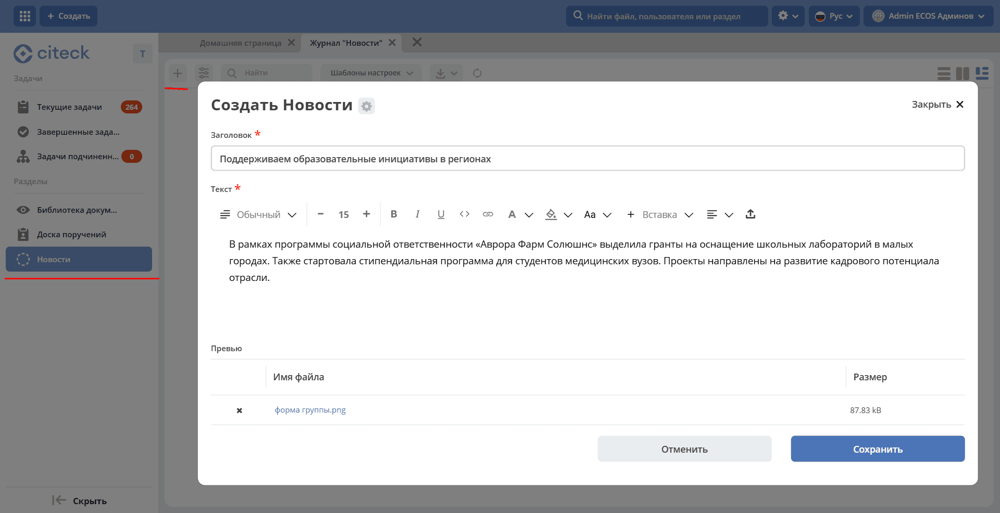

.. _news:

Новости
==============

.. contents::
   :depth: 3

**Журнал «Новости»** предназначен для публикации анонсов и новостей компании. Они отображаются сотрудникам непосредственно в рабочих пространствах через виджет :ref:`Новости <widget_news>`.

Стандартный журнал **Новости** (``news-journal``) использует тип данных **Новости** (``news``), наследующий :ref:`Публикацию <publication>`. Добавьте журнал в меню для перехода к списку записей.

Для отображения новостей на дашборде добавьте виджет **Новости**. В его настройках можно выбрать тип ``news`` или один из его дочерних типов. По умолчанию используется ``news``. Виджет запрашивает записи текущего рабочего пространства и показывает до трёх последних по времени создания. Пункт меню не является условием этого запроса; записи должны быть доступны пользователю.

Заголовок новости в виджете ведёт к её карточке, а кнопка перехода виджета — к журналу выбранного типа в представлении списка. Изображение-превью необязательно: при его отсутствии используется доступное превью записи либо стандартная картинка.

Добавление в меню рабочего пространства
------------------------------------------

1. Выберите специальный элемент **Список**:

   .. image:: _static/news/news_01.png
      :width: 500
      :align: center

2. Выберите журнал **Новости**:

   .. image:: _static/news/news_02.png
      :width: 500
      :align: center

3. Примените изменения:

   .. image:: _static/news/news_03.png
      :width: 500
      :align: center

Добавление публикаций
-----------------------

Откройте журнал и воспользуйтесь доступным действием создания записи. Создание и редактирование новостей зависят от прав пользователя и настроек действий типа.

В стандартной форме заполните:

- **Заголовок** — обязательное поле.
- **Текст** — обязательное поле с визуальным :ref:`редактором Lexical <wysiwyg_editor>`.
- **Превью** — необязательное изображение. В поле формы установлен максимальный размер 10 МБ; также действуют ограничения загрузки на стенде.

Сохраните новость. Она появится в списке доступных записей журнала, а в виджете — если соответствует выбранному типу, текущему рабочему пространству и входит в три последние записи по времени создания.

