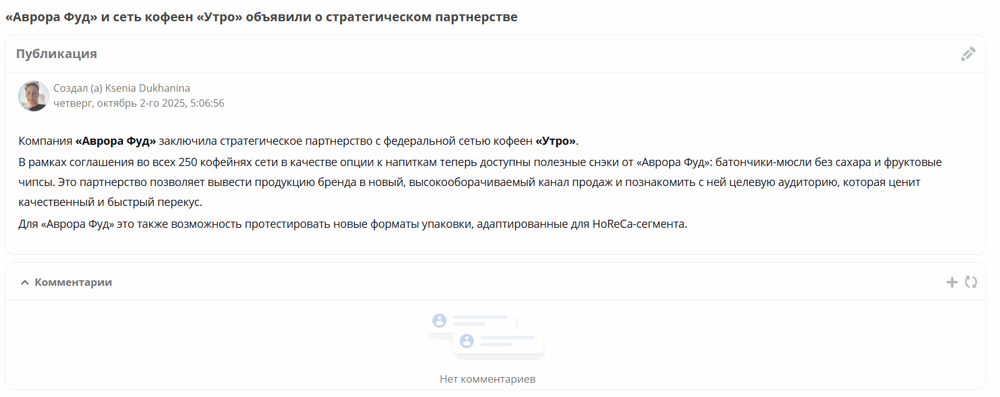
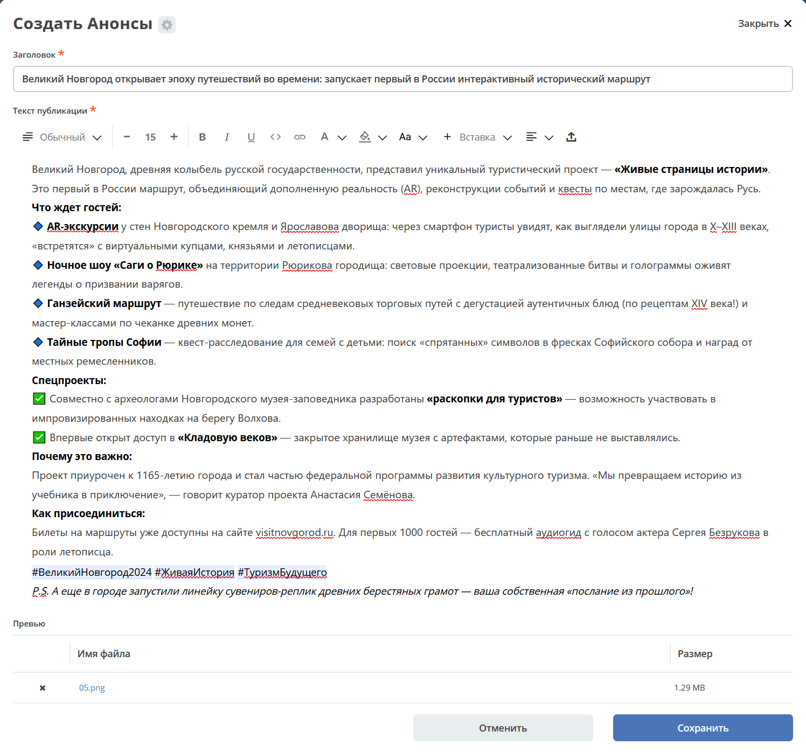
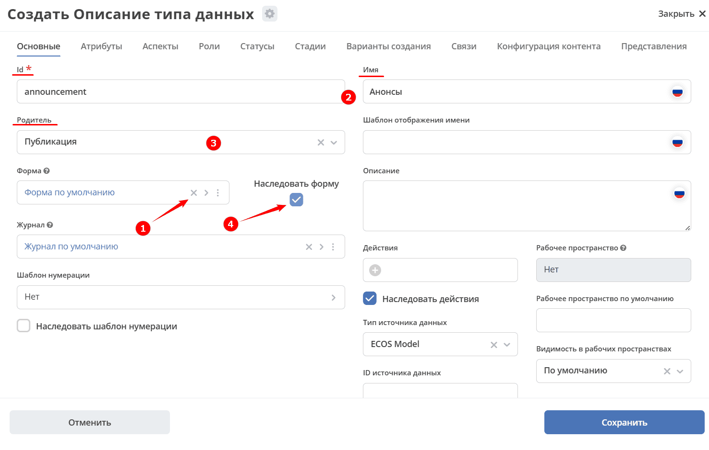

.. _publication:

Публикация
===========

.. contents::
   :depth: 3

**Публикация** (``publication``) — встроенный тип данных для создания новостей, анонсов и редакционных материалов в рабочих пространствах. Его стандартный журнал — **Публикации** (``publications``).

Тип **Новости** (``news``) наследует публикацию и использует собственные форму и журнал :ref:`Новости <news>`. В настройках виджета :ref:`Новости <widget_news>` можно выбрать ``news`` или его дочерний тип; записи запрашиваются в текущем рабочем пространстве. Создание произвольной публикации не гарантирует её отображение в этом виджете.

Тип предоставляет готовую форму с полями заголовка, текста и изображения-превью, а также аспект ``listview``. Список и плитки — варианты одного представления журнала ``preview-list``. Плиточная раскладка включается в настройках представлений типа данных. Подробнее см. :ref:`Список и плитки <tiles>`.

Примеры отображения записей:

.. grid:: 2
   :gutter: 2

   .. grid-item::

      Список:

      .. image:: _static/publication/publication_03.png
         :width: 500
         :align: left

   .. grid-item::

      Плитка:

      .. image:: _static/publication/publication_03_1.png
         :width: 500
         :align: left

При включённой панели предпросмотра клик на тело элемента выбирает запись и показывает её предпросмотр. По заголовку открывается карточка записи.

Стандартная карточка для компьютера содержит виджеты :ref:`Публикация <widget_publication>` и :ref:`Комментарии <widget_comments>`. В стандартной мобильной раскладке включён только виджет публикации. Состав дашборда может быть переопределён для типа или рабочего пространства:

Виджет публикации требует подключённого плагина и включённых рабочих пространств. Он показывает текст, сведения об авторе и последнем изменении. Кнопка редактирования доступна при наличии права изменения записи и открывает её форму.

При создании публикации заполните стандартную форму ``publication``:

- **Заголовок** (``title``) — обязательное поле;
- **Текст публикации** (``text``) — обязательное поле с визуальным :ref:`редактором Lexical <wysiwyg_editor>`;
- **Превью** (``image``) — необязательное изображение. В поле формы установлен максимальный размер 10 МБ; также действуют ограничения загрузки на стенде.

Если изображение отсутствует, в списке используется стандартная иконка. Создание и изменение записей зависят от прав пользователя и настроек действий.

.. _publication_creation:

Создание типа «Публикация»
----------------------------

Создайте новый :ref:`тип данных <data_types_main>`:

1. Удалите **Форму по умолчанию** **(1)**.
2. На вкладке **«Основное»** укажите **id** и **Имя** **(2)**.
3. В качестве родителя выберите **Публикация** **(3)**.
4. Установите флажок **Наследовать форму** **(4)**.

При включённом наследовании формы созданный тип сможет использовать форму родителя. Действия и конфигурацию журнала проверьте отдельно: в стандартном журнале **Публикации** просмотр, редактирование и удаление заданы явно, а не получены из списка действий типа.

5. Чтобы добавить журнал созданного типа в меню, выберите специальный элемент **Список** и укажите нужный журнал:

   .. image:: _static/publication/publication_02.png
      :width: 600
      :align: center
