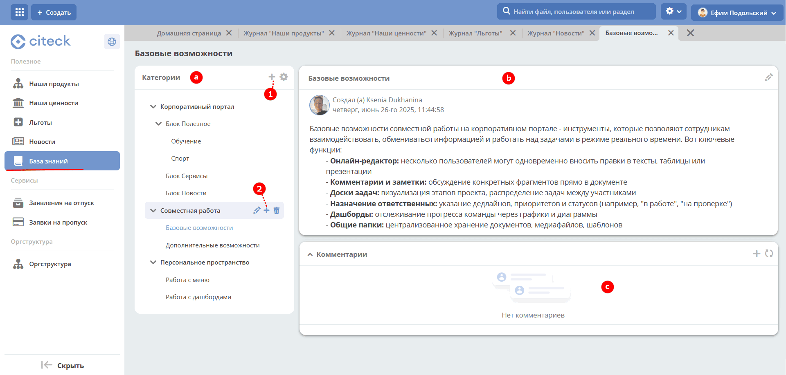
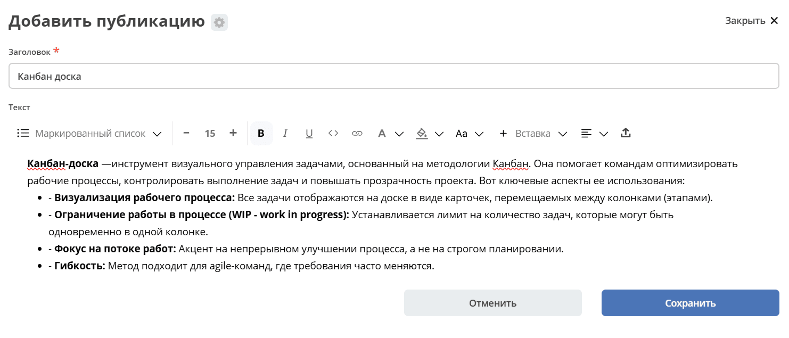
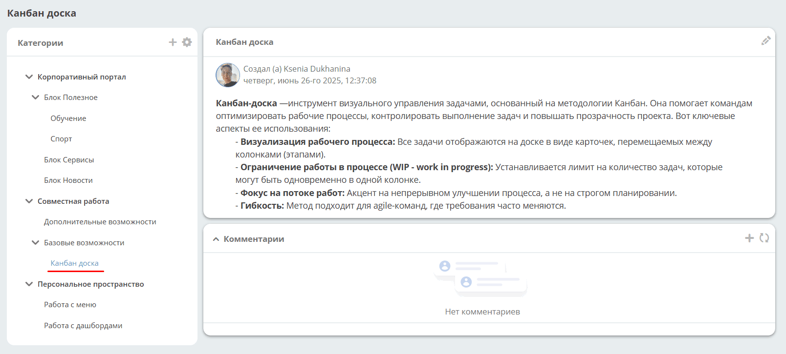
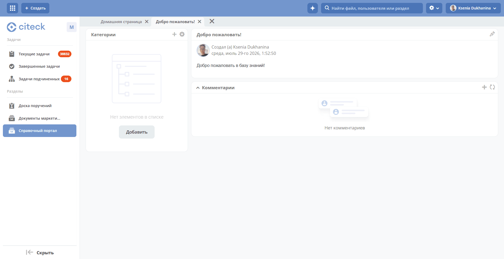

.. _wiki_base:

База знаний
========================

.. contents::
   :depth: 3

**База знаний** рабочего пространства предназначена для создания и структурирования внутренней документации: регламентов, инструкций, статей и других материалов. Контент организован в иерархическое дерево записей типа **Статья базы знаний** (``wiki``), наследующего :ref:`Публикацию <publication>`. Для просмотра используется дашборд базы знаний.

.. note::

   В меню персонального рабочего пространства нельзя добавить базу знаний.

   Доступность операций зависит от прав на записи. Виджет публикации проверяет право изменения публикации; управление деревом — право изменения корневой записи, с отдельным разрешением для администратора. Менеджер рабочего пространства может получать необходимые права согласно серверным правилам, но перечень пользователей не ограничивается этой ролью. Удаление требует соответствующих прав и подтверждения в дереве. Видимость кнопок управления не заменяет серверную проверку прав на выбранную запись.

Откройте раздел **«База знаний»** рабочего пространства:

Стандартное представление на компьютере базы знаний состоит из трёх виджетов:

- **a:** :ref:`Меню <widget_knowledge_base>`,
- **b:** :ref:`Публикация <widget_publication>`,
- **c:** :ref:`Комментарии <widget_comments>`.

Виджеты дерева и публикации требуют подключённых плагинов и включённых рабочих пространств. Состав дашборда может быть переопределён. В стандартной мобильной раскладке v2 виджеты не заданы; для мобильной работы настройте её отдельно.

Добавление статьи или раздела
--------------------------------------------

Чтобы добавить статью или раздел, нажмите:

1. большой **+** **(1)** — для статьи или раздела 1-го уровня;
2. маленький **+** **(2)** — для публикации или подраздела.

В стандартной форме укажите обязательный **Заголовок**. **Текст** оформляется с помощью визуального :ref:`редактора Lexical <wysiwyg_editor>` и может быть пустым — например, для раздела, объединяющего дочерние статьи. Отдельного переключателя «Раздел / Статья» в форме нет. Сохраните запись.

Созданная публикация становится активной и сразу отображается в правой части страницы.

Добавленная статья в структуре:

Перемещение статей и разделов
--------------------------------------------

При наличии прав управления деревом перетащите статью или раздел на другой узел, чтобы сделать его дочерним. Для возврата на первый уровень используйте корень дерева как цель переноса.

Перемещение меняет родительский раздел. Перенос в сам узел или его потомка недопустим. Сохранение изменения зависит от серверных прав на запись.

.. _wiki_adding:

Добавление базы знаний
--------------------------------------------

1. В меню выберите специальный элемент **База знаний**:

   .. image:: _static/wiki/wiki_new.png
      :width: 600
      :align: center

2. Укажите название и выберите иконку:

   .. image:: _static/wiki/wiki_new_1.png
      :width: 400
      :align: center

Пункт меню добавляет переход к базе знаний текущего рабочего пространства. Он не создаёт отдельную независимую базу, поэтому в ней уже могут находиться статьи:

При создании рабочего пространства платформа создаёт корневую страницу базы знаний. Стандартный заголовок — **«Добро пожаловать!»**, текст — **«Добро пожаловать в базу знаний!»**. Начальное содержимое задаётся конфигурацией ``wiki-initial-page-content`` и может быть изменено на стенде.
