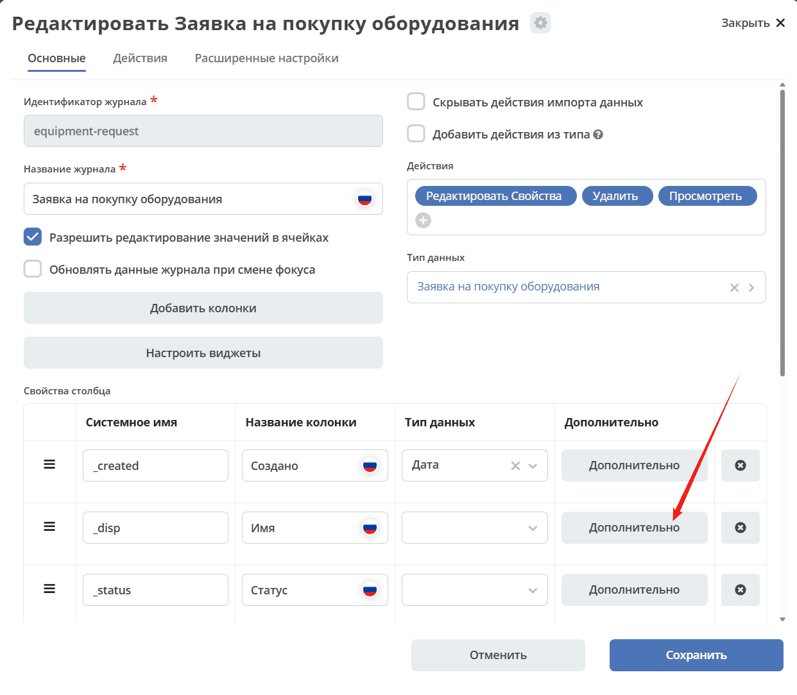
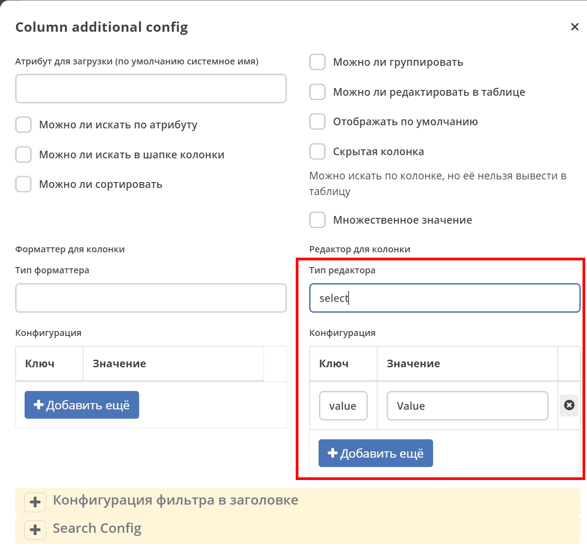

.. _editors:

Редакторы
==========

.. contents:: Содержание
   :depth: 3

Редакторы (editors) определяют внешний вид и поведение поля при инлайн-редактировании записи в журнале и при фильтрации. Каждому типу атрибута соответствует свой редактор, который задаётся в конфигурации колонки журнала в поле ``editor``.

.. important::

   ``formatter`` и ``editor`` в конфигурации колонки — независимые поля:

   - ``formatter`` управляет **отрисовкой ячейки** в таблице;
   - ``editor`` управляет **инлайн-редактором** и используется для фильтра, если не задан отдельный ``headerFilterEditor``.

   Для фильтра в заголовке можно независимо задать ``headerFilterEditor`` с полями ``type`` и ``config``. Если его тип не задан, UI использует ``editor`` из итоговой конфигурации, полученной от сервера. Настройка одного ``formatter`` не определяет контрол фильтра. Если ни один редактор не определён в итоговой конфигурации, контрол ввода может отсутствовать.

   Рекомендуемые редакторы для типов колонок текущей схемы:

   .. list-table::
      :widths: 30 20
      :header-rows: 1

      * - Тип колонки (``type``)
        - Редактор (``editor.type``)
      * - ``ASSOC``
        - ``journal``
      * - ``PERSON`` / ``AUTHORITY_GROUP`` / ``AUTHORITY``
        - ``orgstruct``
      * - ``TEXT`` / ``MLTEXT``
        - ``text``
      * - ``NUMBER``
        - ``number``
      * - ``DATE``
        - ``date``
      * - ``DATETIME``
        - ``datetime``
      * - ``BOOLEAN``
        - ``boolean``

.. note::

   В редакторах могут использоваться :ref:`вычисляемые атрибуты <computed_attributes>`.

Настройки
---------

Перейти в раздел администрирования > :guilabel:`Журналы` > найти необходимый журнал > действие :guilabel:`Редактировать`. Перейти в :guilabel:`Дополнительно`.

Типы
---------

BooleanEditor
~~~~~~~~~~~~~~~~~~

Тип: ``boolean``

.. list-table::
   :widths: 5 40 40
   :header-rows: 1

   * - Ключ
     - Значение
     - По умолчанию
   * - **mode**
     - Режим редактора ``select``:

       .. image:: _static/editor/editor_3.png
          :width: 200

       ``checkbox``:

       .. image:: _static/editor/editor_4.png
          :width: 200

     - ``select``

DateEditor
~~~~~~~~~~~~~~~~~~

Тип: ``date``

DateTimeEditor
~~~~~~~~~~~~~~~~~~

Тип: ``datetime``

JournalEditor
~~~~~~~~~~~~~~~~~~

Тип: ``journal``

Используется для выбора записей через журнал, в том числе в колонках типа ``ASSOC``. Его можно задать в ``editor`` для редактирования и фильтрации либо в ``headerFilterEditor`` только для фильтра. Редактора с типом ``assoc`` в реестре нет; выбор редактора зависит от требуемого способа ввода, например ``journal``, ``orgstruct`` или ``select``.

.. list-table::
   :widths: 5 40 40
   :header-rows: 1

   * - Ключ
     - Значение
     - По умолчанию
   * - **journalId**
     - Идентификатор журнала, из которого будет выбираться значение. Обычно — журнал, связанный с целевым типом ассоциации.
     -

Пример полной конфигурации ASSOC-колонки с ``formatter`` и ``editor``:

.. code-block:: yaml

  - id: urgencyClass
    name:
      ru: Класс срочности
    type: ASSOC
    multiple: true
    searchable: true
    formatter:
      type: assoc
      config:
        sourceId: emodel/ecos-urgency-class
    editor:
      type: journal
      config:
        journalId: ecos-urgency-class

Здесь ``formatter`` определяет отображение ячейки, а ``editor`` — инлайн-редактор и фильтр в заголовке. Для отдельной настройки фильтра задайте ``headerFilterEditor``; итоговая конфигурация также может содержать редактор, определённый сервером.

NumberEditor
~~~~~~~~~~~~~~~~~~

Тип: ``number``

OrgstructEditor
~~~~~~~~~~~~~~~~~~

Тип: ``orgstruct``

Конфигурация:

.. list-table::
   :widths: 5 40 40
   :header-rows: 1

   * - Ключ
     - Значение
     - По умолчанию
   * - **allowedAuthorityTypes**
     - Строка типов субъектов через запятую, например ``GROUP,USER``
     - ``GROUP,USER``
   * - **allowedGroupTypes**
     - Строка разрешённых типов групп через запятую
     - Все типы групп
   * - **multiple**
     - множественный выбор boolean
     - false

SelectEditor
~~~~~~~~~~~~~~~~~~

Тип: ``select``

Конфигурация:

Можно задавать статические варианты либо загружать их по ``optionsAtt``. Значения ``recordRef`` и ``attribute`` передаются редактору из контекста ячейки.

.. list-table::
   :widths: 5 40 40
   :header-rows: 1

   * - Ключ
     - Значение
     - По умолчанию
   * - **options**
     - | Массив вариантов или строка JSON
       | пр. ``[{"label":"priority.high","value":1},``
       | ``{"label":"priority.low","value":3},``
       | ``{"label":"priority.medium","value":2}]``
     -
   * - **optionsAtt**
     - Атрибут для загрузки вариантов у записи
     - ``_edge.${attribute}.options[]{value:?str,label:?disp}``

TextEditor
~~~~~~~~~~~~~~~~~~

Тип: ``text``
