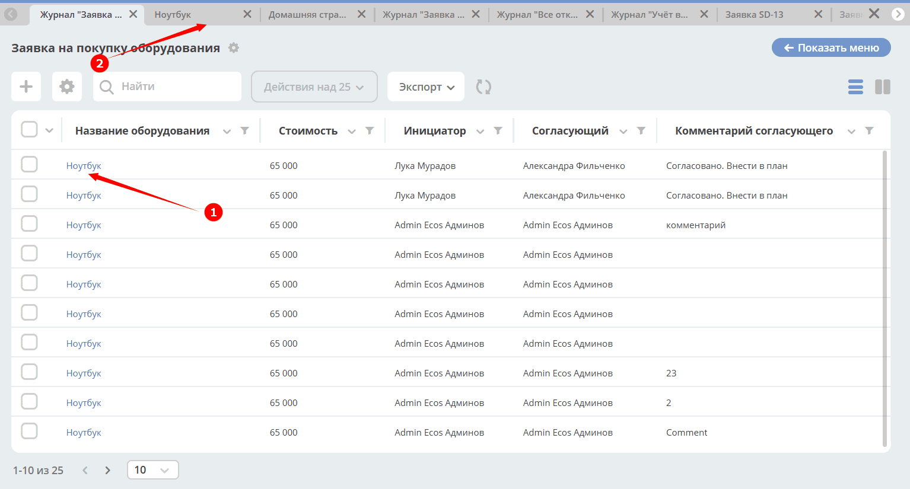
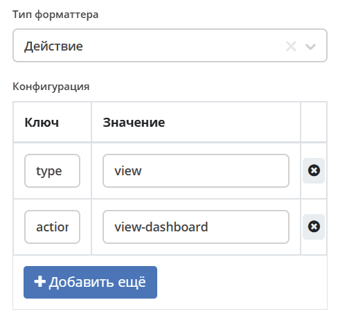
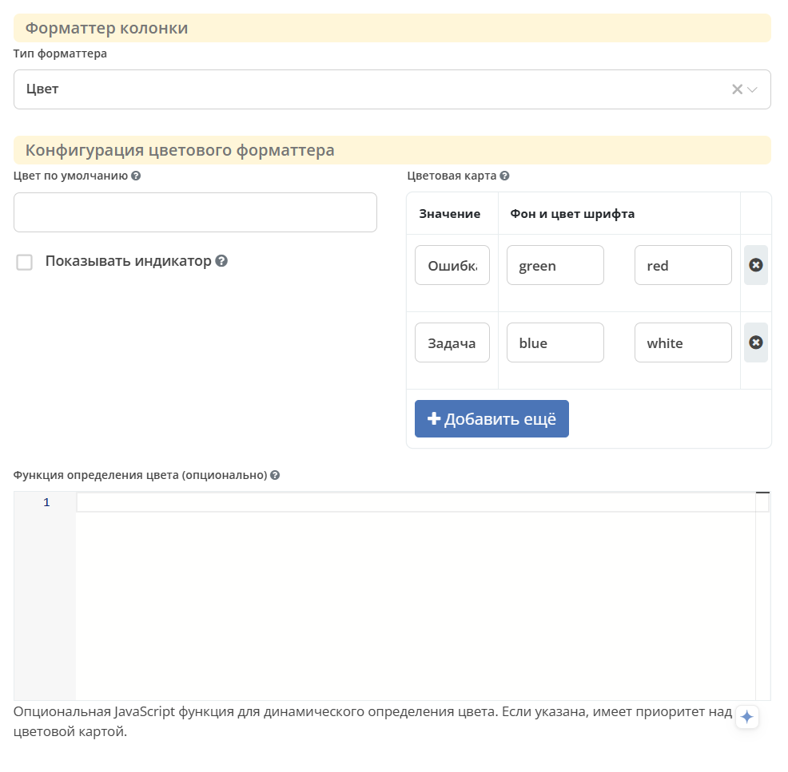
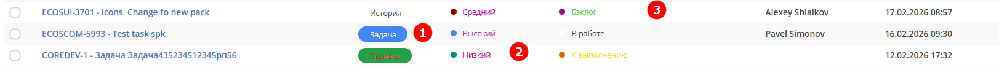
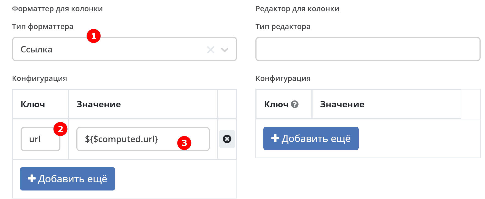
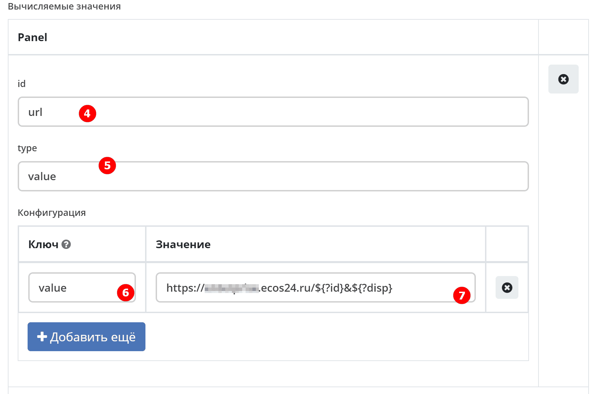
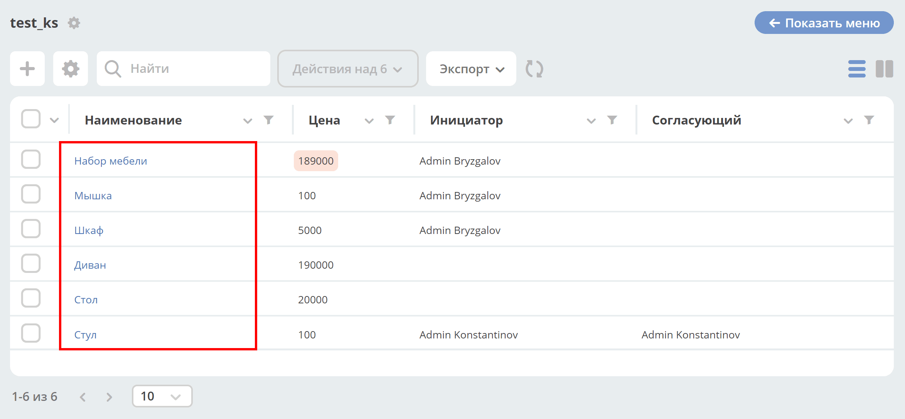
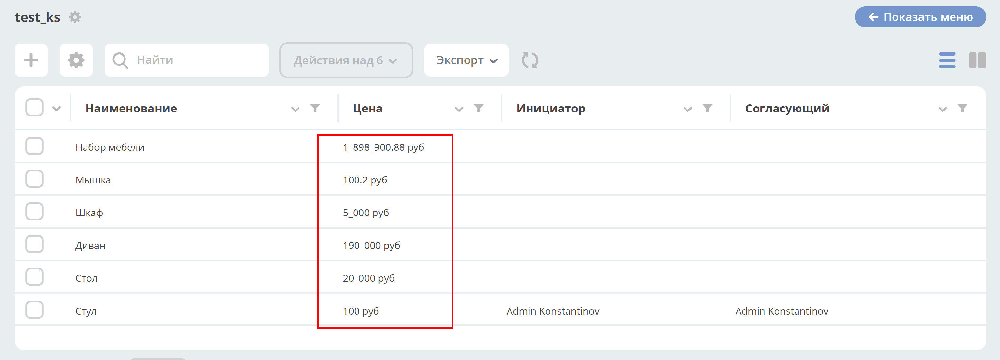

.. _formatters:

Форматтеры
===========

.. contents:: Содержание
   :depth: 3

Форматтеры (formatters) определяют способ отображения значений атрибутов в ячейках колонок журнала. Каждый тип форматтера задаёт собственный внешний вид и поведение ячейки — от простого текста до цветных индикаторов, ссылок, дат и скриптовых вычислений. Форматтер задаётся в конфигурации колонки журнала в поле ``formatter``.

.. note::

   В форматтерах могут использоваться :ref:`вычисляемые атрибуты <computed_attributes>`.

Настройки
---------

Перейти в раздел администрирования > :guilabel:`Журналы` > найти необходимый журнал > действие :guilabel:`Редактировать`. Перейти в :guilabel:`Дополнительно`.

.. grid:: 2
   :gutter: 2

   .. grid-item::

      .. image:: _static/formatter/formatter_1.png
         :width: 500
         :align: left

   .. grid-item::

      .. image:: _static/formatter/formatter_2.png
         :width: 500
         :align: left

Выберите форматтер из списка, заполните ключ-значение:

.. grid:: 2
   :gutter: 2

   .. grid-item::

      .. image:: _static/formatter/formatter_3.png
         :width: 300
         :align: center

   .. grid-item::

      .. image:: _static/formatter/formatter_4.png
         :width: 300
         :align: center

Типы
---------

AssocFormatter / Ассоциация
~~~~~~~~~~~~~~~~~~~~~~~~~~~~~

Тип: ``assoc``

Конфигурация:

.. list-table::
   :widths: 5 40
   :header-rows: 1

   * - Ключ
     - Значение
   * - **sourceId**
     - Идентификатор источника Records для построения ссылки на связанную запись
   * - openInBackground
     - Открыть в новой вкладке ECOS
   * - openNewBrowserTab
     - Открыть в новой вкладке браузера

ActionFormatter / Действие
~~~~~~~~~~~~~~~~~~~~~~~~~~~~~~

Тип: ``action``

Конфигурация:

.. list-table::
   :widths: 5 40
   :header-rows: 1

   * - Ключ
     - Значение
   * - **type**
     - Тип исполнителя действия; используется, если не задан ``actionId``
   * - actionId
     - Идентификатор или ссылка конкретной конфигурации действия, загружаемой для записи

Предполагается в строке журнала наличие **id** или **recordRef** — ref записи, необходимый для выполнения действия.

**Пример:**

По клику на информацию в поле **(1)** в соседней вкладке Citeck открывать дашборд с данными документа **(2)**:

Настройка форматтера:

где:

- type — ``view``
- actionId — ``view-dashboard``

BooleanFormatter / Логическое выражение
~~~~~~~~~~~~~~~~~~~~~~~~~~~~~~~~~~~~~~~~~~

Тип: ``bool``

Конфигурация:

Простой форматтер, который отдаёт «Да» или «Нет» в ячейке.

.. _ColoredFormatter:

ColoredFormatter / Цвет
~~~~~~~~~~~~~~~~~~~~~~~~~~~~~~

Тип: ``colored``

Универсальный форматтер для отображения значений с цветовой индикацией.

Функции
""""""""

- Поддержка как предопределённых цветов (через классы CSS), так и пользовательских цветов HEX.
- Использование идентификатора для сопоставления цветов и локализованного значения для отображения.
- Возможность отображения цветного индикатора в качестве указателя или фона.
- Если в ``showPointer`` установлено значение **false**, цвет фона отображается в виде закруглённого овала.

Параметры конфигурации
""""""""""""""""""""""""

.. list-table::
   :widths: 5 5 5 10
   :header-rows: 1
   :align: center
   :class: tight-table

   * - Параметр
     - Тип
     - По умолчанию
     - Описание
   * - **colors**
     - Object
     - {}
     - Карта значение → { backgroundColor (цвет фона), color (цвет текста) }. Имеет приоритет над ``color`` для соответствующего значения.
   * - **color**
     - Object
     - {}
     - Карта значение → цвет фона. Поддерживается для совместимости.

   * - **showPointer**
     - Boolean
     - false
     - Показывать ли цветной указатель. Если **false**, показывает овальный фон со скруглением.
   * - **defaultColor**
     - String
     - ``'#FFFFFF'``
     - Цвет по умолчанию для значений, не найденных в ``color``. Может быть HEX или именованным цветом.
   * - **fn**
     - String/Function
     -
     - Скрипт или функция для определения цвета фона. Доступны ``Records``, ``cell``, ``row``, ``index``, ``rowIndex``.

Непустой результат ``fn`` задаёт фон с наивысшим приоритетом. Если его нет, используется объект ``colors[value]``: цвет фона из ``backgroundColor`` (или ``defaultColor``) и цвет текста из ``color``. При отсутствии объекта используется ``color[value]``, затем ``defaultColor``. При срабатывании ``fn`` цвет текста из ``colors`` не применяется.

Предопределённые цвета
***********************

Форматтер поддерживает следующие предопределённые цвета:

- green;
- yellow;
- pink;
- red;
- blue;
- currentColor.

Для пользовательского фона используйте HEX из трёх или шести цифр (например, ``#F00`` или ``#FF0000``). Произвольные имена цветов CSS не входят в перечень предопределённых цветов форматтера.

Визуальное отображение
***********************

При ``showPointer: true`` — перед текстом отображается небольшой цветной кружок
При ``showPointer: false`` — текст отображается с овальным цветным фоном со скруглением

Использование
""""""""""""""""

|

.. grid:: 3
   :gutter: 2

   .. grid-item::

      .. image:: _static/formatter/color_formatter_3.png
         :width: 500
         :align: left

   .. grid-item::

      .. image:: _static/formatter/color_formatter_4.png
         :width: 500
         :align: left

   .. grid-item::

      .. image:: _static/formatter/color_formatter_5.png
         :width: 500
         :align: left

**Базовое использование с предопределёнными цветами**

.. code-block:: yaml

  - id: priority
    name:
      ru: Приоритет
      en: Priority
    type: TEXT
    editor:
      type: select
    formatter:
      type: colored
      config:
        color:
          low: green
          medium: yellow
          high: pink
          urgent: red

**Использование с цветами HEX**

.. code-block:: yaml

  - id: priority
    name:
      ru: Приоритет
      en: Priority
    type: TEXT
    editor:
      type: select
    formatter:
      type: colored
      config:
        color:
          low: '#00FF00'
          medium: '#FFFF00'
          high: '#FF69B4'
          urgent: '#FF0000'

**Использование с указателем на дисплее**

.. code-block:: yaml

  - id: priority
    name:
      ru: Приоритет
      en: Priority
    type: TEXT
    editor:
      type: select
    formatter:
      type: colored
      config:
        color:
          low: green
          medium: yellow
          high: pink
          urgent: red
        showPointer: true

**Использование с цветом по умолчанию**

.. code-block:: yaml

  - id: priority
    name:
      ru: Приоритет
      en: Priority
    type: TEXT
    editor:
      type: select
    formatter:
      type: colored
      config:
        color:
          low: green
        defaultColor: '#CCCCCC'

**Использование с именованным цветом по умолчанию**

.. code-block:: yaml

  - id: priority
    name:
      ru: Приоритет
      en: Priority
    type: TEXT
    editor:
      type: select
    formatter:
      type: colored
      config:
        color:
          low: green
        defaultColor: 'red'

**Форматирование цвета на основе скрипта**

.. code-block:: yaml

  - id: priority
    name:
      ru: Приоритет
      en: Priority
    type: TEXT
    editor:
      type: select
    formatter:
      type: colored
      config:
        fn: 'if (cell.value > 2) return "#e2e2e2"'
        defaultColor: '#FFFFFF'

**Использование пользовательского цвета фона и текста**

Чтобы задать одновременно цвет фона и цвет текста (шрифта) для каждого значения, используйте ключ ``colors``. Каждое значение сопоставляется с объектом, содержащим ``backgroundColor`` и ``color``. Эти настройки имеют
приоритет над устаревшей картой ``color`` для того же значения (устаревший ``color`` сохраняется как запасной вариант для значений, отсутствующих в ``colors``).

.. code-block:: yaml

  - id: priority
    name:
      ru: Приоритет
      en: Priority
    type: TEXT
    editor:
      type: select
    formatter:
      type: colored
      config:
        colors:
          low: { backgroundColor: '#24A148', color: '#FFFFFF' }
          medium: { backgroundColor: '#F1C21B', color: '#000000' }
          high: { backgroundColor: '#DA1E28', color: '#FFFFFF' }

DateFormatter / Дата
~~~~~~~~~~~~~~~~~~~~~~

Тип: ``date``

Конфигурация:

.. list-table::
   :widths: 5 40
   :header-rows: 1

   * - Ключ
     - Значение
   * - format
     - Временной формат (по умолчанию ``'DD.MM.YYYY'``)

DateTimeFormatter / Дата и время
~~~~~~~~~~~~~~~~~~~~~~~~~~~~~~~~~~

Тип: ``datetime``

Конфигурация:

.. list-table::
   :widths: 5 40
   :header-rows: 1

   * - Ключ
     - Значение
   * - format
     - Временной формат (по умолчанию ``'DD.MM.YYYY HH:mm'``)
   * - relative
     - Флаг, который будет отсчитывать время, которое прошло

DefaultFormatter / По умолчанию
~~~~~~~~~~~~~~~~~~~~~~~~~~~~~~~~~

Тип: ``default``

Конфигурация:

Всегда отдаёт строковое значение, полученное из значения атрибута. Если ячейка имеет булево значение, то отдаёт «Да» или «Нет».

.. _DurationFormatter:

DurationFormatter / Продолжительность
~~~~~~~~~~~~~~~~~~~~~~~~~~~~~~~~~~~~~~

Тип: ``duration``

Числовое значение ячейки задаёт продолжительность в миллисекундах.

Конфигурация:

.. list-table::
   :widths: 5 40
   :header-rows: 1

   * - Ключ
     - Описание
   * - **showSeconds**
     - | При применении в журнале отображается запись в формате ``1d 2h 30m 2s``.
       | Возможные значения: ``true`` / ``false``.
       | По умолчанию секунды отображаются — ``showSeconds = true``.
   * - **maxAsHours**
     - | При применении в журнале продолжительность будет трансформироваться в часы, то есть ``2d 3h 30m`` = ``51h 30m``.
       | Возможные значения: ``true`` / ``false``.
   * - **hoursPerDay**
     - Положительное число часов в рабочем дне для расчёта продолжительности в днях. Используется при ``maxAsHours: false``. Без параметра применяется обычный расчёт суток.

Пример:

.. code-block:: yaml

  formatter:
    type: duration
    config:
      maxAsHours: true

FileNameFormatter / Имя файла
~~~~~~~~~~~~~~~~~~~~~~~~~~~~~~~

Тип: ``filename``

Конфигурация:

Всегда отдаёт ссылку на документ вида:

.. code-block:: html

  <a href="${URL.DASHBOARD}?recordRef=${row.id}" target="_blank" rel="noopener noreferrer">
    <icon />
    { НАЗВАНИЕ ЯЧЕЙКИ}
  </a>

HtmlFormatter / HTML
~~~~~~~~~~~~~~~~~~~~~~

Тип: ``html``

Конфигурация:

.. list-table::
   :widths: 5 40
   :header-rows: 1

   * - Ключ
     - Значение
   * - html
     - Строка с HTML-кодом

.. _LinkFormatter:

LinkFormatter / Ссылка
~~~~~~~~~~~~~~~~~~~~~~~~~~~~~~

Тип: ``link``

Форматтер отображает значение ячейки как ссылку. Адрес задаётся строкой ``config.url``; без неё используется URL из ячейки, если он распознан как ссылка, либо адрес карточки записи. При программном создании конфигурации можно задать функцию ``config.getUrl(row)``, результат которой имеет приоритет.

Варианты конфигурации открытия ссылки по форматтеру
""""""""""""""""""""""""""""""""""""""""""""""""""""""

Параметры навигации передаются внутри ``config.target`` — объекта либо строки JSON с объектом. Без ``target`` отображается обычная ссылка с ``target="_blank"``. При передаче объекта вызывается сервис навигации Citeck; по умолчанию включён ``openNewTab``. Доступные параметры:

.. code-block:: none

  updateUrl {boolean}
  openNewTab {boolean}
  openNewBrowserTab {boolean}
  reopenBrowserTab {boolean}
  closeActiveTab {boolean}
  openInBackground {boolean}
  pushHistory {boolean}
  replaceHistory {boolean} - default true, if updateUrl is true
  rerenderPage {boolean} - needed to replace link in the router and start rerendering page

Ссылка по шаблону с использованием переменных
"""""""""""""""""""""""""""""""""""""""""""""
Добавлена возможность строить ссылки по шаблону с использованием переменных (атрибутов записи/полей журнала). Шаблон адреса ссылки задаётся в параметрах форматтера для столбца в конфигурации журнала (**Форматтер для колонки**).

Пример шаблона ссылки:

.. code-block:: yaml

  formatter:
    type: link
    config:
      url: "https://example.com/path?var1=${columnId1}&var2=${columnId2}"
      target:
        openNewBrowserTab: true

Здесь ``columnId1`` и ``columnId2`` — атрибуты записи, подставляемые общим механизмом конфигурации журнала. Значения для параметров URL должны иметь подходящее URL-кодирование; сама подстановка его не выполняет.

В качестве текста ссылки используется значение ячейки. Для пустого значения текст необходимо задать отдельно, например другим форматтером.

Во время ввода значения таблица показывает редактор вместо форматтера. Само разрешение редактирования колонки не скрывает ссылку в режиме просмотра.

**Например:**

Выбрать форматтер **Ссылка (1)** и указать:

- **ключ (2)** — ``url``,
- **значение (3)** — ``${$computed.url}``.

Указать:

- **id (4)** — ``url``,
- **type (5)** — ``value``.

В конфигурации указать:

- **ключ (6)** — ``value``,
- **значение (7)** — ``https://host/${?id}&${?disp}``.

В журнале выглядит следующим образом:

По клику на наименование будет открываться ссылка.

.. _NumberFormatter:

NumberFormatter / Число
~~~~~~~~~~~~~~~~~~~~~~~~~

Тип: ``number``

Конфигурация:

.. list-table::
   :widths: 5 40
   :header-rows: 1

   * - Ключ
     - Описание
   * - **mask**
     - маска, где ``{value}`` — само число
   * - **locales**
     - | Какую локаль использовать для форматирования.
       | От неё зависит, как будут разделяться тысячи и дробные числа (точкой, запятой или пробелом). По умолчанию — текущая локаль.
   * - **maximumFractionDigits**
     - Максимальное число знаков после запятой, по умолчанию 16
   * - **decimalSeparator**
     - как отделяются дробные числа. По умолчанию зависит от локали
   * - **thousandSeparator**
     - как разделяются тысячи. По умолчанию зависит от локали.

Пример:

.. code-block::

  mask: {value} руб.
  locales: ru
  maximumFractionDigits: 16
  decimalSeparator: .
  thousandSeparator: ,

Например:

.. list-table::
   :widths: 5 40
   :header-rows: 1

   * - Ключ
     - Описание
   * - **mask**
     - {value} руб
   * - **maximumFractionDigits**
     - 2
   * - **decimalSeparator**
     - .
   * - **thousandSeparator**
     - _

ScriptFormatter / Скрипт
~~~~~~~~~~~~~~~~~~~~~~~~~~

Тип: ``script``

Конфигурация:

.. list-table::
   :widths: 5 40
   :header-rows: 1

   * - Ключ
     - Значение
   * - **fn**
     - | Тип: ``String`` или функция
       | Тело функции. В любом месте скрипта можно использовать ``return``.
       | В теле функции доступны следующие параметры:
       | **_** — библиотека Lodash (https://lodash.com/docs/)
       | **Records** — API работы с записями.
       | **t** — вспомогательная функция локализации. Принимает ключ и возвращает локализованное значение, либо сам ключ, если перевод отсутствует.
       | **vars** — переменные из конфигурации.
       | **cell** — значение текущей ячейки.
       | **row** — вся строка.
       | **index** — индекс значения в ячейке (для множественных значений).
       | **rowIndex** — индекс строки.
       |
       | Функция может возвращать значения разных типов:
       | Булево — заменяется на локализованное значение по ключу ``boolean.yes`` для ``true`` и ``boolean.no`` для ``false``;
       | Число или Строка — результат отображается в ячейке;
       | Объект — воспринимается как конфигурация для следующего форматтера в формате ``{"type":"...", "config": {...}}``.
       |          Непустое ``cell`` используется как значение ячейки для следующего форматтера.
       |          В текущей реализации ``0``, ``false``, пустая строка и отсутствие ``cell`` оставляют исходное значение.
       | Возвращаемый Promise ожидается перед форматированием результата.
   * - **vars**
     - | Тип: ``Object``
       | Дополнительные переменные, которые могут понадобиться при выполнении скрипта.
       | Внутри скрипта к ним можно обращаться через ``vars.yourVariable``, где ``yourVariable`` — это имя ключа в объекте ``vars``.
       | Это полезно, например, когда нужно динамически подгрузить дополнительные данные через функционал форматтеров,
       | заменяющий все вхождения вида ``${...}`` на соответствующие значения атрибутов.
       | Например, если указать ``vars: { currency: "${currencyAssoc.code!'unknown'}" }``, то в скрипте через ``vars.currency``
       | можно получить код валюты из ассоциации ``currencyAssoc``.

Пример использования:

.. code-block:: yaml

  formatter:
    type: script
    config:
      vars:
        processingStatus: ${processingStatus}
      fn: return t(vars.processingStatus);

Если есть необходимость вызвать другой форматтер, например **HtmlFormatter**:

.. code-block:: yaml

  formatter:
    type: script
    config:
      fn: |
        const cellNum = _.parseInt(cell) || 0;
        let link = "";
        if (cellNum > 100000) {
          link = "https://duckduckgo.com/";
        } else if (cellNum > 1000) {
          link = "https://www.yahoo.com/";
        } else {
          link = "https://www.google.com/";
        }
        return {
          "type": "html",
          "config": {
            "html": "<a href='" + link + "' target='_blank'>" + link + "</a>"
          }
        };

WorkflowPriorityFormatter / Приоритет рабочего процесса
~~~~~~~~~~~~~~~~~~~~~~~~~~~~~~~~~~~~~~~~~~~~~~~~~~~~~~~~~~~~~~~~~

Типы: ``workflowPriority`` и ``workflowPriorityV2``.

Оба форматтера отображают приоритет с цветным индикатором и локализованным названием:

- ``1`` — высокий (``priority.high``);
- ``2`` — средний (``priority.medium``);
- ``3`` — низкий (``priority.low``).

Для остальных значений отображается исходное значение ячейки. Типы различаются оформлением индикатора и используют разные CSS-классы. Дополнительная конфигурация не требуется.
