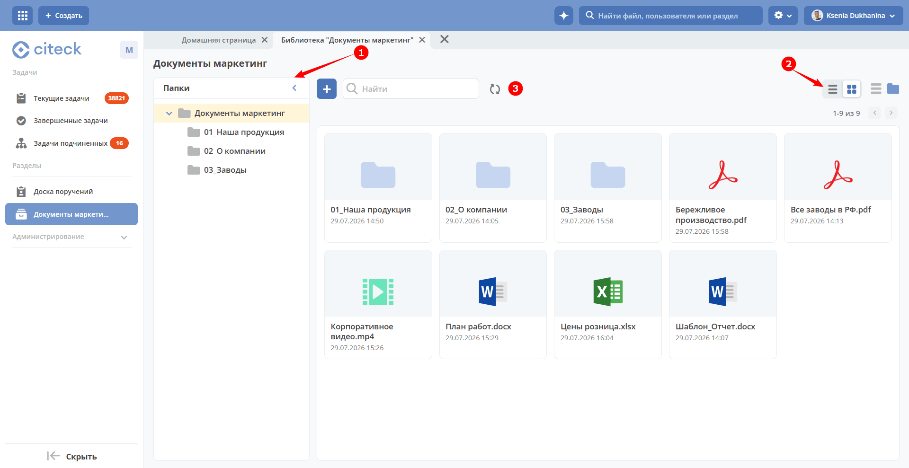
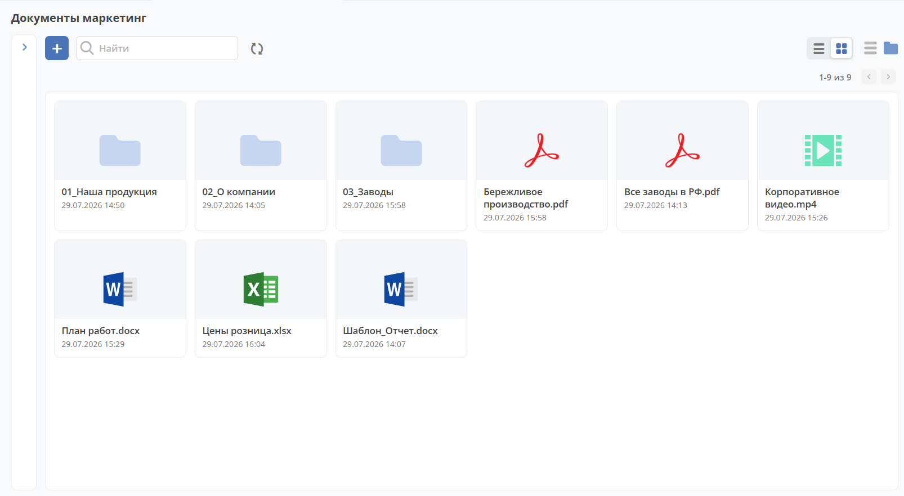
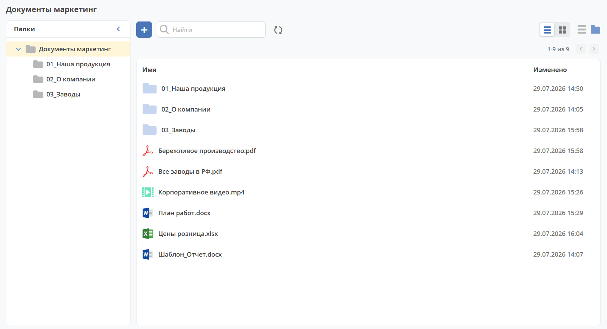
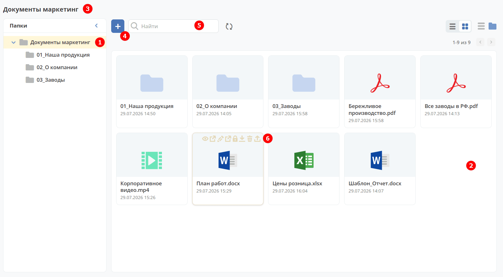
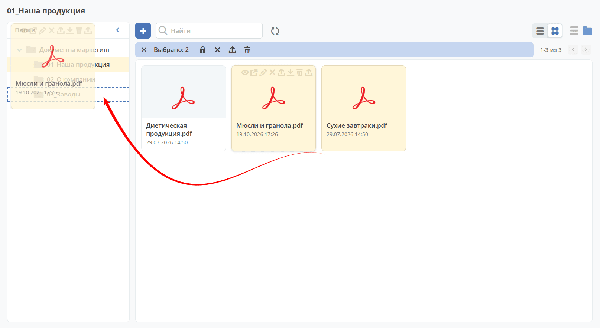
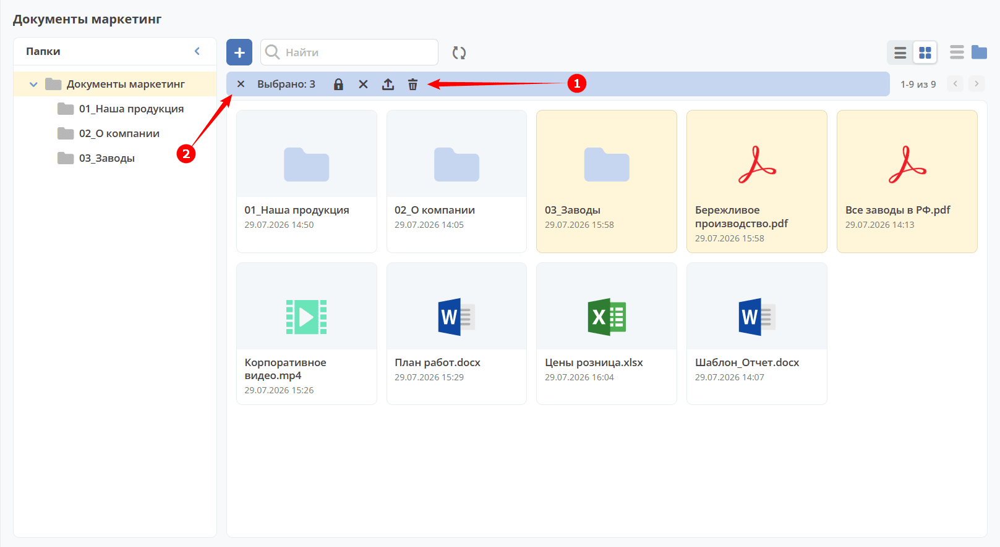
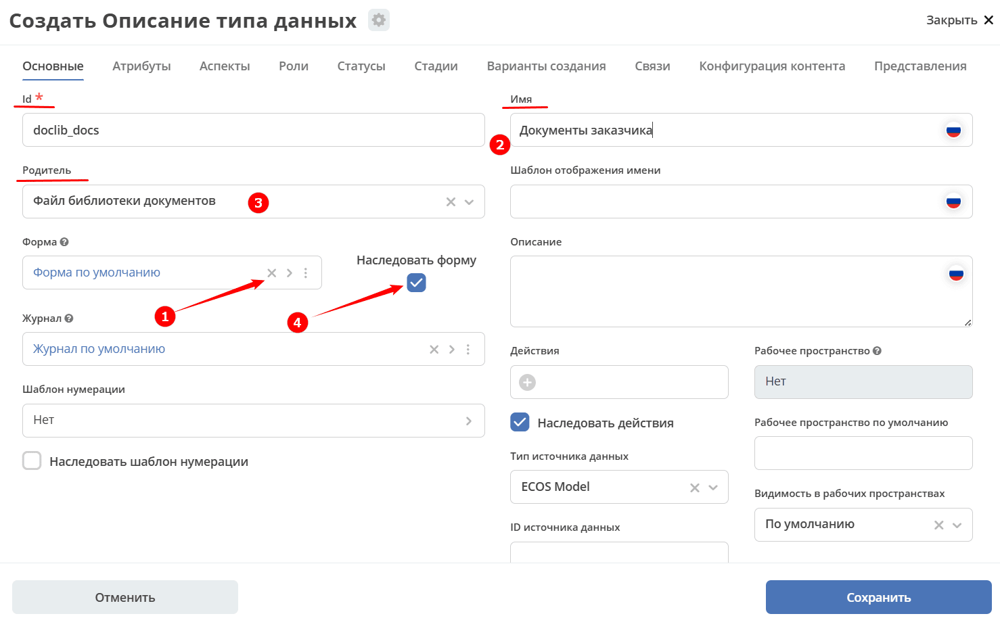
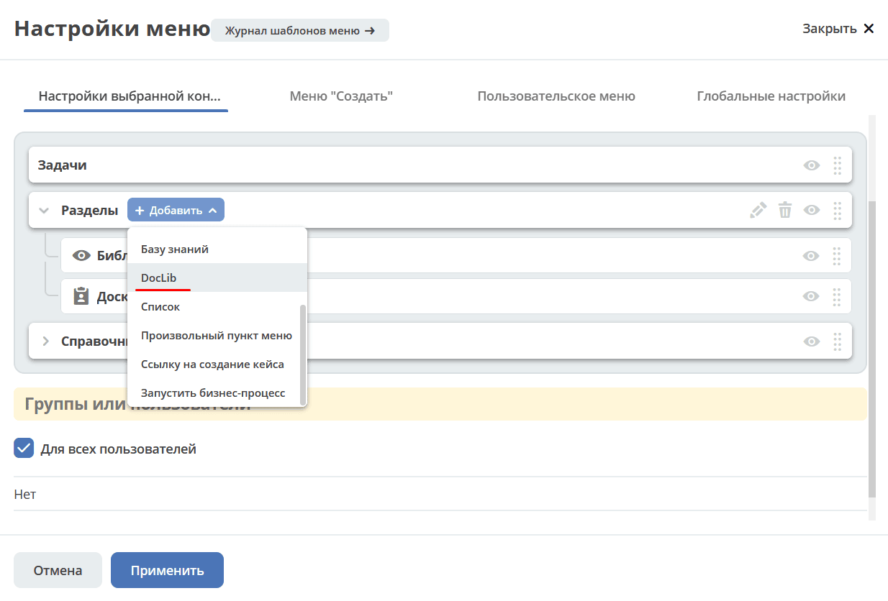

.. _document_library:

Библиотека документов (Document Library)
==========================================

.. contents::
    :depth: 3

**Библиотека документов (Document Library)** — раздел для хранения и организации файлов в виде дерева папок, похожий на проводник Windows. Здесь вы можете загружать документы, создавать папки, а также перемещать и удалять файлы.

Библиотека подключается к меню через специальный элемент **DocLib**. Стандартный способ настройки — создать тип данных на основе **Файл библиотеки документов** с наследованием формы и действий. Возможность работы типа в режиме библиотеки определяется аспектом ``doclib``. См. раздел :ref:`Создание библиотеки документов <new_document_library>`.

Доступность создания и редактирования документов, OnlyOffice, блокировки и других действий зависит от прав пользователя, конфигурации действий и подключённых серверных сервисов.

На компьютере дерево папок отображается по умолчанию. Чтобы свернуть его, нажмите **(1)**. Состояние сворачивания сохраняется в браузере (``docLibTreeCollapsed``). На мобильном устройстве дерево изначально скрыто и открывается отдельной кнопкой:

Режим отображения восстанавливается из сохранённого выбора браузера (``docLibDisplayMode``). Если представление ещё не выбрано, на компьютере отображается список, а на мобильном устройстве — плитки. Для переключения между списком и плитками используйте кнопку **(2)**:

Для обновления данных нажмите **(3)**.

1. Папка, которую вы выбрали, подсвечивается среди остальных **(1)**.
2. Для папок используется отдельная иконка, а иконка файла определяется по расширению его отображаемого названия **(2)**. Примеры форматов:

   - Microsoft Word (doc, docx);
   - Microsoft Excel (xls, xlsx);
   - Microsoft Powerpoint (ppt, pptx);
   - Adobe Acrobat (pdf);
   - Файлы изображений (jpg, bmp, png, gif, tif);
   - OpenOffice / LibreOffice (odf);
   - Файл сообщения из электронной почты (.msg).

   Для нераспознанного расширения используется общая иконка файла.

3. Над журналом вы увидите название текущей раскрытой папки **(3)**.
4. Нажмите **(4)**, чтобы создать документ, загрузить файл или создать папку, либо перетащите файл в область библиотеки. См. ниже раздел :ref:`Создание папки / Загрузка файла <doclib_create_upload>`.
5. Используйте поиск **(5)**, чтобы найти документ в выбранной папке и её вложенных папках. При непустом поисковом тексте запрос выполняется рекурсивно.
6. Наведите курсор на файл или папку, чтобы увидеть доступные действия **(6)**. См. ниже раздел :ref:`Действия с элементом <doclib_item_actions>`.
7. Одиночный клик выделяет элемент. Двойной клик открывает папку или карточку файла. Для просмотра файла также можно воспользоваться доступным действием просмотра. См. ниже раздел :ref:`Карточка файла <doclib_file_card>`.

.. _doclib_item_actions:

Действия с элементом
----------------------

.. list-table::
   :widths: 5 10
   :class: tight-table
   :align: center

   * - .. image:: _static/doclib/ic_1.png
          :width: 25
          :align: center

     - Перейти к просмотру карточки в новой вкладке.

   * - .. image:: _static/doclib/ic_3.png
          :width: 25
          :align: center

     - Открыть в фоновой вкладке.

   * - .. image:: _static/doclib/ic_2.png
          :width: 25
          :align: center

     - Переименовать файл или папку:

       .. image:: _static/doclib/DocLib_5.png
          :width: 400
          :align: center

       Можно изменить название файла или сам вложенный файл.

   * - .. image:: _static/doclib/ic_7.png
          :width: 25
          :align: center

     - | Заблокировать файл с содержимым для ручного редактирования.
       | Действие доступно при наличии права изменения и отсутствии блокировки.
       | Стандартные папки это действие не поддерживают.

   * - .. image:: _static/doclib/ic_8.png
          :width: 25
          :align: center

     - | Отменить ручную блокировку файла.
       | Действие доступно владельцу блокировки или администратору при наличии права изменения.
       | После отмены блокировки файл снова доступен для редактирования с учётом прав пользователя.

   * - .. image:: _static/doclib/ic_6.png
          :width: 25
          :align: center

     - | Загрузить новую версию и разблокировать файл. 
       | Отредактированный файл сохраняется как новая версия документа. 
       | После загрузки блокировка снимается автоматически. Действие доступно владельцу ручной блокировки при наличии права изменения.

   * - .. image:: _static/doclib/ic_3.png
          :width: 25
          :align: center

     - :ref:`Редактировать документ в OnlyOffice <edit_only_office>`. Стандартное действие типа ``doclib-file`` допускает DOC, DOCX, XLSX, PPTX, TXT и CSV по MIME-типу содержимого. Требуются право изменения и настроенный OnlyOffice. При ручной блокировке действие недоступно; блокировка в режиме редактора обрабатывается отдельно.

   * - .. image:: _static/doclib/ic_4.png
          :width: 25
          :align: center

     - Скачать файл.

   * - .. image:: _static/doclib/ic_5.png
          :width: 25
          :align: center

     - Удалить файл или папку:

       .. image:: _static/doclib/DocLib_4.png
          :width: 400
          :align: center

   * - .. image:: _static/doclib/ic_6.png
          :width: 25
          :align: center

     - Загрузить новую версию:

       .. image:: _static/doclib/DocLib_11.png
          :width: 300
          :align: center

       :ref:`Подробно о версиях <widget_versions_journal>`

.. _doclib_create_upload:

Создание папки / Загрузка файла
~~~~~~~~~~~~~~~~~~~~~~~~~~~~~~~~~~

.. tab-set::

   .. tab-item:: Drag-and-drop

      Перетащите нужные файлы или папки в область загрузки:

      .. image:: _static/doclib/drag_01.png
         :width: 700
         :align: center

      Прогресс загрузки вы увидите в правом нижнем углу:

      .. image:: _static/doclib/drag_02.png
         :width: 700
         :align: center

      Если название файла или папки уже занято, вы увидите предупреждение:

      .. grid:: 2
         :gutter: 2

         .. grid-item::

            .. image:: _static/doclib/validation_name_01.png
               :width: 300
               :align: center

         .. grid-item::

            .. image:: _static/doclib/validation_name_02.png
               :width: 300
               :align: center

      Можно загрузить папку вместе с файлами внутри неё, если браузер поддерживает перетаскивание каталогов. Сохранение пустых вложенных папок не гарантируется. Загрузка зависит от доступных вариантов создания и прав пользователя.

   .. tab-item:: С использованием кнопки

      По кнопке **+ Создать** доступны варианты добавления файлов, папок и новых документов, настроенные для типов данной библиотеки:

      .. image:: _static/doclib/DocLib_6.png
         :width: 600
         :align: center

      Если в меню настроены варианты **OnlyOffice (Документ, Таблица, Презентация)**, выберите нужный и укажите название:

      .. image:: _static/doclib/OnlyOffice_01.png
         :width: 600
         :align: center

      Файл создаётся по шаблону сервиса трансформаций. Для совместного редактирования используется подключённый OnlyOffice. Например, стандартный тип ``workspace-file`` содержит варианты DOCX, XLSX и PPTX; одно наследование от ``doclib-file`` не добавляет эти варианты автоматически:

      .. image:: _static/doclib/OnlyOffice_02.png
         :width: 700
         :align: center

      При загрузке файла введите название, которое будет отображаться в библиотеке, и выберите или перетащите сам файл:

      .. image:: _static/doclib/DocLib_8.png
         :width: 600
         :align: center

      Чтобы создать папку, укажите её название:

      .. image:: _static/doclib/DocLib_7.png
         :width: 600
         :align: center

Перемещение файлов и папок
~~~~~~~~~~~~~~~~~~~~~~~~~~~~~~~~~~

Перетащите файл или папку на папку назначения в списке, плитках или дереве. Корень библиотеки также может быть целью переноса. За один такой перенос перемещается перетаскиваемый элемент, независимо от количества выделенных записей.

Нельзя переместить папку в саму себя или в её потомка. При совпадении имени в папке назначения потребуется разрешить конфликт имён.

Групповые действия с файлами и папками
~~~~~~~~~~~~~~~~~~~~~~~~~~~~~~~~~~~~~~~

Для выбора нескольких элементов используйте **Ctrl** (или **Cmd** на macOS). **Shift** добавляет диапазон от последнего нажатого элемента в текущем списке. На мобильном устройстве касание добавляет элемент в выбор или исключает его.

При выборе двух и более элементов появляется панель групповых действий **(1)**. Её состав зависит от действий, доступных для выбранных записей; часть команд может находиться в дополнительном меню:

Чтобы снять выделение, нажмите **(2)**, клавишу **Escape** или пустую область списка. Повторный обычный клик по единственному выбранному элементу также снимает выделение.

.. _doclib_file_card:

Карточка файла
----------------

Карточка состоит из виджетов: например, предпросмотра, свойств, действий, версий и комментариев. Состав определяется настройками дашборда типа и может отличаться:

Подробно о :ref:`виджетах <widgets>`.

.. _new_document_library:

Создание библиотеки документов
---------------------------------

1. Создайте новый :ref:`тип данных <data_types_main>`.
2. Удалите **Форму по умолчанию** **(1)**.
3. На вкладке **«Основное»** укажите **id** и **Имя** **(2)**.
4. В качестве родителя выберите **«Файл библиотеки документов»** **(3)**.
5. Установите чекбокс **«Наследовать форму»** **(4)**.

Проверьте, что для созданного типа включено наследование действий и формы родителя. Аспект ``doclib`` включает режим библиотеки; в стандартной конфигурации текущий тип используется для файлов, а ``doclib-directory`` — для папок. В расширенной конфигурации аспекта можно задать другие типы файлов и папок.

.. dropdown:: Кастомная форма библиотеки документов. Компонент File component
   :color: secondary

   В стандартной форме ``doclib-file-form`` поле ``_content`` обязательно; максимальный размер в настройках поля — ``500GB``. Это клиентская настройка, а не гарантия допустимого размера загрузки: серверные сервисы и инфраструктура могут вводить меньшие ограничения.

   Если вы используете :ref:`кастомную форму <auto_form_change>`, сохраните обязательность поля с контентом и задайте максимальный размер с учётом ограничений вашего стенда.

   .. image:: _static/doclib/DocLib_13.png
      :width: 600
      :align: center

   .. grid:: 2
      :gutter: 2

      .. grid-item::

         .. image:: _static/doclib/DocLib_13_2.png
            :width: 500
            :align: left

      .. grid-item::

         .. image:: _static/doclib/DocLib_13_1.png
            :width: 500
            :align: left

6. Для добавления библиотеки документов в меню выбирайте специальный элемент **DocLib**:

