.. _kanban_board:

Канбан-доска
========================

.. contents::
   :depth: 3

**Канбан-доска** — альтернативное представление журнала, которое отображает записи типа данных в виде карточек, распределённых по колонкам в соответствии со статусами.

Используйте канбан-доску для наглядного отслеживания движения бизнес-объектов: задач, договоров, заявок, сделок и других сущностей. Карточки в колонках формируются на основе активного фильтра журнала.

.. note::

   Фильтры, применённые в журнале, действуют и на канбан-доске — и наоборот.

Для одного журнала можно создать несколько канбан-досок и переключаться между ними через **Список досок**. Сохранённые конфигурации отображения доступны через **Шаблоны настроек**. При открытии используется сохранённый выбор доски и шаблона по умолчанию, если он задан. Шаблоны учитывают журнал и рабочее пространство.

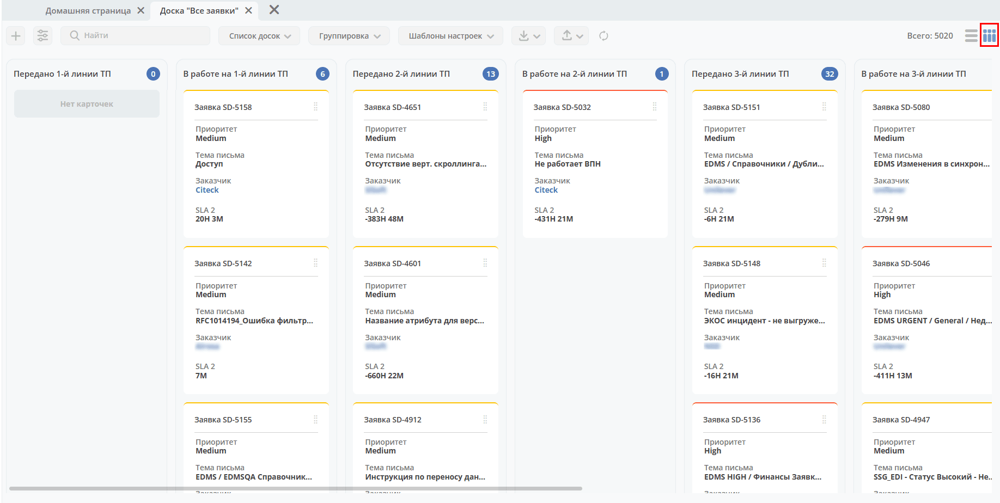

|

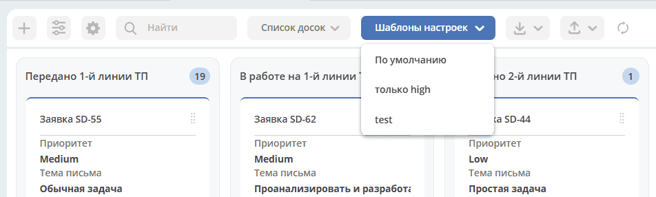

Если доска разрешает изменение (``readOnly: false``) и у пользователя есть необходимые права, карточку можно перетащить (drag-and-drop) в нужную колонку. UI отправляет серверное действие перемещения; изменение статуса и допустимость перехода определяет серверная логика.

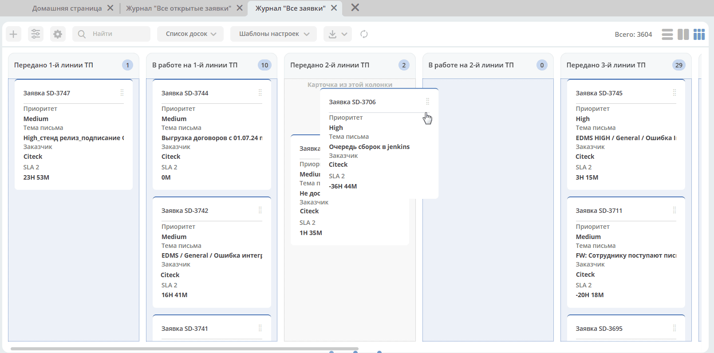

Если серверная логика запрещает изменение статуса или у пользователя нет необходимых прав, выводится ошибка. Например:

При разрешённом перетаскивании (``readOnly: false``) внутри одной колонки можно менять порядок карточек вертикально. При ``readOnly: true`` перетаскивание отключено и используется обычный порядок выборки.

Ручной порядок сохраняется на сервере для доски, рабочего пространства, режима группировки и колонки. Карточки, статус которых изменился после последней ручной расстановки, могут появляться выше упорядоченных карточек.

.. note::

   Вертикальное перемещение задаёт порядок карточек на доске. Команда может использовать этот порядок для визуального обозначения срочности, но само перемещение не означает изменения отдельного атрибута «Приоритет» записи.

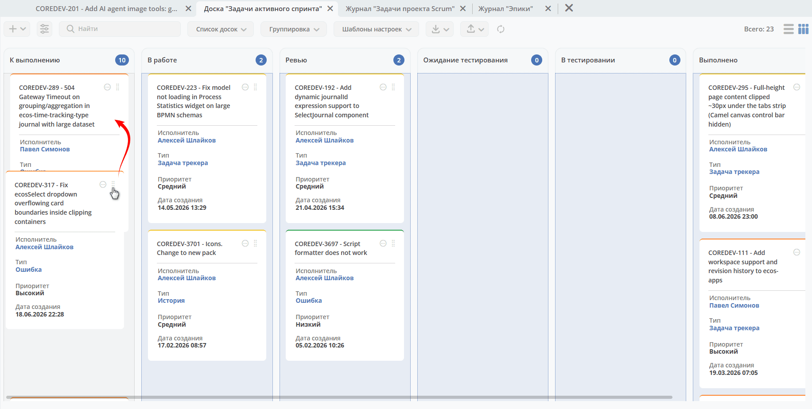

Настройка колонок канбан доски
----------------------------------------------------------

Настроить фильтрацию элементов, порядок и отображение колонок можно, нажав:

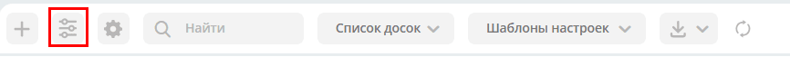

1. Отметьте статусы, которые необходимо показывать, и при необходимости измените порядок колонок перетаскиванием. Набор колонок определяется конфигурацией доски; если колонки в ней не заданы, они формируются из статусов типа данных.

   .. image:: _static/kanban/KB14.png
      :width: 500
      :align: center

2. Нажмите **Применить** — на канбан-доске будут показаны выбранные в настройках статусы и элементы в этих статусах.

3. Чтобы сбросить применённый фильтр, воспользуйтесь кнопкой:

   .. image:: _static/kanban/KB18.png
      :width: 700
      :align: center

4. Выбранные настройки можно сохранить в шаблон, нажав **Создать шаблон**:

   .. image:: _static/kanban/KB15.png
      :width: 400
      :align: center

5. Укажите название, для кого он доступен (пользователи, группы), сохраните.

Применение шаблона
------------------------------------

Сохранённые шаблоны доступны по нажатию на **Шаблоны настроек**:

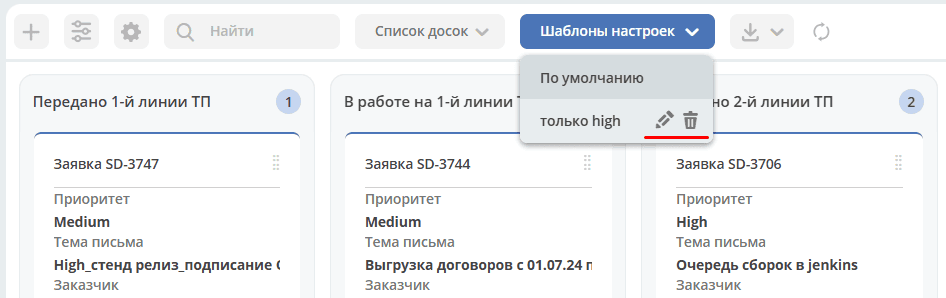

Шаблон можно отредактировать или удалить.

Группировка карточек (swimlanes)
----------------------------------------------------------

На канбан-доске доступна группировка карточек по атрибутам записей — режим **swimlanes**. Это позволяет визуально разделять карточки на горизонтальные дорожки по значениям выбранного поля, что упрощает навигацию и анализ задач.

Включение группировки
~~~~~~~~~~~~~~~~~~~~~~~~~~~~~~~~~~

В тулбаре канбан-доски расположен выпадающий список **«Группировка»**. В нём доступны атрибуты, которые в журнале помечены как доступные для группировки.

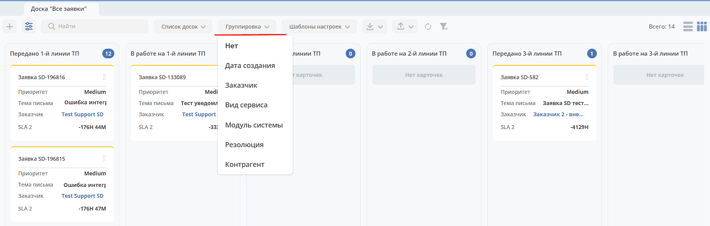

При отсутствии выбранной группировки кнопка показывает текст «Группировка». После выбора атрибута в кнопке отображается его название.

Чтобы вернуться к обычному представлению, выберите пункт без группировки. Фильтры журнала и ограничения рабочего пространства продолжают действовать в обоих режимах.

Работа со swimlane-дорожками
~~~~~~~~~~~~~~~~~~~~~~~~~~~~~~~~~~

При выборе атрибута группировки доска переключается в режим swimlanes — карточки разбиваются на горизонтальные дорожки по значениям выбранного атрибута.

.. note::

   В текущей реализации загружается не более 500 групп. Если групп больше, часть дорожек не отображается, а записи пропущенных групп не учитываются в счётчиках колонок. Чтобы сузить выборку, используйте фильтры журнала.

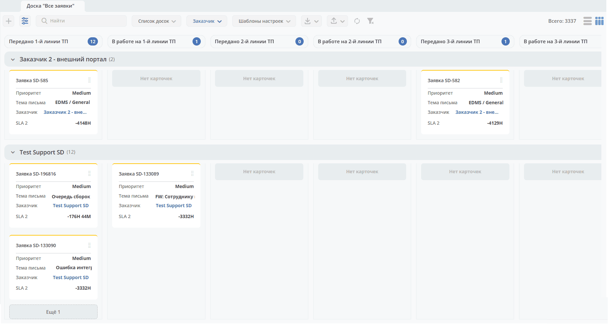

Каждая swimlane-дорожка содержит:

- **Заголовок** — название значения группировки и суммарное количество карточек по колонкам.
- **Кнопку сворачивания/разворачивания** — позволяет скрыть или показать карточки дорожки.
- **Цветные бейджи** — для атрибутов в журнале с настроенным форматированием (:ref:`ColoredFormatter <ColoredFormatter>`) в заголовках отображаются цветные бейджи.
- **Кнопку «Показать ещё»** — постраничная подгрузка карточек в ячейках swimlane.

При разрешённом перетаскивании внутри одной дорожки можно переносить карточки между колонками и менять их порядок в ячейке. Перенос между разными дорожками не поддерживается и не меняет значение атрибута группировки. Для смены этого значения отредактируйте запись доступным способом.

Конфигурация канбан-доски
------------------------------------------------

Журнал с конфигурациями **«Канбан доски»** (Рабочее пространство «Раздел администратора» → Конфигурация UI):

В журнале также отображается рабочее пространство конфигурации доски. Его следует отличать от текущего пространства, в котором просматриваются карточки и сохраняется их порядок.

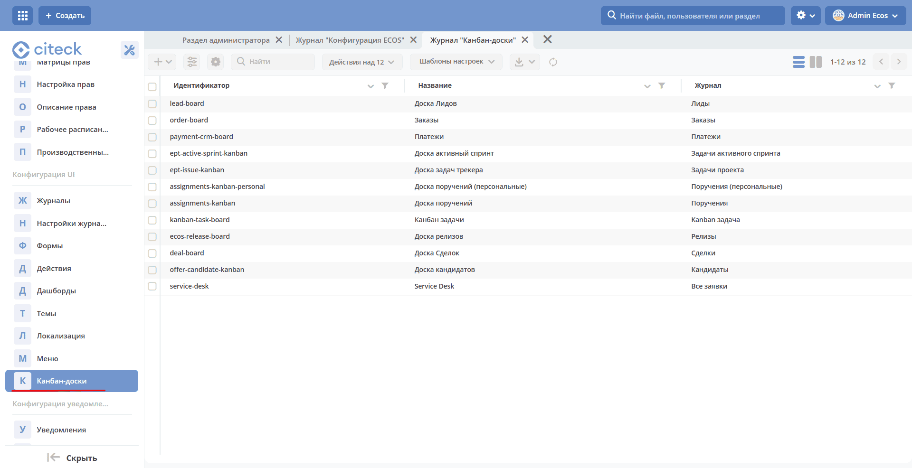

Действия
~~~~~~~~~~~~~~~~

Возможные действия с конфигурацией доски зависят от прав пользователя:

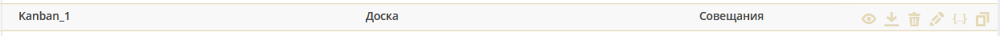

- Просмотреть свойства
- Скачать
- Удалить
- Редактировать свойства
- Редактор json
- Копировать

Форма создания
~~~~~~~~~~~~~~~~~~~~~~~~~~~~

**+ → Создать конфигурацию канбан-доски**

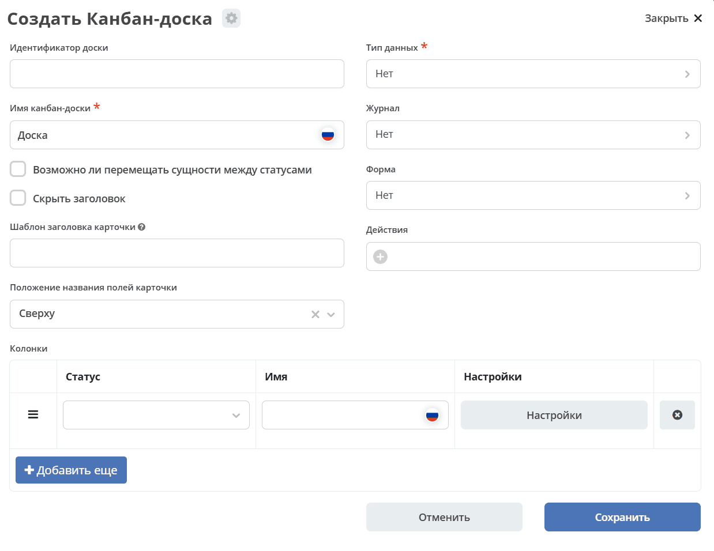

.. list-table::
   :widths: 5 40 5
   :header-rows: 1
   :class: tight-table

   * - Поле
     - Описание
     - Номер
   * - **Идентификатор доски**
     - | Уникальный идентификатор доски. Например, ``test_board`` (snake case).
       | Если идентификатор не заполнять, он будет сгенерирован автоматически. Например, ``c8393bfa-5291-464d-88b7-7ae822516e02``.
     -
   * - **Имя канбан-доски**
     - | Отображаемое имя доски. Отображается в списке канбан-досок и как title страницы.
       | Обязательно в стандартной форме. Если имя отсутствует во внешней конфигурации, для отображения используется идентификатор доски.
     -
   * - **Возможно ли перемещать сущности между статусами**
     - | Разрешает drag-and-drop между колонками и ручное изменение порядка карточек внутри колонки. В конфигурации хранится как ``readOnly: false``.
       | Смена колонки изменяет статус записи через серверную логику; схема бизнес-процесса при этом не редактируется.
     - 7
   * - **Скрыть заголовок**
     - | Возможность убирать заголовок канбан-карточки.
     - 5
   * - **Шаблон заголовка карточки**
     - | Настройка вида ``№ ${numberAtt} - ${?disp}``, которая по шаблону меняет заголовок карточки в канбане.
     - 5
   * - **Положение названия полей карточки**
     - | Возможность выбрать расположение названий полей карточки: слева или сверху. По умолчанию — сверху.
     - 2
   * - **Тип данных**
     - | Тип сущности, который необходимо отражать на доске. Выбор осуществляется из списка всех уже созданных типов.
       | Может быть выбрано только 1 значение.
       | В соответствии с типом в колонках можно выбирать связанные с ним статусы.
     -
   * - **Журнал**
     - | Журнал для типа данных.
       | Для какого журнала создаётся представление канбан-доска.
       | Выбор осуществляется из списка всех уже созданных журналов. Может быть выбрано только 1 значение.
     - 1
   * - **Форма**
     - | Форма карточки для отображения сущности.
       | Выбор осуществляется из списка всех уже созданных форм. Может быть выбрано только 1 значение.
       | Если форму не выбирать, на канбан-доске будет отображение сущности по умолчанию со следующими данными:
       | Автор; Дата создания.
     - 4
   * - **Действия**
     - | Действия над сущностью на доске. Выбор осуществляется из списка всех уже созданных действий.
       | Может быть выбрано несколько значений.
     -
   * - **Колонки**
     - Конфигурация колонок.
     - 3

Соответствие полей конфигурации и интерфейса:

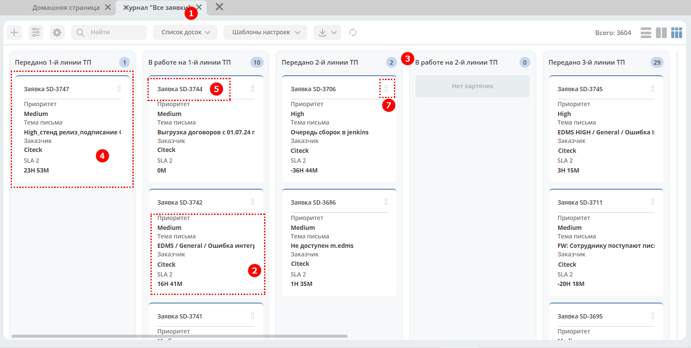

Возможное положение названия полей карточки:

.. list-table::
   :widths: 20 20
   :align: center

   * - **Сверху**
     - **Слева**
   * - |

         .. image:: _static/kanban/card_up.png
               :width: 200
               :align: center

     - |

         .. image:: _static/kanban/card_left.png
               :width: 200
               :align: center

Настройка колонок
~~~~~~~~~~~~~~~~~~~~~~~~~~~~~~~~~~

В колонке **«Статус»** выберите статус из выпадающего списка. Статусы в выпадающем списке указаны в соответствии с выбранным **типом данных**.

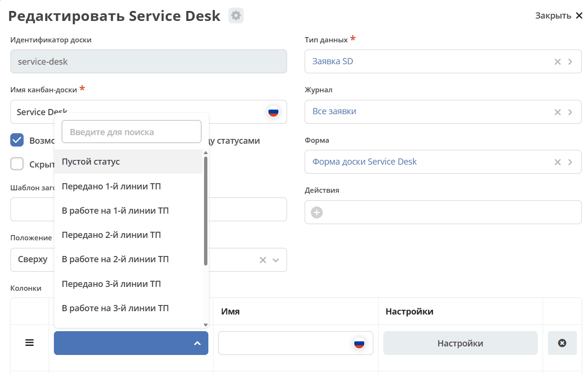

В колонке **«Имя»** укажите название, которое будет отображаться на канбан-доске. По умолчанию выбранный статус автоматически указывается и в колонке **«Имя»**, можно изменить на необходимое.

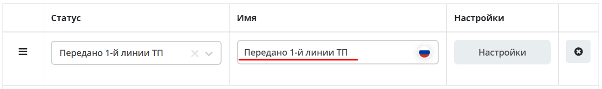

Для каждой колонки можно скрыть элементы старше, чем указанная продолжительность:

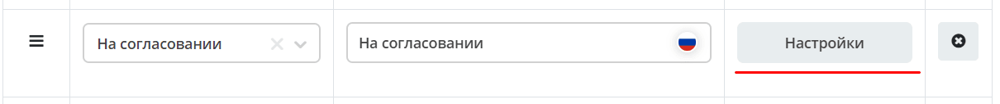

Продолжительность указывается в днях:

В колонках с включённой настройкой скрываются записи, с момента последнего изменения статуса которых прошло больше указанного времени. Проверяется атрибут ``_statusModified``, а не дата создания. В конфигурации продолжительность хранится в формате ISO 8601, например ``P7D`` для семи дней.

.. _kanban_column_sum:

Общая сумма по каждой колонке
~~~~~~~~~~~~~~~~~~~~~~~~~~~~~~~

На канбан-доске можно отображать общую сумму по каждой колонке, что актуально для договоров, сделок и в других случаях, связанных с использованием денежных сумм.

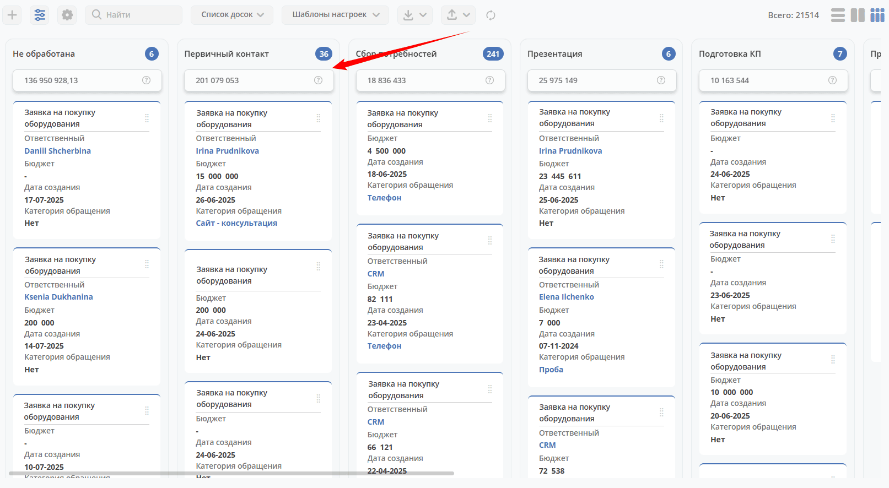

В колонке отображается сумма числового атрибута по записям, соответствующим текущей выборке. Учитываются статус, ограничения журнала, поиск, фильтры пользователя, связанные записи и скрытие старых записей. При перемещении карточки в другой статус сумма пересчитывается в затронутых колонках.

Сумма вычисляется отдельным запросом и не ограничивается уже подгруженной страницей карточек. В режиме swimlanes сумма ячейки дополнительно ограничивается значением группировки дорожки.

Параметр задаётся для каждой колонки и учитывает только числовой атрибут для суммирования.

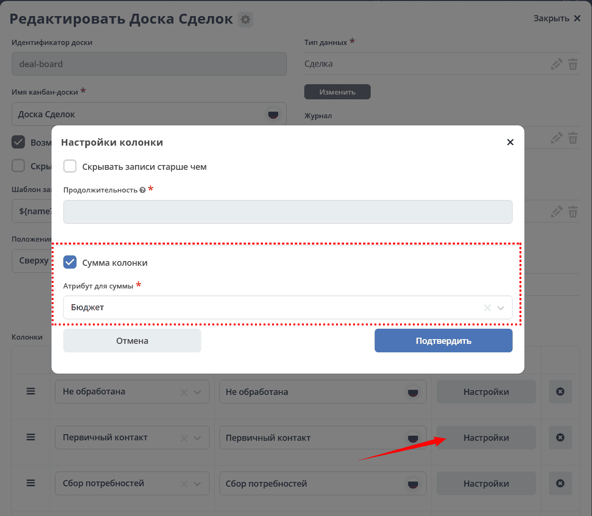

Для каждого рабочего пространства суммы индивидуальны и не являются общими для всех рабочих пространств одного типа.

Результат отображается одним числом без автоматической разбивки по валютам и конвертации. Если записи содержат суммы в разных валютах, используйте фильтр по валюте либо подготовленный атрибут с сопоставимыми значениями.

Цвет карточки
~~~~~~~~~~~~~~~

Цветовой индикатор карточки — её верхняя граница — определяется настройками :ref:`ColoredFormatter <ColoredFormatter>` в журнале (см. :ref:`Форматтеры <formatters>`). Используется первая колонка журнала с форматтером типа ``colored`` и карта значений ``config.color``. Выводить этот атрибут на форму карточки для окрашивания границы не требуется.

Чтобы задать цвет карточки:

1. Перейдите в настройки журнала, на основе которого построена канбан-доска (раздел администрирования → :guilabel:`Журналы` → нужный журнал → :guilabel:`Редактировать` → :guilabel:`Дополнительно`).
2. Найдите колонку с атрибутом, значение которого должно определять цвет карточки, и выберите для неё форматтер типа ``colored``.
3. В конфигурации форматтера сопоставьте значения атрибута с цветами — предопределёнными (``green``, ``yellow``, ``pink``, ``red``) или пользовательскими в формате HEX.

**Например:**

.. code-block:: yaml

  - id: priority
    name:
      ru: Приоритет
      en: Priority
    type: TEXT
    editor:
      type: select
    formatter:
      type: colored
      config:
        color:
          low: green
          medium: yellow
          high: pink
          urgent: red

После сохранения настроек верхняя граница карточки окрашивается по значению атрибута и карте ``config.color``. В режиме swimlanes при отсутствии значения атрибута карточки может использоваться цвет дорожки.

Оформление значения отдельного поля — например, кружок или плашка — настраивается отдельно и описано в разделе :ref:`ColoredFormatter <ColoredFormatter>`. Параметры ``showPointer``, ``colors``, ``defaultColor`` и ``fn`` не заменяют карту ``config.color`` в механизме окрашивания границы карточки.

Заполненная конфигурация
-------------------------

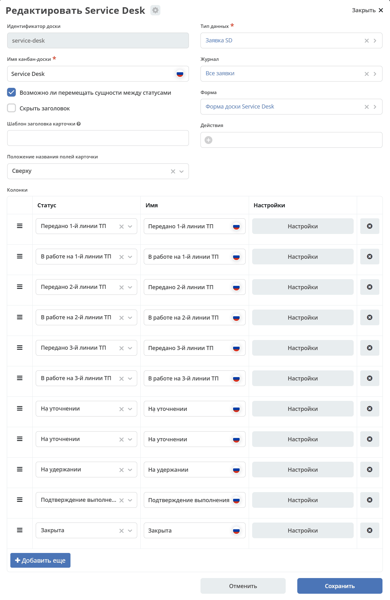

Изменение полей формы карточки
--------------------------------

Кликните на форму:

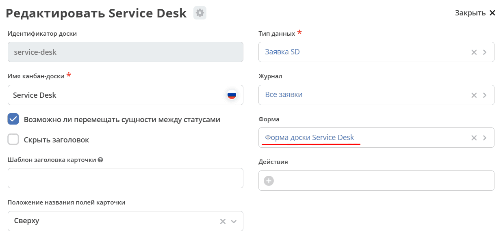

Удалите, добавьте необходимые поля:

.. grid:: 2
   :gutter: 2

   .. grid-item::

      .. image:: _static/kanban/form_card_01.png
         :width: 600
         :align: center

   .. grid-item::

      .. image:: _static/kanban/form_card_02.png
         :width: 600
         :align: center

Связь канбан-доски и типа данных
------------------------------------------------------------

Созданная канбан-доска может быть задана и в типе данных:

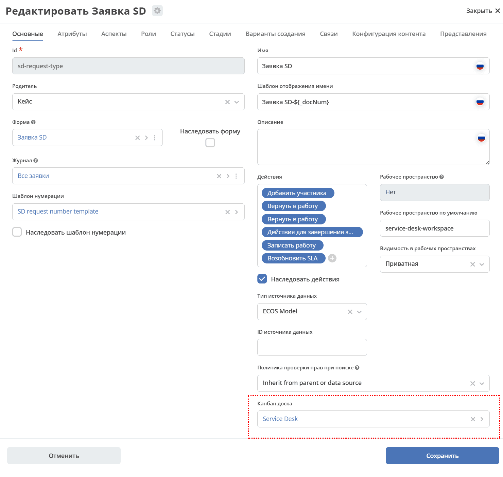
