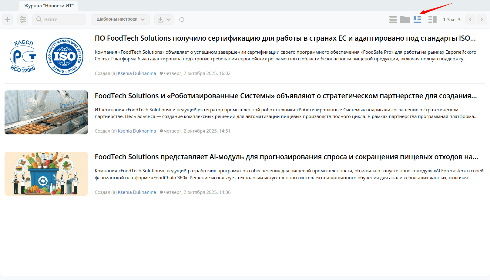
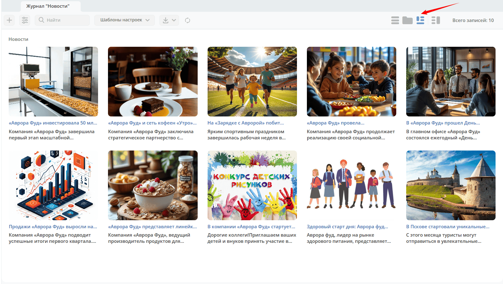
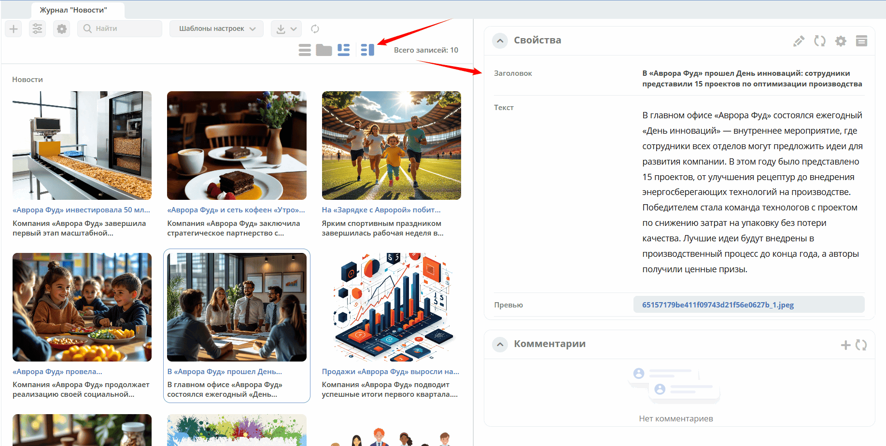
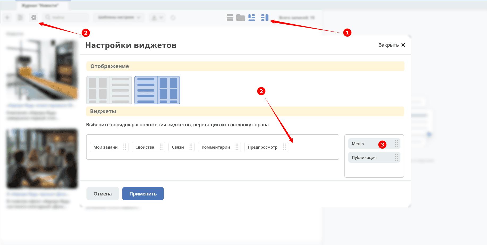
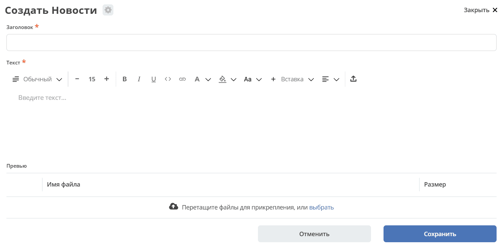
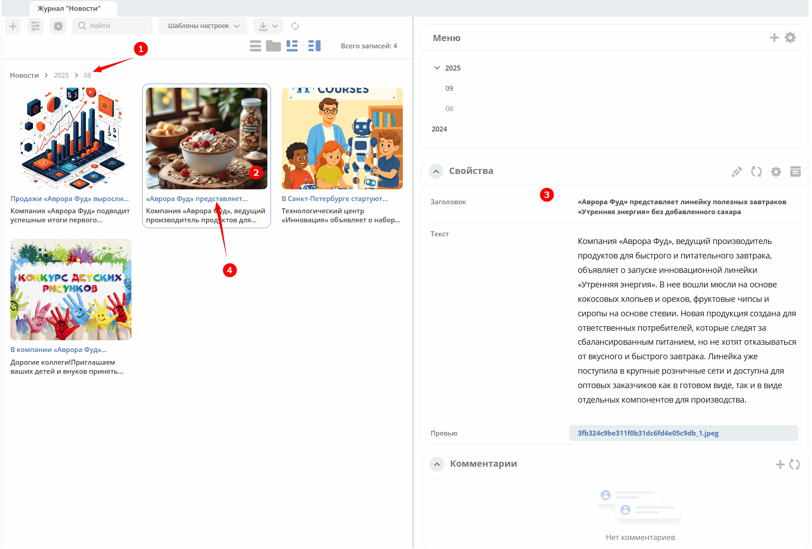
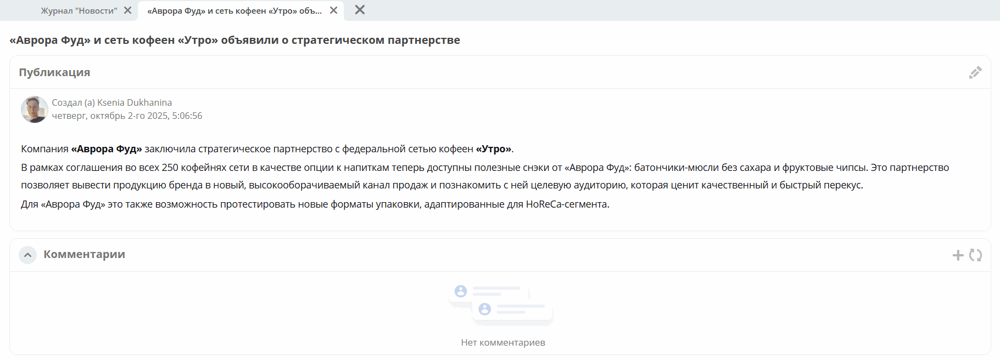
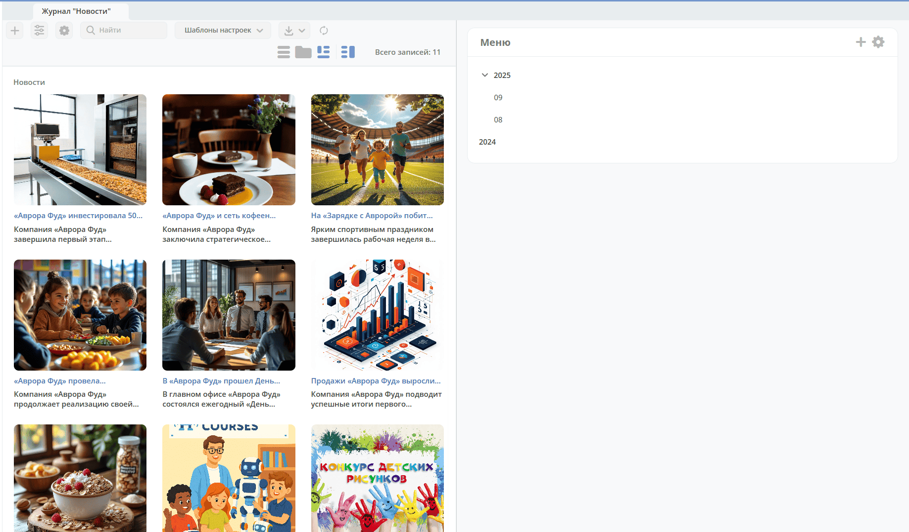

.. _tiles:

Представление данных в виде списка, плиток
==============================================================================

.. contents::
   :depth: 3

**Представление в виде списка и плиток** — альтернативные режимы отображения записей журнала, ориентированные на типы данных с визуальной составляющей: публикации, новости, статьи, каталоги изображений.

- **Список** — строчное отображение, где каждая запись занимает отдельную строку с изображением, заголовком и дополнительными полями.
- **Плитки** — блочное отображение, где каждая запись представлена карточкой с изображением-превью, заголовком и краткой информацией.

Оба режима поддерживают :ref:`предпросмотр <preview>` карточки. О настройке представлений для типа данных см. :ref:`подробно <datatypes_views>`.

Список и плитки — варианты одного представления журнала ``preview-list``. На вкладке **«Представления»** типа данных включается отображение в виде списка (аспект ``listview``), а флаг **«Включить режим отображения контента в виде плиток»** задаёт плиточную раскладку. Здесь же выбираются атрибуты заголовка, текста и изображения.

Карточки также показывают автора и дату создания. Краткий текст выводится без HTML-разметки; если изображение отсутствует, используется стандартная иконка. В плиточной раскладке записи подгружаются при прокрутке вниз, в списке используется пагинация.

Доступность представлений и настройки дерева категорий зависит от конфигурации типа, подключённых возможностей и прав пользователя на соответствующие записи.

Режим **список**:

Режим **плитки**:

В представлении доступен режим :ref:`предпросмотра <preview>`:

.. _tiles_categories:

Дерево категорий
--------------------------------

Виджет **Меню** позволяет организовать записи журнала в иерархическое дерево категорий. Категории выступают как фильтры, а главный раздел показывает доступную выборку журнала без ограничения конкретной категорией.

Для доступности виджета требуются включённые рабочие пространства и подключённый плагин иерархического дерева. Дерево категорий связано с конкретным журналом. Создание и изменение категорий зависят от прав пользователя.

Добавление виджета «Меню»
~~~~~~~~~~~~~~~~~~~~~~~~~~~~~~~~~~

Администратор в режиме предпросмотра **(1)** может помимо стандартных виджетов **(2)** добавить виджет **Меню** **(3)**:

Для добавления виджета нужен доступ к настройке дашборда предпросмотра. Наличие виджета не предоставляет дополнительных прав изменения категорий или записей.

Создание категорий
~~~~~~~~~~~~~~~~~~~~~~~~~~~~~~~~~~

**Виджет Меню** представляет собой дерево категорий.

1. Нажмите **Добавить**, чтобы создать первую категорию:

   .. image:: _static/tiles/tiles_menu_1.png
      :width: 700
      :align: center

2. Для добавления категории 1-го уровня нажмите большой **+** **(1)**. Для добавления подкатегории нажмите маленький **+** **(2)**:

   .. image:: _static/tiles/tiles_menu_2.png
      :width: 700
      :align: center

3. Введите обязательное название и сохраните категорию:

   .. image:: _static/tiles/new.png
      :width: 500
      :align: center

Создание карточки в категории
~~~~~~~~~~~~~~~~~~~~~~~~~~~~~~~~~~

Откройте нужную категорию и воспользуйтесь действием создания записи в журнале. Заполните форму и сохраните запись: при сохранении из журнала с открытой категорией она назначается записи автоматически.

Плюс у узла дерева создаёт подкатегорию. Для отнесения уже существующей записи к категории используйте отдельное действие, описанное в разделе **«Перемещение карточки в другой раздел»**.

Созданная карточка будет доступна в категории и в главном разделе, если соответствует действующим фильтрам журнала и правам доступа.

Навигация
~~~~~~~~~~~~~~~~~~~~~~~~~~~~~~~~~~

Для удобства навигации в представлении есть хлебные крошки **(1)**:

- При включённой панели предпросмотра клик на тело плитки **(2)** выбирает запись и показывает её предпросмотр **(3)**. Повторный клик снимает выбор.
- По заголовку плитки **(4)** открывается карточка записи. Для открытия в новой вкладке браузера используйте стандартные средства браузера.

Главный раздел и иерархия
~~~~~~~~~~~~~~~~~~~~~~~~~~~~~~~~~~

.. note::

   Главный раздел (в данном случае «Новости») показывает записи текущей выборки независимо от категории. Поиск, фильтры журнала и права доступа продолжают действовать. Выбор категории добавляет ограничение по её иерархии.

Перемещение карточки в другой раздел
~~~~~~~~~~~~~~~~~~~~~~~~~~~~~~~~~~~~~~~~

Отнесение карточки к другому разделу изменяет её атрибут ``has-category:category``. Связь с категорией одиночная: новое значение заменяет предыдущее. Запись при этом остаётся в журнале. Для сохранения изменения нужны соответствующие права.

.. tab-set::

   .. tab-item:: Перетаскивание

      Перетащите плитку на нужную категорию в дереве. Перетаскивание карточек доступно при добавленном виджете иерархического дерева в предпросмотре:

      .. image:: _static/tiles/change_dd.png
         :width: 700
         :align: center

   .. tab-item:: Через выбор раздела

      Выберите плитку **(1)**, затем нажмите кнопку со стрелкой у нужной категории **(2)**. Она относит выбранную запись к категории; кнопка с плюсом создаёт подкатегорию:

      .. image:: _static/tiles/change.png
         :width: 700
         :align: center
