.. _menu:

Меню
=====

.. contents:: Содержание
   :depth: 7

**Меню** — навигационная панель Citeck, которая отображается слева в интерфейсе и обеспечивает быстрый доступ к журналам, дашбордам, канбан-доскам, базам знаний и другим разделам системы.

Конфигурация меню гибко настраивается под группы пользователей: каждой группе или конкретному пользователю назначается собственная конфигурация. Поддерживаются три независимо настраиваемых блока — левое меню, меню «Создать» и пользовательское меню.

Статья описывает алгоритм выбора конфигурации меню для пользователя, структуру и версии конфигураций, типы элементов меню, настройку приоритетов групп, а также типичные проблемы при конфигурировании.

Зависимости настроек
--------------------

.. important::

 На отображение влияют настройки:
 
 * **Интерфейс основного меню (Журнал Конфигурация)** - глобальная настройка, для всего приложения и всех пользователей.
 * **Приоритеты групп (Настройки меню > Глобальная настройка)** - глобальная настройка для всех конфигураций и пользователей.
 * **Группы или пользователи (Настройки меню > Текущая конфигурация)** - принадлежность одной конфигурации меню.
 * **Доступность раздела (Настройки меню > Настройки конфигурации > Элементы меню > Раздел)** - принадлежность одного раздела пользователям.
 * **Рабочие пространства** с релиза 2025.1.2

Выбор меню для пользователя
~~~~~~~~~~~~~~~~~~~~~~~~~~~~~~

Конфигурацию выбирает серверный источник ``uiserv/rmenu``. Клиент читает ``main-menu-type``, определяет версию модели (по умолчанию ``1``) и передаёт в запрос имя пользователя, версию и контекст рабочего пространства:

.. tab-set::

   .. tab-item:: Рабочие пространства выключены

      Клиент передаёт ``user`` и ``version``. Поле ``workspace`` в запрос не включается.

   .. tab-item:: Рабочие пространства включены

      Вместе с ``user`` и ``version`` передаётся ``workspace`` — текущее рабочее пространство. Это правило действует и для пространства ``default``: его наличие не означает, что механизм рабочих пространств выключен.

Сервер возвращает идентификатор конфигурации и разрешённую структуру ``subMenu``. Назначения ``authorities``, настройка ``menu-group-priority``, выбор конфигурации по умолчанию и разрешение совпадений обрабатываются сервером. Фронтенд не выполняет самостоятельный перебор персональных и групповых конфигураций.

Общий подход к настройке
~~~~~~~~~~~~~~~~~~~~~~~~

Основной подход к кастомизации меню под проект/модуль — создание нового меню с нужными элементами и назначениями. Приоритет относительно других подходящих конфигураций определяется серверными правилами выбора меню.

Журнал Конфигурация
~~~~~~~~~~~~~~~~~~~~

В журнале для настройки **Интерфейса основного меню** (main-menu-type) устанавливается какой **вариант** (версия) меню будет использоваться в системе.

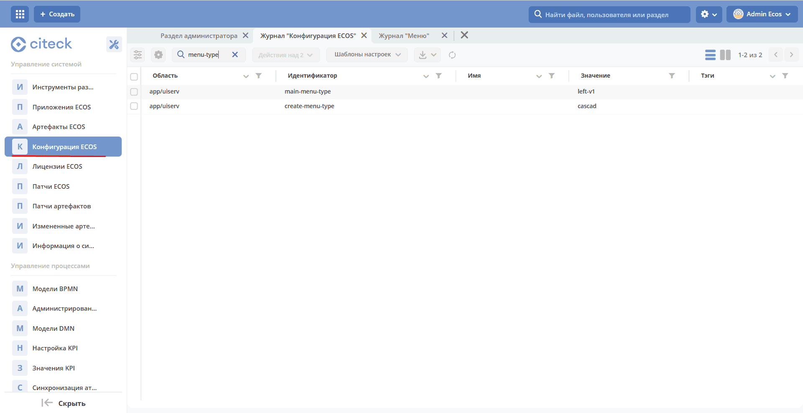

где **left-v1** - первая версия конфигурации левого меню (поддерживается просмотр и редактирование).

Журнал Меню
~~~~~~~~~~~~~

В журнале перечислены все конфигурации разных версий.

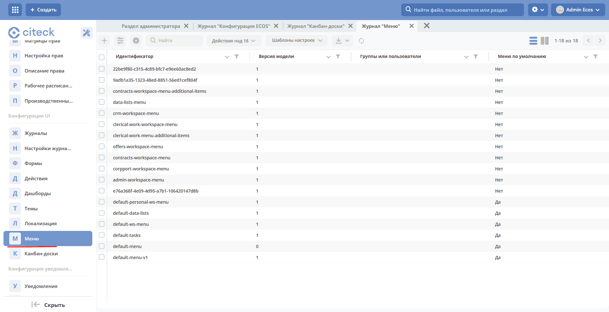

Версия конфигурации меню
~~~~~~~~~~~~~~~~~~~~~~~~~

В конфигурации меню есть поле **Версия модели**, которое определяет версию модели. Актуальный список версий:

 - **0** - устаревший xml формат конфигурации
 - **1** - актуальный json формат конфигурации

Дефолтные конфигурации меню
~~~~~~~~~~~~~~~~~~~~~~~~~~~~~

Ниже приведены примеры поставляемых конфигураций. Их наличие, состав и выбор для пользователя определяются серверной поставкой, а не фиксированным списком в ecos-ui:

1. **default-tasks** содержит все пункты из раздела :ref:`"Задачи"<tasks_spaces>` в дефолтном меню, включая сам раздел.
2. **default-data-lists** содержит все пункты из раздела :ref:`"Справочники"<datalists>` в дефолтном меню включая сам раздел.
3. **default-personal-ws-menu** содержит задачи (default-tasks) через пункт "Вложенное меню" (INCLUDE_MENU) и раздел "Разделы", куда добавлена ссылка на doclib (:ref:`библиотеку документов<ws_doc_library>`) с типом workspace-file и ссылка на :ref:`канбан доску<ws_kanban>` (kanban-task).
4. **default-ws-menu** содержит задачи (default-tasks) через пункт "Вложенное меню" (INCLUDE_MENU) и раздел "Разделы", куда добавлена ссылка на doclib (:ref:`библиотеку документов<ws_doc_library>`) с типом workspace-file и ссылка на :ref:`канбан доску<ws_kanban>` (kanban-task).

Доступность действий в журнале
~~~~~~~~~~~~~~~~~~~~~~~~~~~~~~~~~

Доступность редактирования, удаления, копирования, редактирования JSON и скачивания определяется списком действий журнала и серверными условиями доступа. Она может различаться для поставляемых конфигураций по умолчанию и пользовательских конфигураций.

Редактор интерфейса не поддерживает модель версии ``0``. Для модели версии ``1`` доступны описанные ниже настройки, если действие редактирования разрешено. Чтобы изменить поставляемое меню, создайте собственную конфигурацию или её копию с отдельным идентификатором.

Настройка меню
--------------

Способы открытия
~~~~~~~~~~~~~~~~

- Через шапку сайта иконка "Шестеренка" > :guilabel:`Настроить меню`.

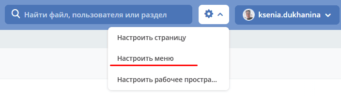

|

.. note:: 
       При использовании этого способа загружается конфигурация меню, используемая в текущем интерфейсе. Это не обязательно административное меню: выбор зависит от пользователя и рабочего пространства.

- Через журнал **Конфигурация UI** - **Меню** действие *Редактировать*

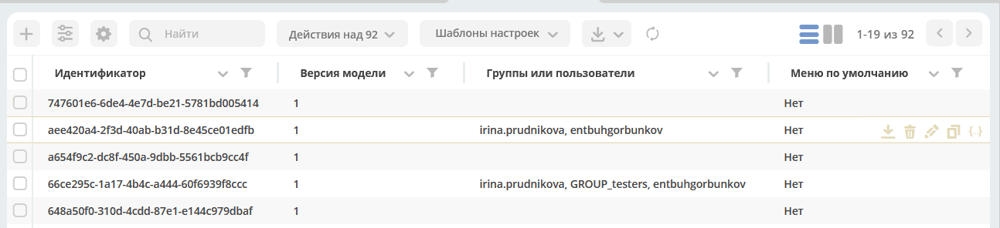

Окно настроек
~~~~~~~~~~~~~~

Настройки содержат четыре вкладки:

#. **Настройки выбранной конфигурации** - описывает состояние отображаемого меню (элементы меню, версия, принадлежность и т.д.).
#. **Меню "Создать"** - для редактирования пунктов меню, доступных по нажатию на кнопку :guilabel:`Создать`
#. **Пользовательское меню** - для редактирования пунктов меню, доступных по нажатию на имя пользователя в правом верхнем углу.
#. **Глобальные настройки** - те настройки, что влияют на всю систему и всех пользователей (приоритеты).

Обзор режима редактирования
~~~~~~~~~~~~~~~~~~~~~~~~~~~~

.. tab-set::

   .. tab-item:: Вкладка "Настройки выбранной конфигурации"

      .. image:: _static/menu/Menu_edit_mode_1.png
         :width: 600
         :align: center

   .. tab-item:: Вкладка "Меню "Создать""

      .. image:: _static/menu/Menu_edit_mode_2.png
         :width: 600
         :align: center

   .. tab-item:: Вкладка "Пользовательское меню"

      .. image:: _static/menu/Menu_edit_mode_3.png
         :width: 600
         :align: center

   .. tab-item:: Вкладка "Глобальные настройки"

      .. image:: _static/menu/Menu_edit_mode_4.png
         :width: 600
         :align: center

Редактирование
~~~~~~~~~~~~~~~

.. important::

       Левое меню, меню «Создать» и пользовательское меню сохраняются в одной конфигурации ``subMenu`` (блоки ``left``, ``create`` и ``user``). У кнопки «Создать» дополнительно есть собственные назначения ``create.allowedFor``. Доступные типы элементов и правила вложенности у блоков различаются.

Вкладка "Настройки выбранной конфигурации" 
"""""""""""""""""""""""""""""""""""""""""""
 
Элементы меню
**************

Возможные типы пунктов и их доступность при ручном добавлении:

.. list-table::
    :widths: 40 30 30
    :header-rows: 1
    :class: tight-table

    * - Тип
      - На верхнем уровне
      - Внутри раздела
    * - Раздел (SECTION)
      - Да
      - Нет
    * - Разделяющий заголовок (HEADER-DIVIDER)
      - Да
      - Нет
    * - Журнал, канбан-доска, дашборд, база знаний, DocLib, список
      - Да
      - Да
    * - Произвольный пункт меню
      - Да
      - Да
    * - Ссылка на создание кейса, запуск бизнес-процесса
      - Да
      - Да
    * - Вложенное меню (INCLUDE_MENU)
      - Да
      - Да

Дочерние элементы вручную добавляются только в раздел. Создание нового раздела и разделяющего заголовка разрешено только на верхнем уровне. Для INCLUDE_MENU отдельного ограничения уровня нет: его содержимое раскрывается сервером. Полученная структура может отличаться от дерева, которое создаётся вручную в редакторе.

Доступность дополнительных характеристик:

- **Скрывать название** — для раздела верхнего уровня.
- **Иконка** — в левом меню на втором уровне, кроме разделяющего заголовка и INCLUDE_MENU. Для пунктов, добавленных из журналов, отображаемые сведения также могут поступать из связанной записи.
- **Свернуть раздел по умолчанию** и **Доступно для** — настройки раздела.
- Обычное редактирование не предлагается для JOURNAL, KANBAN, DOCLIB, PREVIEW_LIST и DASHBOARD. Для них доступны другие действия, например удаление пункта.

Подробнее о некоторых типах:

.. _menu_element_types:

.. tab-set::

   .. tab-item:: Вложенное меню

      .. image:: _static/menu/include_menu.png
         :width: 400
         :align: center

      Пункт, который позволяет вставить в меню уже готовое, ранее сохранённое меню целиком — вместо того чтобы вручную пересоздавать те же пункты в нескольких местах.

      Как это работает:

      Вы выбираете существующее меню из списка — так же, как выбираете журнал или запись.
      В редакторе отображается ссылка на выбранное меню. При загрузке меню для пользователя сервер заменяет этот пункт содержимым включённого меню.
      У него нет собственной иконки.
      Название пункта можно задать своё, а если оставить пустым — будет использовано название самого включённого меню.
      Пример использования: если общий блок пунктов (например, «Отчёты» со вложенными ссылками) нужен в нескольких меню, оформите его как отдельное меню и включите через этот тип пункта. Обновлённое содержимое поступит при повторной загрузке разрешённого сервером меню; править копии пунктов не требуется.

   .. tab-item:: Раздел

      .. image:: _static/menu/Section.png
         :width: 400
         :align: center

      **Скрывать название** - доступно только на головном уровне. В меню подпункты отображаются вне группы, но вместе.

      **Свернуть раздел по умолчанию** - содержимое раздела будет свернутым по умолчанию

      **Доступно для** - возможность ограничивать видимость раздела по группам, пользователям и ролям:

      .. image:: _static/menu/Section_1.png
         :width: 400
         :align: center

   .. tab-item:: Разделяющий заголовок

      .. image:: _static/menu/Chapter_divide.png
         :width: 400
         :align: center

   .. tab-item:: Журнал

      Добавление пунктов осуществляется выбором элементов из журнала. Обычное редактирование пункта не предлагается; его можно скрыть или удалить из меню. Необходимые сведения поступают из конфигурации связанной записи.
      Можно добавлять сразу несколько выбранных значений.

      .. image:: _static/menu/type_data.png
         :width: 600
         :align: center

   .. tab-item:: Канбан доска

      Добавление пунктов осуществляется выбором элементов из журнала :ref:`канбан досок <kanban_board>`:

      .. image:: _static/menu/kanban.png
         :width: 600
         :align: center

      Обратите внимание, что к выбору доступны те канбан-доски, в настройках которой указан журнал.

   .. tab-item:: Дашборд

      Добавление нового пустого :ref:`дашборда <dashboard>`. Укажите его имя и сохраните. Выбор иконки доступен на тех уровнях, где он разрешён редактором.

      .. image:: _static/menu/dashboard.png
         :width: 400
         :align: center

      Далее перейдите из меню в созданный дашборд и нажмите **«Настроить»**.

      .. image:: _static/menu/dashboard_1.png
         :width: 600
         :align: center

      Как настроить см. :ref:`настройки дашборда <dashboard_settings>`. Набор виджетов определяется видом ``custom``, реестром компонентов и подключёнными возможностями. Примеры виджетов:

      - :ref:`Новости <widget_news>`;
      - :ref:`Журнал <widget_journal>`;
      - :ref:`HTML <widget_html>`;
      - :ref:`Веб-страница <widget_web_page>`;
      - :ref:`Дни рождения <widget_birthdays>`;
      - :ref:`Доступные пространства <widget_available_ws>`;
      - :ref:`Активности <widget_activities>`;
      - :ref:`Графическая статистика <widget_graphic_statistics>`;
      - :ref:`Иерархия <widget_knowledge_base>`.

      Это не закрытый список. Например, при наличии соответствующих возможностей также доступны диаграмма Ганта, приветственный виджет и отчёты. Для ряда виджетов проверяются подключённый плагин, включение рабочих пространств или интеграция с Alfresco. Поэтому состав доступных виджетов различается между стендами; см. :ref:`Виджеты <widgets>`.

   .. tab-item:: База знаний

      Добавление новой пустой :ref:`базы знаний <wiki_base>`. Укажите её имя и сохраните. Выбор иконки зависит от уровня пункта.

      При включённых рабочих пространствах в персональном пространстве (``ws`` содержит ``user$``) редактор не предлагает тип «База знаний».

      .. image:: _static/menu/wiki_01.png
         :width: 400
         :align: center

   .. tab-item:: DocLib

      Добавление пунктов осуществляется выбором элементов из журнала, в котором представлены созданные :ref:`библиотеки документов <document_library>`:

      .. image:: _static/menu/doclib.png
         :width: 600
         :align: center

   .. tab-item:: Список

      Добавление пунктов осуществляется выбором элементов из журнала:

      .. image:: _static/menu/news.png
         :width: 600
         :align: center

   .. tab-item:: Произвольный пункт меню

      .. image:: _static/menu/menu_url.png
         :width: 400
         :align: center

      **Ссылка** - В зависимости от значения на выходе формируется соответствующий путь перехода. Под описанием поле выводится результат формируемой ссылки.

      .. note::

         Подробнее про `Абсолютные и относительные ссылки <https://htmlacademy.ru/blog/boost/frontend/links>`_.

      **HTTP/HTTPS URL** обычно открывается в новой вкладке браузера. При включённых рабочих пространствах наличие ``ws=`` в ссылке переводит её открытие в текущую вкладку браузера.

      .. image:: _static/menu/Menu_url_absolut.png
         :width: 400
         :align: center

      **Относительный URL. Варианты формирования:**

      - Атрибут текущего рабочего пространства подставляется через ``${attrName}``, например ``/v2/journals?journalId=${attrName}``, если атрибут содержит идентификатор журнала. Специальный префикс ``%`` не требуется и не обрабатывается. Значение подставляется в строку без автоматического URL-кодирования.

      - Значение с начальным ``/`` задаёт путь от корня текущего хоста. При включённых рабочих пространствах для внутренней ссылки автоматически добавляется параметр ``ws``, если его ещё нет и ссылка не относится к исключениям перенаправления.

      .. image:: _static/menu/Menu_url_relative.png
         :width: 400
         :align: center

      - Для значения без начального ``/`` поведение зависит от рабочих пространств. При включённом механизме клиент разрешает ссылку относительно хоста и добавляет ``ws``. Без этой обработки действуют обычные правила относительных ссылок браузера; это не простое добавление строки к текущему URL.

      .. warning::

         Чтобы путь не зависел от текущей страницы, используйте внутренний маршрут с начальным ``/``, например ``/v2/journals?journalId=contracts``.

      .. image:: _static/menu/Menu_url_relative2.png
         :width: 400
         :align: center

   .. tab-item:: Ссылка на создание кейса

      **Ссылка на создание кейса** в настройке выбирается тип данных, но в самом меню используются сами варианты создания записей этого типа данных. Варианты создания настраиваются в самом типе данных на вкладке **Варианты создания**.

      .. image:: _static/menu/menu_case.png
         :width: 400
         :align: center

   .. tab-item:: Запустить бизнес-процесс

      .. image:: _static/menu/menu_process.png
         :width: 400
         :align: center

      **Запустить бизнес-процесс** в настройке выбирается процесс BPMN. В самом меню используется форма запуска бизнес-процесса, определенная при его настройках.

Секция "Группы и пользователи"
*******************************

Выбор групп и пользователей, которым будет назначено редактируемое меню:

* Назначения сохраняются в ``authorities``. Если список пуст, клиент записывает ``GROUP_EVERYONE`` — назначение всем пользователям.
* При нескольких подходящих конфигурациях выбор выполняет сервер ``uiserv/rmenu``. Чтобы избежать неоднозначной настройки, используйте отдельные назначения и согласованный список приоритетов групп.
* Группы, указанные в конфигурациях, добавляются в список настройки приоритетов. Порядок можно изменить вручную.

В персональном рабочем пространстве (``ws`` содержит ``user$``) секция «Группы и пользователи» не отображается.

.. _menu_tab_create:

Вкладка "Меню "Создать"
"""""""""""""""""""""""

**Возможные типы пунктов при ручном добавлении:**

.. list-table::
    :widths: 40 60
    :header-rows: 1
    :class: tight-table

    * - Тип
      - Ограничение
    * - Раздел (SECTION)
      - Только верхний уровень.
    * - Варианты создания из раздела (CREATE_IN_SECTION)
      - Доступны на верхнем уровне и внутри раздела.
    * - Произвольный пункт меню
      - Доступен на верхнем уровне и внутри раздела.
    * - Ссылка на создание кейса
      - Доступна на верхнем уровне и внутри раздела.
    * - Запуск бизнес-процесса
      - Доступен на верхнем уровне и внутри раздела.

Дочерние пункты вручную добавляются в раздел; новый вложенный раздел создать нельзя. Вложенность, полученная при раскрытии вариантов создания, формируется отдельно и не задаётся фиксированной таблицей из четырёх уровней.

В редакторе меню «Создать» не предлагается настройка иконок. Применимые поля зависят от типа пункта.

**Подробнее о некоторых типах:**

Повторяющиеся типы из первой вкладки аналогичны.

**Варианты создания из раздела**

Выборка составляется на основе конфигурации Левого меню, содержит все пункты с типом **Раздел**. Представлены плоским списком, включая дочерние. 

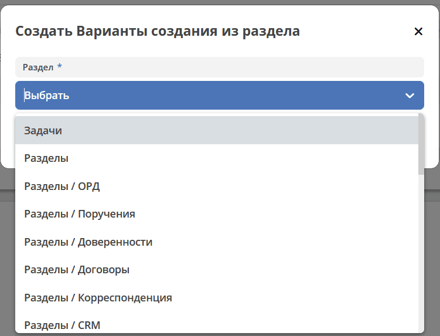

После создания пункта в настройках отображается только имя раздела. 

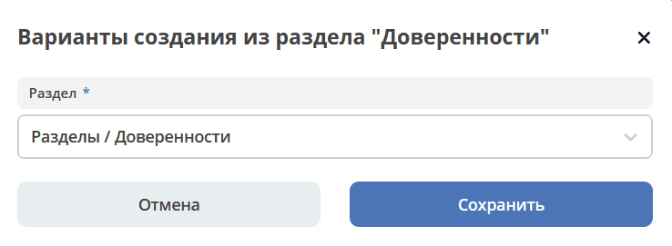

В самом **"Меню Создать"** после применения настроек, пункт превращается в пункты - варианты создания (аналогичные типу **Ссылка на создание кейса**).
             
.. note::
       
       Т.е. данный тип заменяет ручное добавление пунктов с типом Ссылка на создание кейса, если необходимы все варианты из раздела.

Для кнопки **Создать** можно оставить общий доступ без отдельного списка назначений:

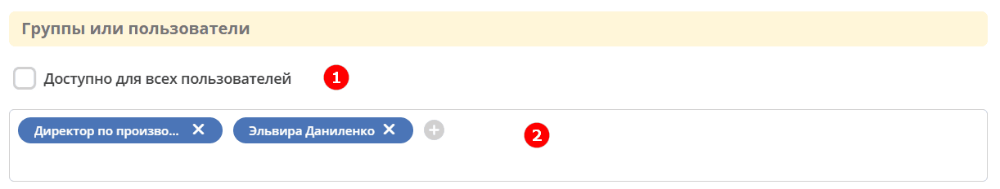

Либо задать выбранных пользователей и группы в ``subMenu.create.allowedFor``. Разрешённое содержимое меню возвращается сервером:

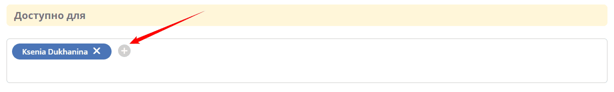

Вкладка "Пользовательское меню"
""""""""""""""""""""""""""""""""

**Возможные типы пунктов:**

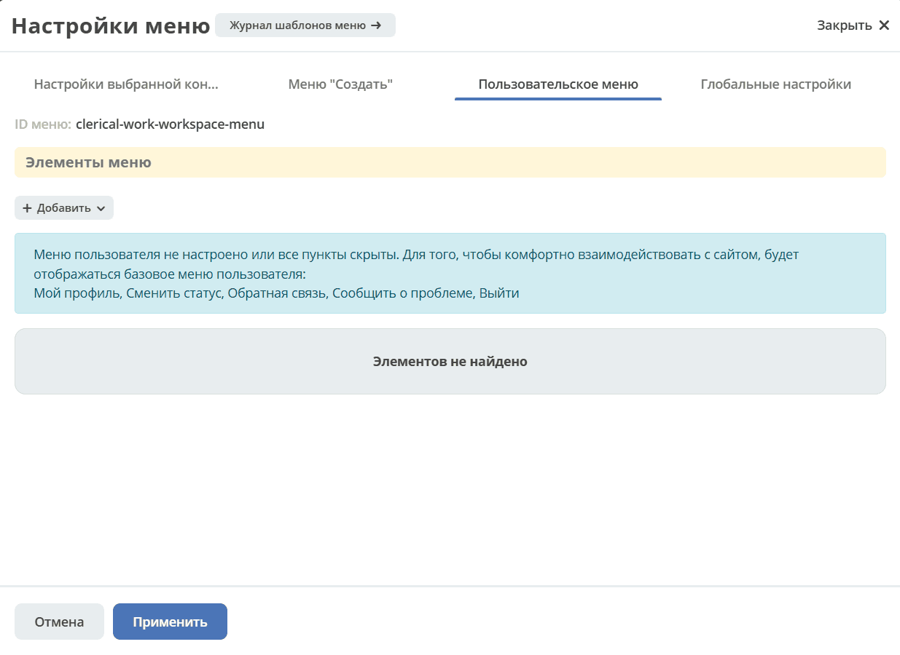

Для настройки доступны следующие пункты:

- **Мой профиль** (``USER-PROFILE``);
- **Сменить статус** (``USER-STATUS``);
- **Изменить пароль** (``USER-CHANGE-PASSWORD``);
- **Обратная связь** (``USER-FEEDBACK``);
- **Сообщить о проблеме** (``USER-SEND-PROBLEM-REPORT``);
- **О платформе** (``USER-ABOUT-PLATFORM``);
- **Выйти** (``USER-LOGOUT``);
- **Произвольный пункт меню** (``ARBITRARY``).

В списке по умолчанию есть пункт «О платформе», а смена пароля исключена. В текущем ecos-ui обработчик ``change-user-password``, вызываемый пунктом смены пароля, не реализует методы выполнения: добавление пункта в редакторе не обеспечивает рабочую смену пароля.

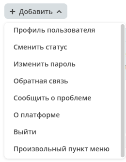

**Подробнее о некоторых типах:**

Тип **"Произвольный пункт меню"** аналогичен первой вкладке. 

Вкладка "Глобальные настройки"
""""""""""""""""""""""""""""""
.. note::

       Данные настройки относятся ко всей системе.

Секция "Приоритеты групп"
**************************

* Список объединяет группы из сохранённой настройки приоритетов и назначений конфигураций меню. ``GROUP_EVERYONE`` и персональные пользователи в список групп не включаются.
* Приоритет задаётся вручную перетаскиванием и сохраняется в ``menu-group-priority``. Клиент не вычисляет его автоматически по уровню группы в оргструктуре.
* Более специфичные группы и группы администраторов рекомендуется располагать в соответствии с нужным порядком выбора. Применение этого порядка и соотношение с персональными назначениями определяет сервер.

.. dropdown:: Как это работает
   :color: secondary

   В конфигурациях меню указываются назначения. Глобальная настройка приоритетов передаёт серверу порядок групп. Пример ниже иллюстрирует организацию назначений; конкретный результат подбора определяется серверными правилами.

   .. image:: _static/menu/menu_groups_1.png
      :width: 600
      :align: center

   **АП** - авторизованный пользователь

   1. Для персонального меню tam42 назначьте его пользователя конфигурации №10. Не создавайте несколько конкурирующих персональных назначений без необходимости.

   2. Для меню администраторов назначьте соответствующую группу конфигурации №3 и задайте нужное положение группы в приоритетах.

   3. Если пользователь входит в группы «Клерки» и «Главные клерки» с разными меню, разместите более специфичную группу в соответствии с желаемым приоритетом и проверьте итоговое меню под этим пользователем.

   4. Конфигурацию по умолчанию при отсутствии подходящих назначений выбирает сервер с учётом рабочего пространства и версии меню.

Редактор иконок
---------------
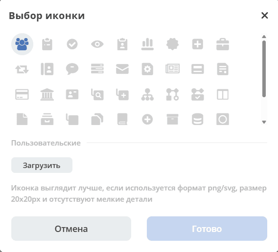

На выбор пользователю предоставлен набор системных иконок. 
Если в наборе нет подходящей, можно загрузить собственную, которая появится в блоке *Пользовательские*. Загрузчик принимает изображения (``image/*``); SVG рекомендуется для масштабируемых иконок.

Иконка по умолчанию: 

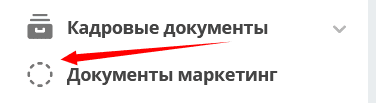

Результат настроек
------------------

Меню Левое
~~~~~~~~~~

.. grid:: 2
   :gutter: 2

   .. grid-item::

      .. image:: _static/menu/Tab_1.png
         :width: 500
         :align: center

   .. grid-item::

      .. image:: _static/menu/Tab_1_1.png
         :width: 280
         :align: center

Меню Создать
~~~~~~~~~~~~

.. grid:: 2
   :gutter: 2

   .. grid-item::

      .. image:: _static/menu/Tab_2.png
         :width: 500
         :align: center

   .. grid-item::

      .. image:: _static/menu/Tab_2_1.png
         :width: 300
         :align: center

Пользовательское меню
~~~~~~~~~~~~~~~~~~~~~

.. grid:: 2
   :gutter: 2

   .. grid-item::

      .. image:: _static/menu/Tab_3.png
         :width: 500
         :align: center

   .. grid-item::

      .. image:: _static/menu/Tab_3_1.png
         :width: 250
         :align: center

Решение возможных проблем
---------------------------

.. dropdown:: Несколько подсвеченных элементов меню
   :color: secondary

   В меню должен быть подсвечен только активный (выбранный) журнал.

   Но может быть ситуация, что при выборе одного элемента подсвечиваются несколько элементов меню сразу:

   .. image:: _static/menu/active_01.png
      :width: 300
      :align: center

   Такое происходит, если при конфигурации меню использовалось копирование ui-элементов без изменения их **id**.

   .. image:: _static/menu/active_02.png
      :width: 500
      :align: center

   Логика у UI следующая - подсвечивается синим открытый в данный момент элемент. И если id задублированы, то все элементы с данным id будут подсвечены.

   Поэтому необходимо следить за уникальностью id элементов, и если элементы копируются, то для получения уникальных id использовать онлайн генераторы:

   .. image:: _static/menu/active_03.png
      :width: 300
      :align: center
