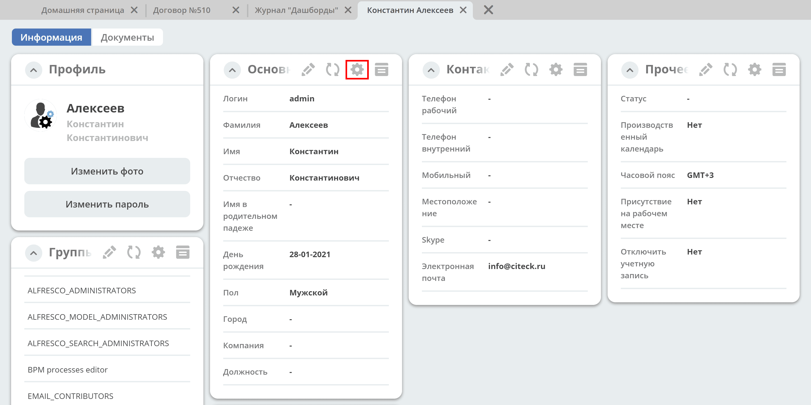
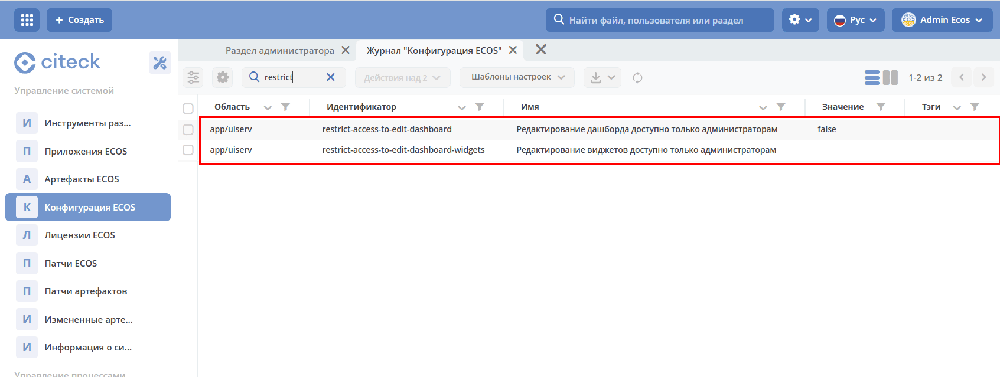

.. _widgets:

Виджеты
==========================

**Виджеты** — настраиваемые блоки информации, которые размещаются на :ref:`дашбордах <dashboard>` и отображают данные о документе, задачах, процессах, пользователях и другом контенте системы.

Виджеты добавляются и переносятся перетаскиванием при настройке дашборда. Набор доступных виджетов зависит от типа дашборда, подключённых плагинов и включённых функций системы. Для части виджетов доступна индивидуальная настройка отображаемых данных.

Доступность в редакторе
-----------------------

Клиентский реестр проверяет поддерживаемые виды дашборда и дополнительные условия. Для плагинных виджетов важны подключённый модуль и, в некоторых случаях, включённые рабочие пространства:

.. list-table::
    :widths: 30 30 40
    :header-rows: 1
    :class: tight-table

    * - Виджет / ключ конфигурации
      - Виды дашбордов
      - Дополнительные условия
    * - Доступные пространства / ``welcome``
      - ``user-dashboard``, ``custom``
      - Включены рабочие пространства, подключён ``WelcomeWidget``.
    * - Активности / ``activities``
      - ``case-details``, ``custom``
      - Включены рабочие пространства, подключён ``ActivitiesWidget``.
    * - Графическая статистика / ``charts``
      - ``case-details``, ``user-dashboard``, ``custom``
      - Подключён ``ChartsWidget``.
    * - Диаграмма Ганта / ``gantt-chart``
      - Все виды
      - Подключён ``GanttChartWidget``.
    * - Публикация / ``publication``
      - ``publication-details``
      - Включены рабочие пространства, подключён ``PublicationWidget``.
    * - Категории / ``hierarchical-tree``
      - ``publication-details``, ``custom``
      - Включены рабочие пространства, подключён ``HierarchicalTreeWidget``.
    * - Стадии / ``stages``
      - ``case-details``
      - Подключён ``StagesWidget``.
    * - Статистика по задачам / ``report``
      - ``user-dashboard``, ``custom``
      - Включена интеграция с Alfresco.

Это условия клиентской доступности; лицензионный состав определяется поставкой. Плагинные «Новости» и «Канбан» загружаются без аналогичной предварительной проверки наличия модуля: при его отсутствии пункт может оставаться в редакторе, а содержимое не отображаться.

Отображение уже добавленного виджета также может ограничиваться условием ``props.config.widgetDisplayCondition``, см. :ref:`Настройки дашборда <dashboard_settings>`.

.. _widget_settings:

Настройка виджетов
------------------

Для некоторых виджетов доступна настройка. Настройка отмечена следующей иконкой:

.. note::

  При строковом значении ``true`` конфигурации **restrict-access-to-edit-dashboard-widgets** настройка виджетов запрещена пользователям без прав администратора. Клиент сравнивает именно строку ``'true'``; булево ``true`` не эквивалентно ей в этой проверке. На администраторов этот запрет не распространяется.

**Настройка прав на редактирование**

В системе можно разграничить права на настройку дашборда (**restrict-access-to-edit-dashboard**) и настройку виджетов (**restrict-access-to-edit-dashboard-widgets**).

- При включённом **restrict-access-to-edit-dashboard** настройка дашборда доступна администратору, а при использовании рабочих пространств — также менеджеру текущего пространства.
- Если **restrict-access-to-edit-dashboard-widgets** не задан или имеет пустое значение, возможность настройки виджетов определяется конфигурацией **restrict-access-to-edit-dashboard** с исключением для администратора.
- Если **restrict-access-to-edit-dashboard-widgets** задан, строка ``'true'`` запрещает настройку виджетов пользователям без прав администратора, а строка ``'false'`` разрешает её. Роль менеджера пространства сама по себе не снимает этот запрет.

Таким образом, пользователь может иметь право на настройку дашборда, но не иметь права на настройку виджетов. Эти ограничения управляют настройками дашборда и виджетов; права на изменение документов, комментариев и других данных проверяются отдельно.

Конфиги хранятся в разделе **Управление системой – Конфигурация ECOS** (``v2/journals?journalId=ecos-configs&viewMode=table&ws=admin$workspace``):

Включение настройки:

Каталог виджетов
----------------

.. grid:: 1
   :gutter: 2

   .. grid-item-card:: Активности
      :link: widget_activities
      :link-type: ref

      Планирование и организация работы по кейсу: звонки, встречи, письма, поручения (только Enterprise).

   .. grid-item-card:: Все задачи
      :link: widget_tasks
      :link-type: ref

      Отображение всех активных задач по кейсу и их исполнителей.

   .. grid-item-card:: Графическая статистика
      :link: widget_graphic_statistics
      :link-type: ref

      Наглядное представление и анализ данных бизнес-процессов (только Enterprise).

   .. grid-item-card:: Дни рождения
      :link: widget_birthdays
      :link-type: ref

      Ближайшие дни рождения пользователей по данным из профиля.

   .. grid-item-card:: Действия
      :link: widget_record_actions
      :link-type: ref

      Доступные действия с кейсом с учётом его статуса и прав пользователя.

   .. grid-item-card:: Диаграмма Ганта
      :link: widget_gantt
      :link-type: ref

      Визуализация временной шкалы проекта с задачами разных типов.

   .. grid-item-card:: Документы
      :link: widget_documents
      :link-type: ref

      Загрузка и отображение сопутствующих документов и записей с группировкой по настроенным типам. Сам виджет не определяет серверный процесс синхронизации пользователей и групп.

   .. grid-item-card:: Доступные пространства
      :link: widget_available_ws
      :link-type: ref

      Карточки основных пространств с доступными действиями перехода и присоединения. Ключ виджета — ``welcome``; реализация — плагин ``WelcomeWidget``.

   .. grid-item-card:: Журнал
      :link: widget_journal
      :link-type: ref

      Настройка отображения журнала.

   .. grid-item-card:: Журнал версий
      :link: widget_versions_journal
      :link-type: ref

      Актуальная и предыдущие версии документа, загрузка новой версии и сравнение файлов.

   .. grid-item-card:: История событий
      :link: widget_events-history
      :link-type: ref

      Таблица событий кейса (создание, обновление, смена статуса) с датой и участниками.

   .. grid-item-card:: Канбан
      :link: widget_kanban
      :link-type: ref

      Канбан-доска в карточке кейса с настраиваемым журналом и атрибутами.

   .. grid-item-card:: Комментарии
      :link: widget_comments
      :link-type: ref

      Отображение комментариев к документу.

   .. grid-item-card:: Категории
      :link: widget_knowledge_base
      :link-type: ref

      Иерархическая навигация по страницам базы знаний или категориям журнала.

   .. grid-item-card:: Мои задачи
      :link: widget_current_tasks
      :link-type: ref

      Активные задачи по кейсу у текущего пользователя и варианты их завершения.

   .. grid-item-card:: Новости
      :link: widget_news
      :link-type: ref

      Анонсы трёх последних новостей выбранного типа в текущем рабочем пространстве.

   .. grid-item-card:: Предпросмотр
      :link: widget_doc_preview
      :link-type: ref

      Отображение и скачивание основного документа и связанных файлов.

   .. grid-item-card:: Профиль
      :link: widget_user_profile
      :link-type: ref

      Профиль пользователя.

   .. grid-item-card:: Публикация
      :link: widget_publication
      :link-type: ref

      Отображение и редактирование контента: новости, публикации базы знаний.

   .. grid-item-card:: Связи документа
      :link: widget_doc_associations
      :link-type: ref

      Установка и отображение связей кейса с другими записями.

   .. grid-item-card:: Стадии
      :link: widget_stages
      :link-type: ref

      Визуализация прохождения стадий документа.

   .. grid-item-card:: Статистика по задачам
      :link: widget_report
      :link-type: ref

      Статистика по задачам при включённой интеграции с Alfresco.

   .. grid-item-card:: Статистика процесса
      :link: widget_process_statistics
      :link-type: ref

      Отображение схемы и статистики процесса. Расширенные данные зависят от плагина ``HeatmapWrapper`` и режима формы: упрощённый режим не включает их даже при наличии плагина. Право «Просмотр отчетности» отдельно ограничивает тепловую карту и счётчики.

   .. grid-item-card:: Статус
      :link: widget_doc-status
      :link-type: ref

      Отображение текущего статуса кейса и, при включённой настройке и наличии доступных переходов, его изменение.

   .. grid-item-card:: Свойства
      :link: widget_properties
      :link-type: ref

      Отображение и inline-редактирование атрибутов карточки.

   .. grid-item-card:: HTML
      :link: widget_html
      :link-type: ref

      Произвольный HTML-контент с En/Ru локализацией и WYSIWYG-редактором.

   .. grid-item-card:: Веб-страница
      :link: widget_web_page
      :link-type: ref

      Отображение произвольной веб-страницы по заданному адресу.

   .. grid-item-card:: Штрих-код
      :link: widget_barcode
      :link-type: ref

      Отображение штрих-кода записи, полученного от сервера. Извлечение значения из записи и генерация выполняются серверным сервисом; текущий клиент предлагает тип Code-128.

.. toctree::
   :maxdepth: 3
   :hidden:

   widgets/activities
   widgets/tasks
   widgets/graphic_statistics
   widgets/birthdays
   widgets/record_actions
   widgets/gantt
   widgets/documents
   widgets/available_ws
   widgets/journal
   widgets/versions_journal
   widgets/events_history
   widgets/kanban
   widgets/comments
   widgets/knowledge_base
   widgets/current_tasks
   widgets/news
   widgets/preview
   widgets/user_profile
   widgets/publication
   widgets/doc_associations
   widgets/stages
   widgets/report
   widgets/process_statistics
   widgets/doc_status
   widgets/properties
   widgets/html
   widgets/web_page
   widgets/barcode
