.. _widget_activities:

Виджет «Активности»
===============================================

.. contents::
   :depth: 3

.. note::

    Доступно только в enterprise версии.

**Виджет «Активности»** помогает планировать и организовывать работу по кейсу. Задачу: телефонный звонок, встречу, письмо, поручение можно запланировать из карточки кейса и просмотреть в календаре. |br|
Виджет доступен для дашбордов ``case-details`` и ``custom`` при включённых рабочих пространствах и подключённом плагине ``ActivitiesWidget``. |br|

Например, в модуле CRM с помощью виджета можно отслеживать этапы работы со сделкой и просматривать все запланированные и завершённые задачи (активности). |br|
Запланированные активности используется для напоминания менеджеру о необходимости контакта. Завершённые активности, как важная часть истории сделки, могут использоваться для расчета KPI менеджера. |br|
Созданные активности отображаются в карточке сделке, по которой они назначены: |br|

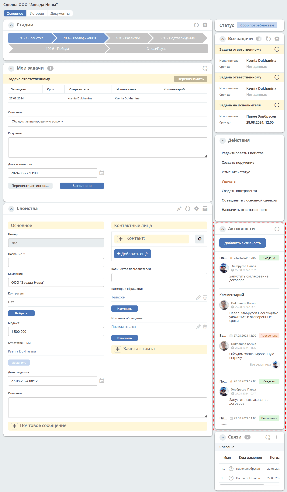

Кроме того, можно просматривать:

-	в календаре (только планируемые задачи):

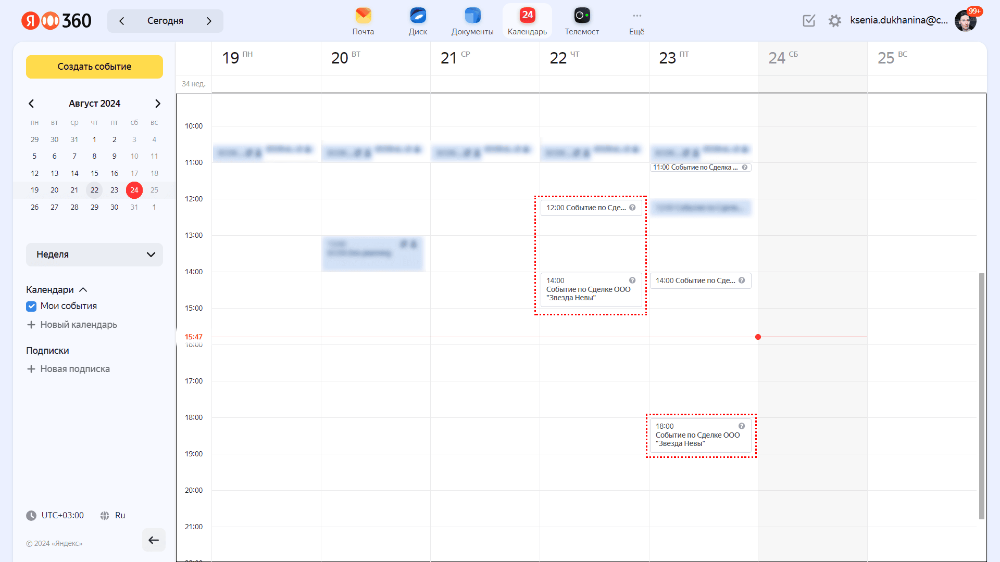

См. подробно :ref:`Письмо-приглашение <activity_ics>` ниже

-	и в разделе Задачи -> Текущие задачи:

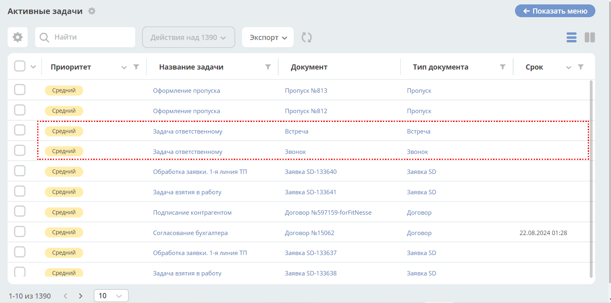

См. подробно :ref:`Задачи <activity_task>` ниже

Активности бывают:

 - :ref:`Планируемые <planned_activity>` : звонок, встреча, письмо;
 - :ref:`Непланируемые <unplanned_activity>`: поручение, комментарий

Как добавить
------------

Нажмите **«+»** в заголовке виджета, выберите вид активности из списка и введите информацию об активности. По умолчанию выбран тип **«Комментарий»**, если он доступен. В зависимости от типа список полей и возможные статусы различаются.

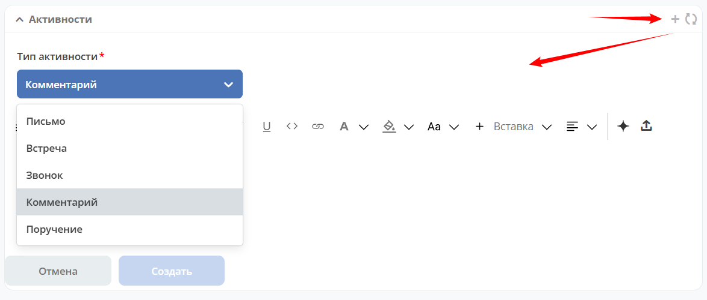

.. note::

 Ввод комментария всегда обязателен для всех активностей.

Для любого типа активности при необходимости можно добавить файлы в текст комментария. Вложения доступны как при создании, так и при редактировании активности.

Планируемые активности
-----------------------

.. _planned_activity:

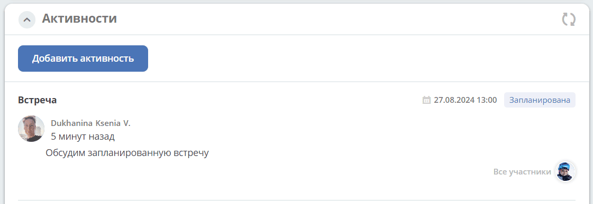

Планируемые активности:

       - Звонок;
       - Письмо;
       - Встреча.

Для планируемой активности обязательны **дата и время**, **продолжительность** и **ответственный**. По умолчанию ответственным указан текущий пользователь. **Название** заполняется по желанию.

Продолжительность выбирается от **15 минут до 8 часов** с шагом **15 минут**. По умолчанию для звонка и письма установлено **15 минут**, для встречи — **30 минут**. При смене типа новой активности продолжительность устанавливается заново в соответствии с выбранным типом. При открытии редактора существующей активности отображается сохранённая продолжительность.

Для планируемых активностей на электронный адрес, указанный в профиле ответственного и выбранных участников, отправляется письмо-приглашение, содержащее ics файл. См. :ref:`Письмо-приглашение <activity_ics>`

Так же по таким активностям назначается задача, в которой можно дату и время активности перенести, или отметить ее выполнение. См. :ref:`Задачи <activity_task>`

Статусная модель таких активностей следующая:

.. list-table::
      :widths: 3 5
      :class: tight-table
      :align: center

      * - |

              .. image:: ../_static/widgets/activity/status_01.png
                     :width: 80
                     :align: center

        - |  Статус по умолчанию.
          |  Планируемая активность создана, дата в будущем, задача еще не создана.
          |  В назначенной задаче ответственный выбрал вердикт **«Перенести активность»**.
          |  Активность в этом статусе можно редактировать и удалять. См. подробно про :ref:`действия <activity_actions>`

      * - |

              .. image:: ../_static/widgets/activity/status_02.png
                     :width: 80
                     :align: center

        - |  Наступила дата и время активности.
          |  Назначается задача ответственному. В задаче доступны два действия: выполнить и перенести активность. См. подробно про :ref:`задачу <activity_task>`

      * - |

              .. image:: ../_static/widgets/activity/status_03.png
                     :width: 80
                     :align: center

        - |  В назначенной задаче ответственный выбрал вердикт **«Выполнено»**.

.. note::

       Поле **«Участники»** доступно для звонка и встречи; в нём можно выбирать только пользователей. У письма этого поля нет.

       При включённой поддержке рабочих пространств для типов с автозаполнением участников в новую активность добавляются пользователи, непосредственно указанные в составе текущего пространства. Группы и пользователи, включённые в пространство только через группы, автоматически не добавляются. Участников можно удалять и добавлять вручную.

       При редактировании существующей активности список участников не заполняется заново, даже если он пуст.

Типы
~~~~~

.. tab-set::

   .. tab-item:: Звонок

      По умолчанию **ответственным** указан текущий пользователь:

      .. image:: ../_static/widgets/activity/activity_07.png
         :width: 600
         :align: center

      Выберите **дату** и **время** из календаря, проверьте **продолжительность** и **ответственного**. При необходимости укажите **название**, добавьте **участников**. Введите комментарий. Нажмите **«Создать»**.

      .. image:: ../_static/widgets/activity/activity_08.png
         :width: 600
         :align: center

      Созданная активность в карточке:

      .. image:: ../_static/widgets/activity/activity_09.png
         :width: 600
         :align: center

   .. tab-item:: Письмо

      По умолчанию **ответственным** указан текущий пользователь:

      .. image:: ../_static/widgets/activity/activity_10.png
         :width: 600
         :align: center

      Выберите **дату** и **время** из календаря, проверьте **продолжительность** и **ответственного**. При необходимости укажите **название**. Введите комментарий, при необходимости добавьте файл. Нажмите **«Создать»**.

      .. image:: ../_static/widgets/activity/activity_11.png
         :width: 600
         :align: center

      Созданная активность в карточке:

      .. image:: ../_static/widgets/activity/activity_12.png
         :width: 600
         :align: center

   .. tab-item:: Встреча

      По умолчанию **ответственным** указан текущий пользователь:

      .. image:: ../_static/widgets/activity/activity_13.png
         :width: 600
         :align: center

      Выберите **дату** и **время** из календаря, проверьте **продолжительность** и **ответственного**. При необходимости укажите **название**, добавьте **участников**. Введите комментарий. Нажмите **«Создать»**.

      .. image:: ../_static/widgets/activity/activity_14.png
         :width: 600
         :align: center

      Созданная активность в карточке:

      .. image:: ../_static/widgets/activity/activity_15.png
         :width: 600
         :align: center

Письмо-приглашение
~~~~~~~~~~~~~~~~~~~

.. _activity_ics:

Для типов **Звонок**, **Письмо**, **Встреча** на электронный адрес, указанный в профиле ответственного и выбранных участников, отправляется письмо-приглашение, содержащее **ICS файл**.

В файле ICS указан список запланированных событий и встреч в универсальном формате календаря, который можно использовать в различных программах-органайзерах онлайн и офлайн, например, Microsoft Outlook, Google Calendar и Apple iCal. У файла простой текстовый формат, включающий заголовок события, время его начала и окончания, краткое описание.

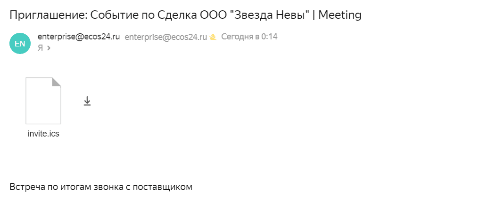

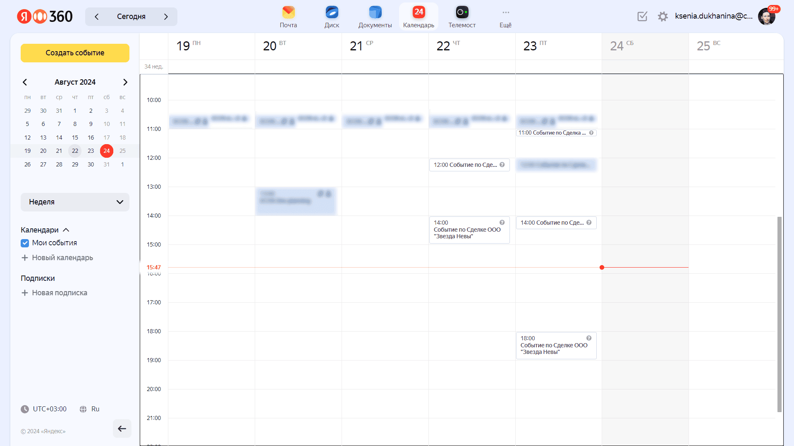

Задача
~~~~~~~

.. _activity_task:

При наступлении **даты** и **времени** активности система назначает задачу ответственному. Задача будет доступна:

       - в Журнале **Текущие задачи»**;

              .. image:: ../_static/widgets/activity/activity_18.png
                     :width: 800
                     :align: center

              |

              .. image:: ../_static/widgets/activity/activity_19.png
                     :width: 700
                     :align: center

       - в карточке сделки в виджете **«Мои задачи»**:

              .. image:: ../_static/widgets/activity/activity_20.png
                     :width: 700
                     :align: center

Доступны следующие варианты завершения задачи:

       - **«Выполнено»**;
       - **«Перенести активность»**

Выполнение активности
""""""""""""""""""""""

Если работа по активности завершена, то заполните в задаче **результат** и нажмите **«Выполнено»**. Статус активности с **«Просрочена»** изменится на **«Выполнена»**.

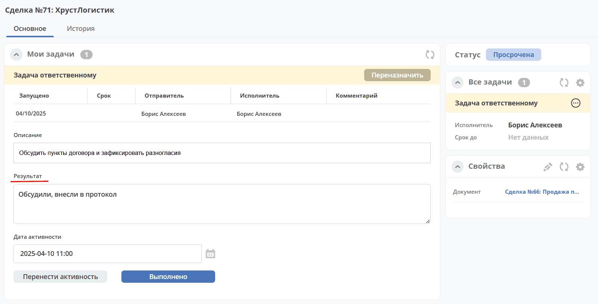

Результат будет добавлен в соответствующую активность:

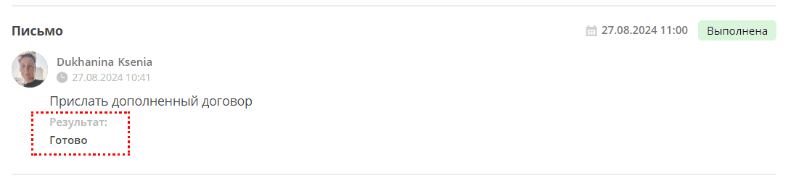

Перенос активности
"""""""""""""""""""

Если работа по активности не завершена, то выберите в календаре новую **дату** и **время** активности и нажмите **«Перенести активность»**. Статус активности с **«Просрочена»** изменится на **«Запланирована»**.

Непланируемые активности
-------------------------

.. _unplanned_activity:

Непланируемые активности:

       - Комментарий;
       - Поручение.

Статусная модель таких активностей следующая:

.. list-table::
      :widths: 3 5
      :class: tight-table
      :align: center

      * - |

              .. image:: ../_static/widgets/activity/status_04.png
                     :width: 80
                     :align: center

        - |  Поручение, Комментарий созданы

Комментарий
~~~~~~~~~~~~

Введите комментарий. Нажмите **«Создать»**.

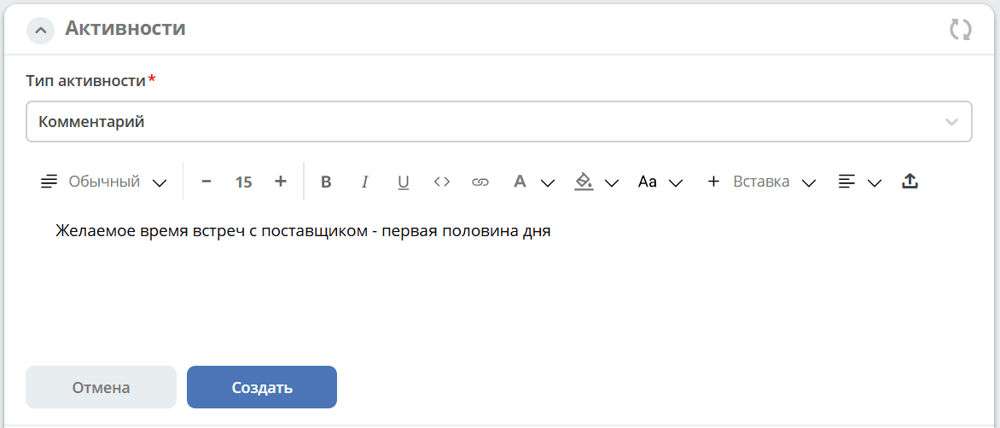

Созданная активность в карточке:

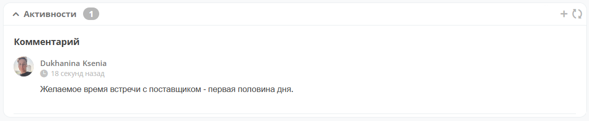

Комментарии из виджета :ref:`«Комментарии» <widget_comments>` транслируются в активности:

 - обычный комментарий;
 - если  настроена трансляция комментария из задачи в виджет комментариев, то он попадает в активности как комментарий;
 - в :ref:`CRM <ecos-crm>` комментарий по слиянию сделок попадает в активности.

Поручение
~~~~~~~~~~

Активность запускает функционал :ref:`поручения <ecos-assignments>`. Инициатором новой активности указан текущий пользователь. По умолчанию установлен **приоритет — средний**:

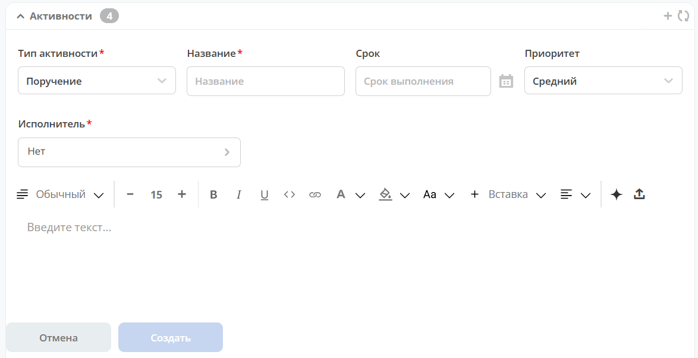

Укажите обязательные **название** и **исполнителя**, введите комментарий. **Срок** в форме виджета необязателен. При необходимости задайте срок и измените **приоритет**, затем нажмите **«Создать»**:

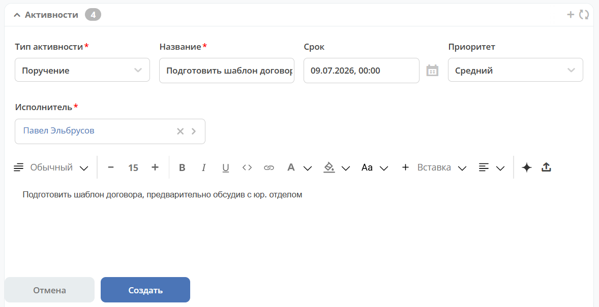

Созданная активность в карточке:

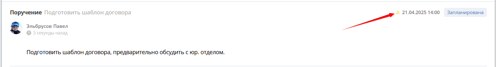

Приоритет отмечен разными цветами:

 - зеленый - низкий;
 - желтый - средний;
 - красный - высокий.

По нажатию на:

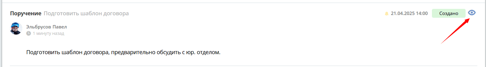

можно перейти в карточку поручения для его редактирования:

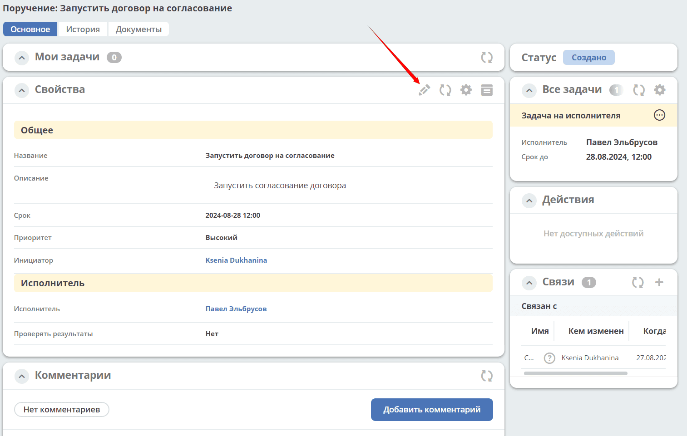

В виджете **«Связи»** и в карточке **поручения**, и в карточке **сделки** добавляются взаимные связи:

.. list-table::
      :widths: 3 5
      :class: tight-table
      :align: center

      * - | В поручении:
        -

              .. image:: ../_static/widgets/activity/activity_29.png
                     :width: 200
                     :align: center

      * - | В сделке:
        -

              .. image:: ../_static/widgets/activity/activity_30.png
                     :width: 200
                     :align: center

Действия с созданной активностью
---------------------------------

.. _activity_actions:

Доступность редактирования и удаления зависит от прав пользователя и статуса активности. Разрешения на эти действия могут различаться. Доступные действия отображаются при наведении на активность.

При наличии соответствующих прав редактировать и удалять можно планируемую активность в статусе **«Запланирована»**:

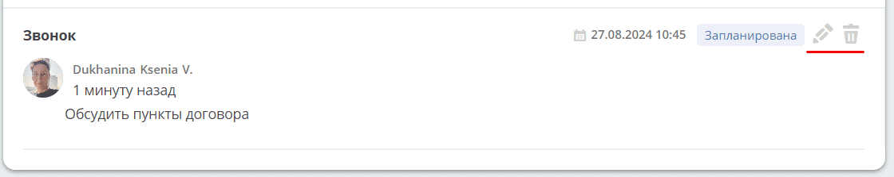

Также редактирование и удаление доступны для типа **«Комментарий»** при наличии соответствующих прав:

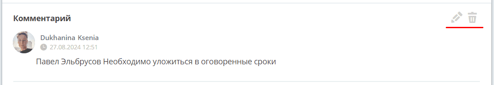

При редактировании тип уже созданной активности изменить нельзя.

Для типа **«Поручение»** редактирование и удаление непосредственно в виджете недоступны. Для просмотра и редактирования предусмотрен переход в карточку связанного поручения. Кнопка перехода отображается, если у активности указан статус, отличный от **«Запланирована»**:

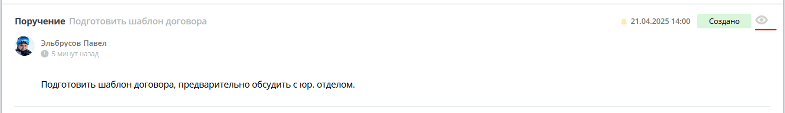

.. |br| raw:: html

      
