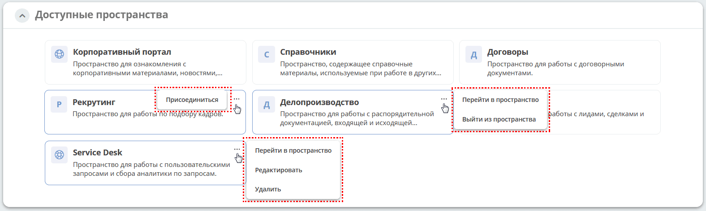

.. _widget_available_ws:

Виджет «Доступные пространства»
==================================================

Виджет показывает карточки заданного набора основных пространств: корпоративного портала, справочников, договоров, заявок, делопроизводства, CRM, Service Desk и пространства администратора. Отображаются существующие записи пространств из этого набора.

Используя :ref:`действия <ws_actions>`, участник может перейти в пространство, а пользователь, который ещё не является участником, — присоединиться к нему. Доступность действий зависит от прав пользователя и настроек пространства:

