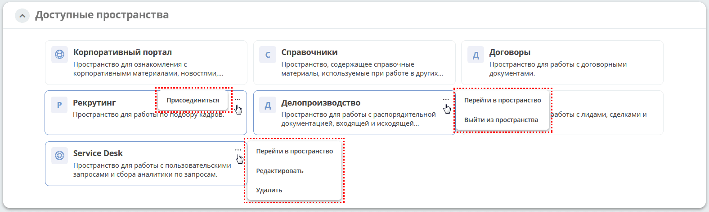

.. _widget_available_ws:

Виджет «Доступные пространства»
==================================================

Ключ ``welcome``

Виджет доступен при включённой функциональности рабочих пространств и подключённом плагине «Доступные пространства».

Виджет показывает карточки заданного набора основных пространств: корпоративного портала, справочников, договоров, заявок, делопроизводства, CRM, Service Desk и пространства администратора. Отображаются существующие записи пространств из этого набора.

Используя :ref:`действия <ws_actions>`, участник может перейти в пространство. Пользователь, который ещё не является участником, может присоединиться к публичному пространству после подтверждения. При успешном присоединении пространство открывается автоматически. Возможность присоединения проверяется сервером и зависит от прав пользователя и настроек пространства.

Прямому участнику доступен выход из пространства. Если пользователь является последним менеджером пространства, выход блокируется. Для членства через группу действие выхода не предлагается.

Редактирование и удаление пространства в карточках этого виджета не отображаются.

