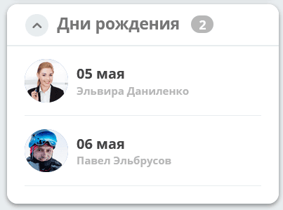

.. _widget_birthdays:

Виджет «Дни рождения»
===============================================

Ключ ``birthdays``

Виджет отображает ближайшие дни рождения по датам, указанным в профилях пользователей. В карточке показаны фотография, отображаемое имя и дата рождения — день и месяц, без года и возраста. Отключённые пользователи в список не включаются.

В узком виджете для перехода в профиль нажмите карточку пользователя, в широком — кнопку **«Перейти в профиль»**.

Дни рождения отбираются примерно на месяц вперёд, начиная с текущей даты. Список упорядочен по месяцу и дню рождения. Настройка периода в виджете не предусмотрена.

.. note::

   В текущей реализации отбор не учитывает переход года: в декабре январские дни рождения в список не попадают.

При загрузке отображается индикатор. Если получить данные не удалось, появляется сообщение об ошибке и кнопка **«Попробовать еще раз»** для повторного запроса.
