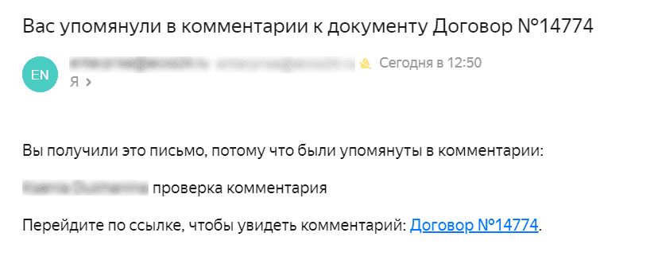
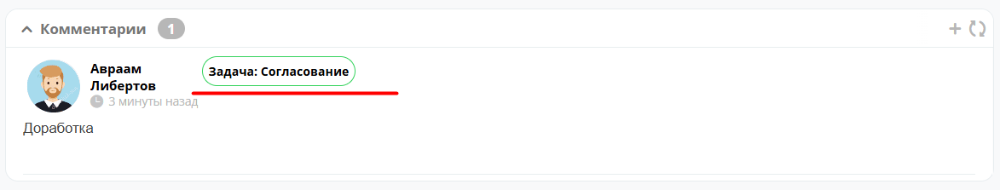

.. _widget_comments:

Виджет «Комментарии»
===============================================

.. contents::
   :depth: 2

Ключ ``comments``

Виджет для отображения комментариев к документу.

Чтобы добавить комментарий, нажмите кнопку с плюсом, введите текст и сохраните его кнопкой в редакторе. Пустой комментарий отправить нельзя. В списке отображаются автор, дата, содержимое и теги комментария; новые комментарии располагаются перед старыми.

.. list-table::
      :widths: 10 40
      :class: tight-table

      * - **Введенные комментарии**
        - |

            .. image:: ../_static/widgets/comment_1.png
                  :width: 700
                  :align: center

      * - **Форма ввода комментария:**
        - | Для ввода текста используется :ref:`визуальный редактор <wysiwyg_editor>`, в котором помимо форматирования текста доступно добавление таблицы, кода, ссылки, файла
          | Чтобы упомянуть пользователя, введите **@** и выберите его из предложенного списка.

            .. image:: ../_static/widgets/comment_2.png
                  :width: 700
                  :align: center

Для нового упоминания внутреннего пользователя с указанным e-mail система отправляет почтовое уведомление. Доставка зависит от настроек почтовой службы. Пример письма:

В текущей реализации текст комментария должен содержать **менее 5 000 символов**: при достижении этого значения кнопка сохранения становится недоступна. Ограничение относится к тексту редактора, а не к длине HTML-разметки.

Редактирование и удаление доступны при наличии соответствующих действий в карточке комментария. Обычный комментарий может изменять его автор или администратор; удаление требует подтверждения. Комментарии, созданные задачей, действием или интеграцией, защищены от редактирования этим механизмом.

Список обновляется по событиям документа и задач. Для повторной загрузки также доступно действие обновления виджета.

Подробно о  :ref:`разграничении пользователей различных заказчиков <UNIFIED_PRIVATE_GROUP>`

Внутренние комментарии
----------------------------------------

Чтобы включить эту возможность, добавьте к типу документа аспект ``has-internal-comments`` — **«Имеет внутренние комментарии»**. В редакторе появится флажок **«Внутренний комментарий»**.

Категория выбирается при создании комментария. При редактировании существующего комментария флажок недоступен. Доступ к внутренним комментариям определяется правилами системы.

Транслирование комментариев при выполнении задачи
-------------------------------------------------

Для добавления комментария из задачи в комментарии документа добавьте к типу данных аспект ``task-comments-broadcastable``. Непустой комментарий переносится после успешного завершения задачи, если она связана с документом.

.. important::

       Инпут комментария на форме задачи должен быть добавлен с id ``comment``.

Комментарий, добавленный из задачи помечается тегом с названием задачи.

Если необходимо выключить добавление комментария из задачи для конкретного рекорда, можно у рекорда выставить свойство ``task-comments-broadcastable:broadcastComments`` в ``false``.
