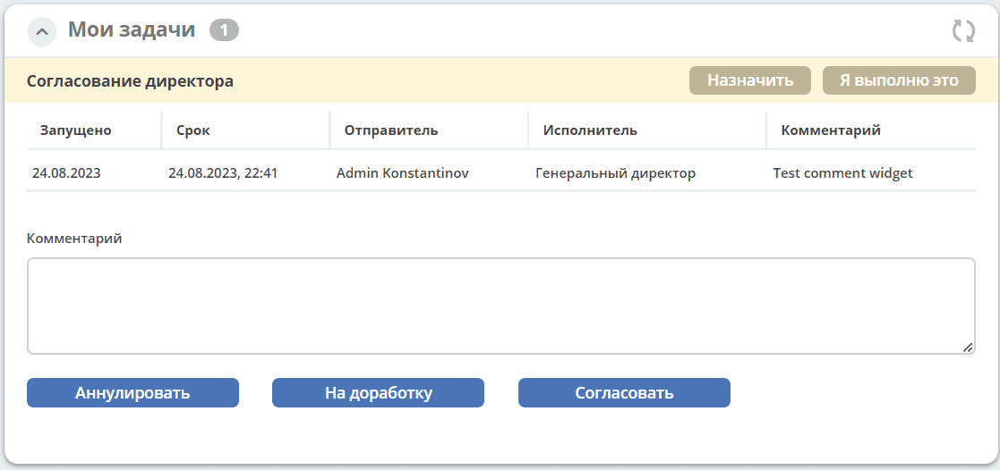

.. _widget_current_tasks:

Виджет «Мои задачи»
====================

Ключ ``tasks``

Виджет отображает активные задачи по данному кейсу у просматривающего его пользователя и варианты их завершения.

Для каждой задачи показаны название, дата запуска, срок, отправитель, исполнитель и комментарий. В широком виджете сведения представлены таблицей, в узком — списком полей. В заголовке виджета отображается количество задач.

В виджет встроена форма каждой задачи. Заполните необходимые поля и выберите доступный вариант завершения. Состав полей, их обязательность и кнопки завершения определяются формой задачи и настройками процесса.

В зависимости от разрешений задачи также могут быть доступны действия:

* взять задачу себе;
* вернуть задачу в группу;
* переназначить задачу;
* назначить исполнителя.

См. подробнее в разделе :ref:`Работа с задачами <work_with_tasks>`.

После отправки формы или изменения назначения данные документа и связанные виджеты задач обновляются. Для повторной загрузки списка и формы используйте действие обновления в меню виджета.
