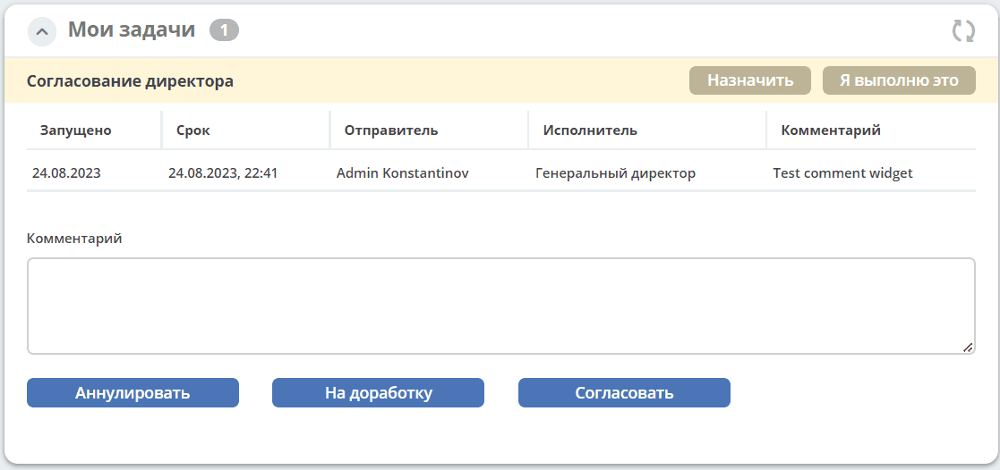

.. _widget_current_tasks:

Виджет «Мои задачи»
====================

Ключ ``tasks``

Виджет отображает активные задачи по данному кейсу у просматривающего его пользователя и варианты их завершения.

