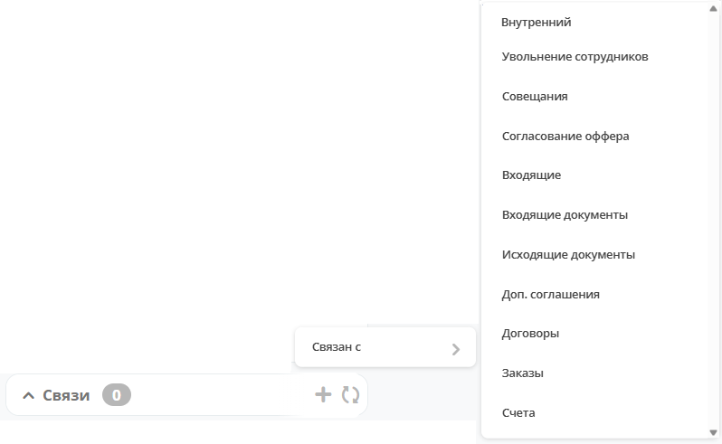
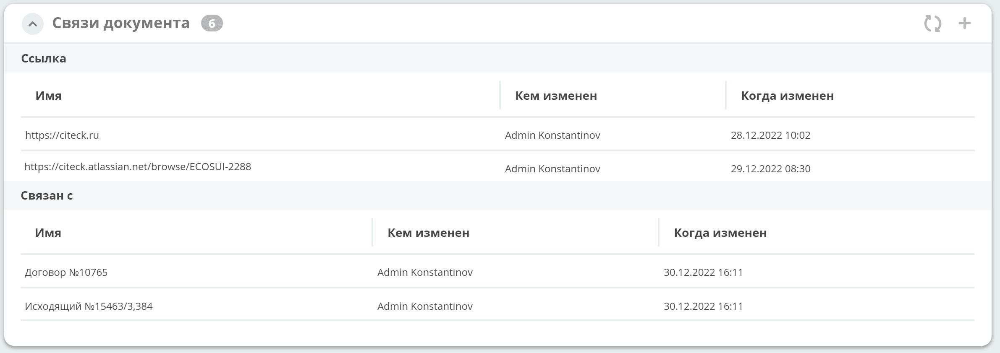

.. _widget_doc_associations:

Виджет «Связи документа»
===============================================

Ключ ``doc-associations``

Виджет используется для просмотра и установки связей текущего документа с другими записями. Он показывает связи, настроенные для типа данных документа:

Установленные связи отображаются группами по виду связи. Колонки таблицы определяются журналом целевого типа; если подходящая конфигурация отсутствует, используются заголовок и дата создания.

Настройки
---------

Настройки производятся на вкладке :ref:`Связи <datatypes_associations>` типа данных. Для связи задаются идентификатор, атрибут, имя, направление и целевой тип. Для выбора существующих записей также нужны журналы — указанные явно или полученные из целевого типа.

Наличие атрибута типа ASSOC само по себе не означает, что он появится в виджете. Используется список связей из конфигурации типа с учётом наследования. Связи без целевого типа, а обычные связи также без доступной конфигурации журналов, исключаются из этого списка.

Направления связи:

- **TARGET** — прямая связь: текущий документ ссылается на выбранные записи.
- **SOURCE** — обратная связь: выбранные записи ссылаются на текущий документ.
- **BOTH** — отображение прямых и обратных связей. Этот режим не означает автоматического создания двух отдельных связей.

Изменения сохраняются с проверкой серверных прав. Для обратной связи может потребоваться право изменения выбранной записи, а не только текущего документа.

Добавление существующих записей
--------------------------------

1. Нажмите кнопку добавления связи.
2. Выберите вид связи и журнал в открывшемся меню.
3. Выберите одну или несколько существующих записей и подтвердите выбор.

В этом окне кнопка создания записи скрыта. Поиск не ограничивается только текущим рабочим пространством, но продолжает учитывать настройки журнала и серверные права доступа.

Создание дочерней записи
-------------------------

Для дочерней связи (``child: true``) используется создание записи целевого типа. При настроенном единственном варианте создания выбор пункта связи открывает соответствующую форму. Созданная запись получает текущий документ как родителя, а атрибут связи — как родительскую ассоциацию.

Если доступных вариантов создания нет, пункт дочерней связи отключён. Настройку дочерней связи следует отличать от выбора существующих записей через журнал.

Просмотр и удаление связи
--------------------------

Для связанной записи доступны действия просмотра и удаления связи:

- **Просмотр** открывает карточку связанной записи через действие просмотра.
- **Удаление связи** запрашивает подтверждение и удаляет значение из атрибута связи. Для обычной связи это следует отличать от удаления самого связанного документа.

Для дочерних отношений последствия удаления связи определяются серверной моделью жизненного цикла. Возможность выполнить операцию зависит от прав на изменяемую запись; наличие кнопки в виджете не гарантирует разрешения на сохранение.
