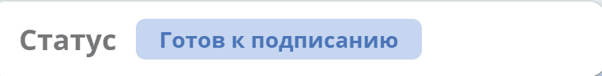
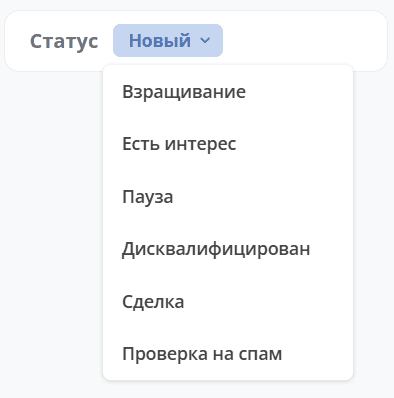

.. _widget_doc-status:

Виджет «Статус»
====================

Ключ ``doc-status``

Виджет отображает текущий статус кейса и позволяет изменить его, если это разрешено настройками виджета и для пользователя доступны другие статусы.

Для современных записей название статуса берётся из модели типа данных с учётом наследования. Если статус не задан или его идентификатор не найден в модели, отображается **«Нет статуса»**.

При настройке дашборда в параметрах виджета можно включить опцию **«Разрешить изменение статуса»** (``allowChangeStatus``). По умолчанию она выключена. В конфигурации артефакта параметр задаётся как ``config.v2.allowChangeStatus``.

При включении опции и наличии доступных для выбора статусов в виджете появляется выпадающий список (шеврон). Если список доступных статусов пуст, изменение недоступно.

Для современных записей при наличии права **Write** список содержит статусы типа данных, кроме текущего. Сам виджет не фильтрует переходы по схеме бизнес-процесса; дополнительные ограничения могут проверяться при сохранении на сервере. Для записей Alfresco список определяется отдельным серверным запросом.

Выбор нового статуса сохраняет его непосредственно в записи. Для смены статуса у пользователя должны быть права на редактирование записи. Дополнительные проверки и действия при изменении статуса могут быть реализованы на сервере и в бизнес-процессах, реагирующих на события.

Отдельное подтверждение не требуется. Во время сохранения выбор блокируется и отображается индикатор. После успеха статус и список вариантов обновляются; при ошибке возвращается прежнее отображение статуса и выводится уведомление.

