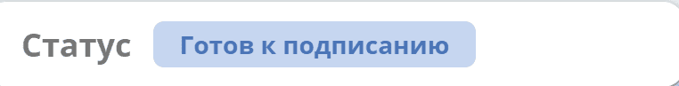
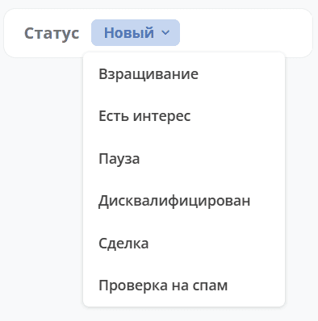

.. _widget_doc-status:

Виджет «Статус»
====================

Ключ ``doc-status``

Виджет отображает текущий статус кейса и позволяет изменить его, если это разрешено настройками виджета и для пользователя доступны другие статусы.

В настройках виджета можно включить опцию **«Разрешить изменение статуса»** (``allowChangeStatus``). По умолчанию она выключена.

При включении опции и наличии доступных для выбора статусов в виджете появляется выпадающий список (шеврон). Если список доступных статусов пуст, изменение недоступно.

Выбор нового статуса сохраняет его непосредственно в записи. Для смены статуса у пользователя должны быть права на редактирование записи. Дополнительные проверки и действия при изменении статуса могут быть реализованы на сервере и в бизнес-процессах, реагирующих на события.

