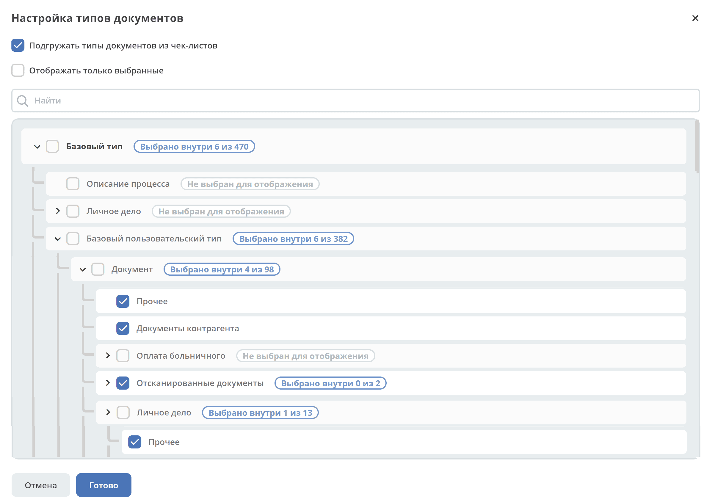
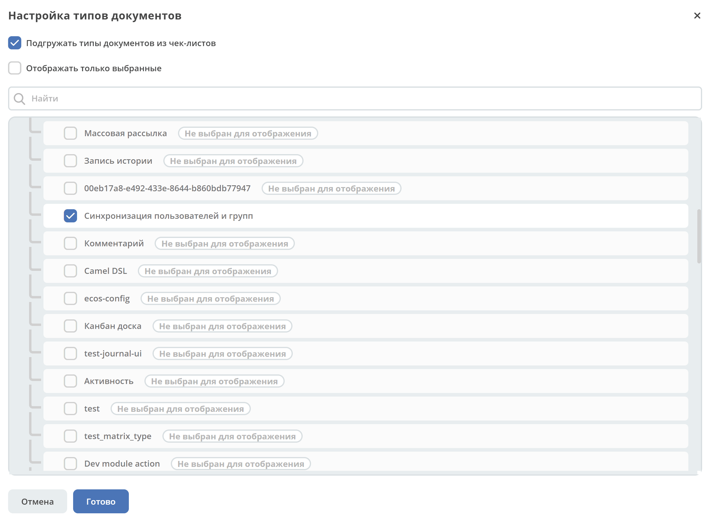
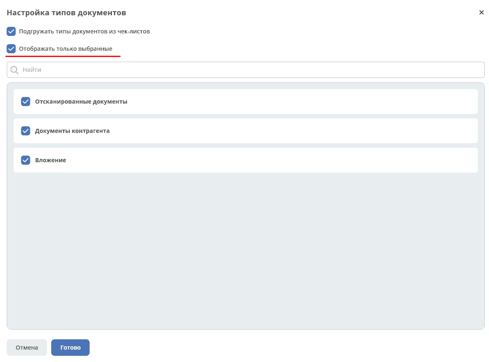
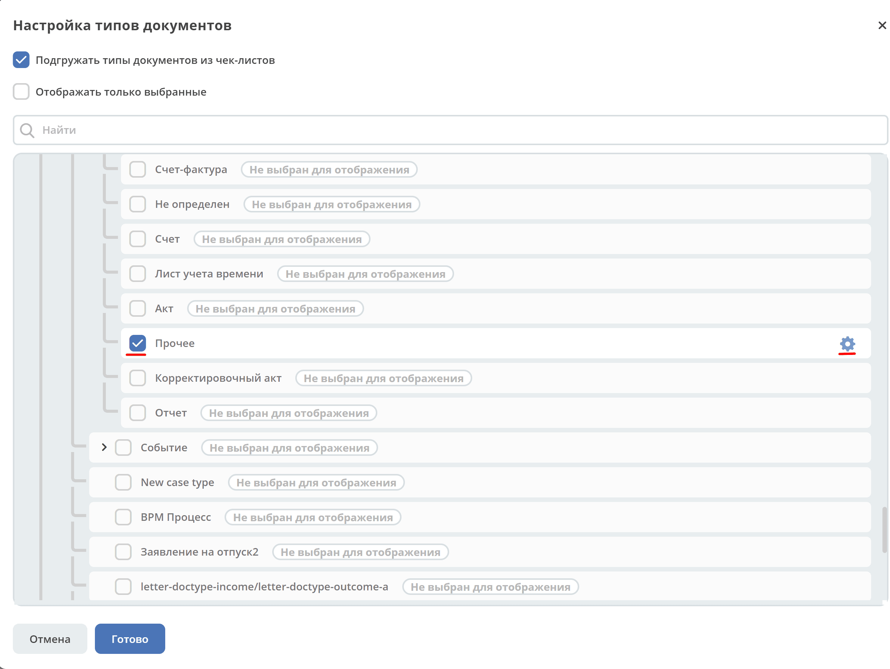
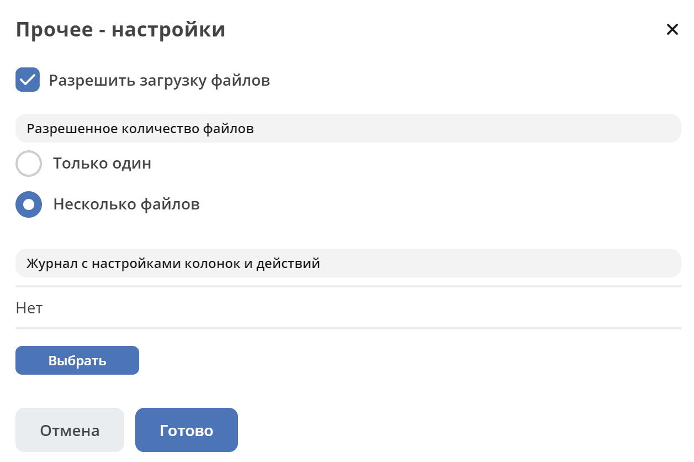
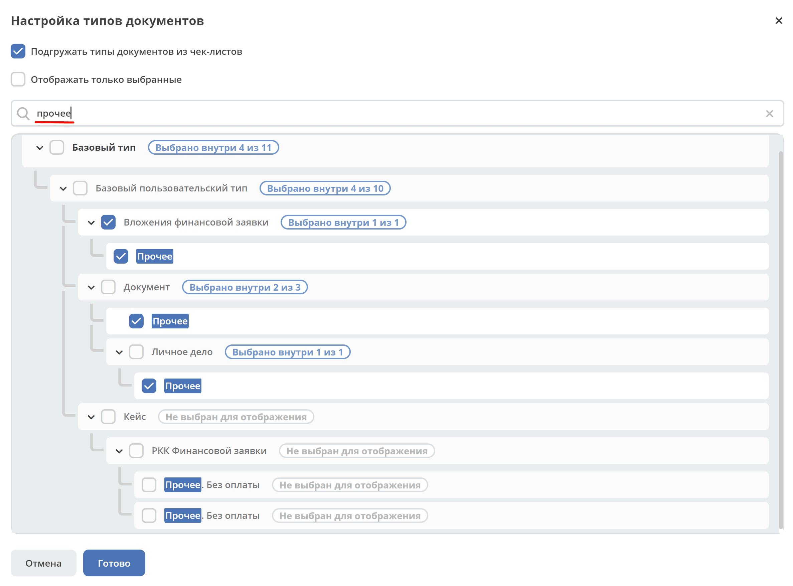
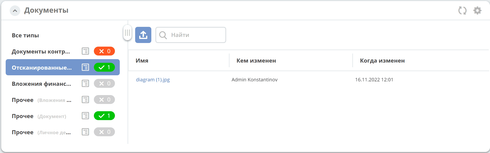
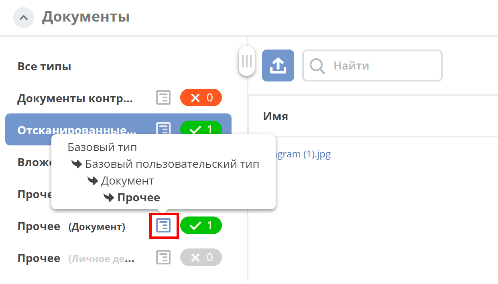
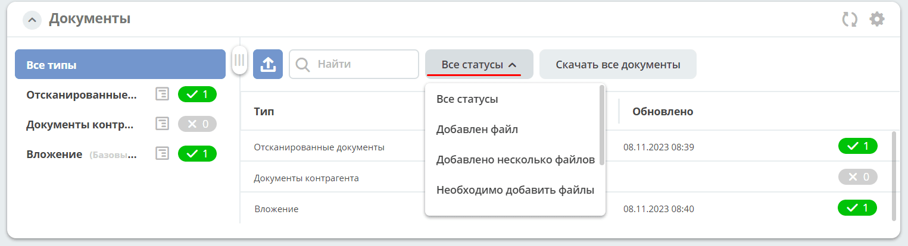
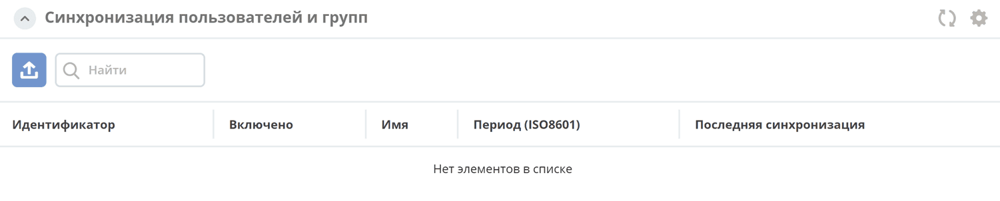

.. _widget_documents:

Виджет «Документы»
================================================================================

Ключ ``documents``

Виджет служит для загрузки и отображения сопутствующих документов и записей с группировкой по настроенным типам. Его использование в административной карточке интеграции не означает, что сам виджет выполняет синхронизацию пользователей и групп; эти операции определяются соответствующим серверным сервисом.

Описание сверено с исходниками ``ecos-ui:2.32.0-snapshot``. Ниже показан интерфейс в версии для компьютера. На мобильных устройствах расположение элементов отличается. Возможность загрузки зависит от настроек выбранного типа и доступности соответствующих операций.

Настройка
--------------------------------------------------------------------------------

В окне настройки выберите типы, документы которых должны отображаться в виджете. Если в дереве настройки один корневой тип (на скриншоте — **Базовый тип**), он раскрывается по умолчанию:

**Документы**

**Пример административной карточки «Синхронизация пользователей»**

Флаг **Подгружать типы документов из чек-листов** дополняет настроенные типы данными чек-листов текущей записи.

Флаг **Отображать только выбранные** фильтрует дерево в окне настройки: в нём остаются только отмеченные типы. Сам состав типов виджета задаётся чекбоксами типов и сохраняется кнопкой **Готово**. Для заблокированных типов изменение выбора недоступно.

После выбора типа чекбоксом становится доступен значок настройки в его строке. Нажмите его, чтобы открыть параметры типа:

Параметры типа:

.. list-table::
   :widths: 35 65
   :class: tight-table
   :header-rows: 1

   * - Поле
     - Назначение
   * - **Разрешить загрузку файлов**
     - Разрешает загрузку файлов для выбранного типа.
   * - **Разрешённое количество файлов**
     - **Только один** или **Несколько файлов**. При выборе одного файла повторная загрузка при уже существующем документе может выполняться как обновление его версии.
   * - **Журнал с настройками колонок и действий**
     - Журнал, из которого берутся колонки и действия для таблицы выбранного типа. Если журнал не указан, конфигурация колонок запрашивается по типу. Это не означает полного совпадения возможностей таблицы с обычным журналом.

Подтвердите параметры типа кнопкой **Готово**, затем сохраните общий выбор в окне настройки типов.

При поиске раскрываются ветви с найденными типами, а совпадения в названиях подсвечиваются:

Настроенный вид
--------------------------------------------------------------------------------

**Документы:**

Для различения одноимённых типов рядом с названием используется контекст родительского типа. Этот же контекст включается во всплывающую подсказку, которая показывается при необходимости. Полная цепочка предков в ней не выводится:

Скачивание документов
--------------------------------------------------------------------------------

Кнопка **Скачать все документы** запрашивает ZIP-архив для списка документов, сформированного виджетом. При выбранном типе используются записи его текущей таблицы; в общем представлении — документы из загруженных групп типов. Кнопка недоступна, пока список подготавливается, во время скачивания и при отсутствии документов.

Эта операция не означает скачивание всех документов карточки независимо от конфигурации виджета или всех исторических версий файлов.

Фильтрация по заполненности типов
--------------------------------------------------------------------------------

В представлении **Все типы**, когда настроено более одного типа и конкретный тип не выбран, доступен фильтр **Все статусы**. Он отражает наличие файлов и обязательность заполнения типа, а не статус жизненного цикла документа или бизнес-процесса:

.. list-table::
   :widths: 35 65
   :class: tight-table
   :header-rows: 1

   * - Состояние
     - Условие
   * - **Все статусы**
     - Без ограничения по заполненности.
   * - **Добавлен файл**
     - Для типа есть один документ.
   * - **Добавлено несколько файлов**
     - Для типа есть более одного документа.
   * - **Необходимо добавить файл** / **Необходимо добавить файлы**
     - Документов нет, тип обязательный. Формулировка зависит от разрешённого количества файлов.
   * - **Можно добавить файл** / **Можно добавить файлы**
     - Документов нет, тип необязательный. Формулировка зависит от разрешённого количества файлов.

**Пример виджета в административной карточке «Синхронизация пользователей»:**

