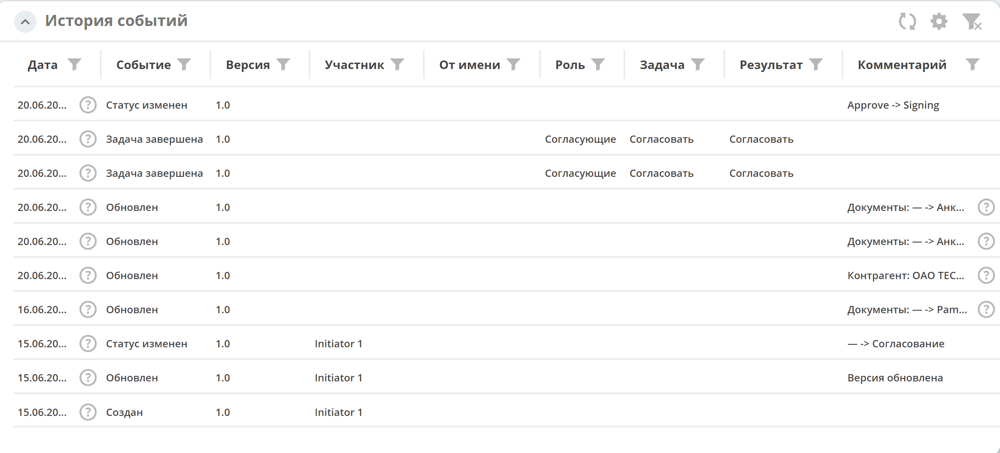
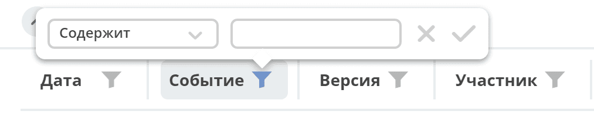
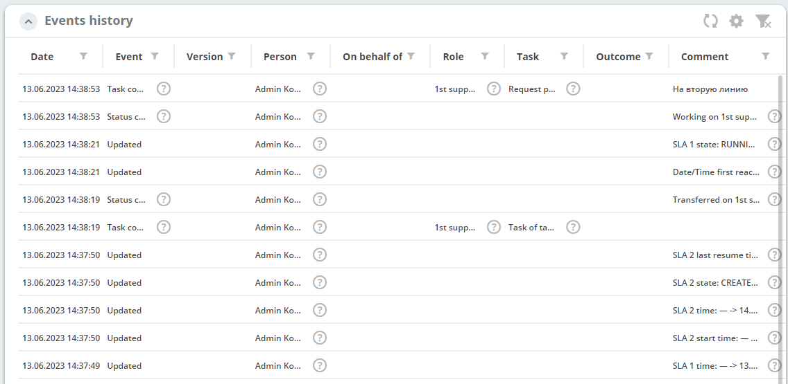
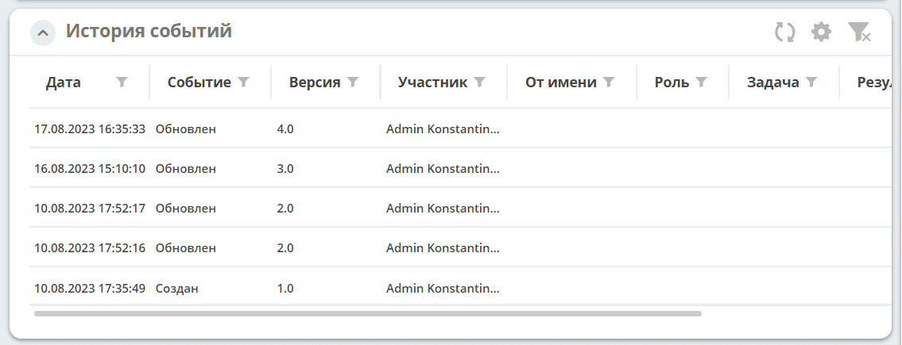

.. _widget_events-history:

Виджет «История событий»
===============================================

Ключ ``events-history``

Виджет отображает записанные события документа, например создание, обновление и смену статуса. Состав событий и полей — дата и время, участники, комментарии и другие сведения — зависит от источника истории и выбранного журнала.

В широком представлении на компьютере используется таблица, в узком и мобильном — карточки событий.

В табличном представлении для поддерживающих фильтрацию столбцов можно задать условия поиска событий:

Отображение мультиязычных значений зависит от данных истории и форматирования столбцов выбранного журнала. Пример:

Настройки и обновление
----------------------------------------

В настройках виджета можно выбрать **«Журнал»**, определяющий источник данных, столбцы и их форматирование. Если журнал не задан, используется ``history-records-widget``. Для применения выбора нажмите **«Сохранить»**, для выхода без сохранения — **«Отмена»**.

Выбранный журнал должен поддерживать отбор по атрибуту ``document``: виджет добавляет условие по текущей записи.

В меню виджета доступны обновление данных и действие **«Очистить фильтр»**. Очистка снимает пользовательские условия, сохраняя привязку истории к текущему документу.

Для BPMN-процесса
------------------

При настроенной серверной записи истории процесса в журнале могут отображаться:

       - Создание процесса;
       - Обновление версии процесса, в том числе с указанием исходной версии;
       - Публикация версии процесса в движок.

Используя аспект :ref:`Конфигурация истории <history-config_aspect>`, можно настроить исключение изменений отдельных атрибутов из серверной записи истории. Виджет отображает результат этой записи через выбранный журнал. Изменение настройки не следует считать удалением ранее сохранённых событий.
