.. _widget_graphic_statistics:

Виджет «Графическая статистика»
===============================================

.. contents::
   :depth: 3

.. note::

    Доступно только в enterprise версии.

Ключ ``charts``

Виджет позволяет пользователям наглядно представлять и анализировать данные, повышая эффективность принятия решений и улучшая понимание текущего состояния бизнес-процессов.

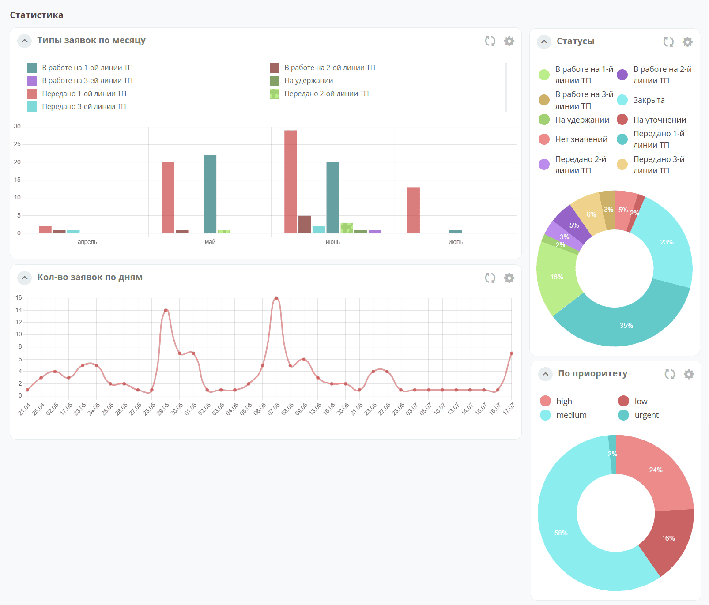

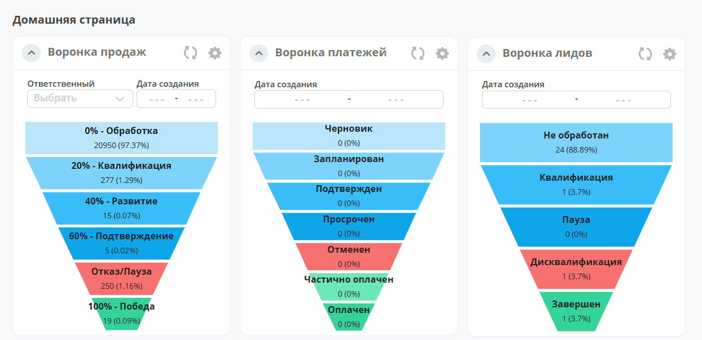

Для столбчатых, линейных и круговых графиков использована библиотека `Chart.js <https://www.chartjs.org/docs/latest/>`_. Воронка имеет отдельную реализацию.

Виджет поддерживает различные типы графиков: линейные, столбчатые, круговые, воронки. Пользователи могут выбирать источник данных для графика, включая определенные атрибуты, колонки, связанные с кейсами и справочниками платформы Citeck.

**Таблицы отчётности.** Табличные отчёты строятся посредством журналов: группировка по одной или нескольким колонкам, агрегация (сумма, среднее, минимум, максимум, количество записей), сохранение настроек в шаблон и выгрузка в Excel (см. :ref:`Группировка журнала <journal_group>` и :ref:`Выгрузка данных журнала <journal_data_export>`). Таблицу и графики по тем же данным можно разместить на одном дашборде: таблицу — виджетом :ref:`«Журнал» <widget_journal>`, графики — виджетом «Графическая статистика».

Настройки зависят от типа графика. Для столбчатого и линейного графиков доступны границы вертикальной шкалы и соотношение ширины к высоте, для кругового — размер центрального выреза, для воронки — отображаемые стадии и их цвета.

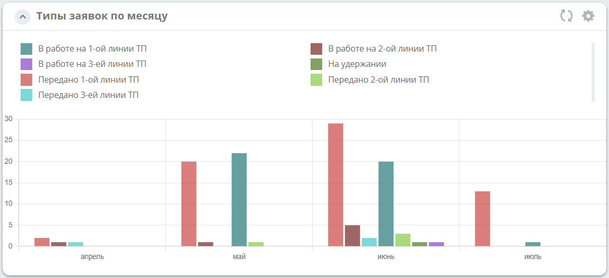

В столбчатом и линейном графиках нажатие на пункт легенды скрывает соответствующий набор данных, в круговом — сектор. Повторное нажатие возвращает данные на график:

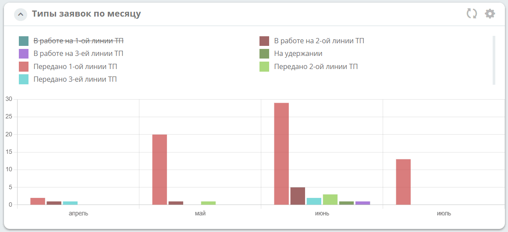

Общая конфигурация
------------------

Для всех типов графиков:

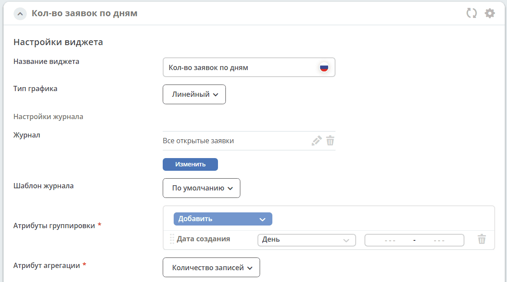

.. list-table::
      :widths: 10 40
      :class: tight-table

      * - **Название виджета**
        - Укажите название виджета. Поддерживаются названия на нескольких языках.
      * - **Тип графика**
        - |  Выберите тип из списка:
          |  - Столбчатый
          |  - Круговой
          |  - Линейный
          |  - Воронка
      * - **Настройки журнала**
        -
      * - **Журнал**
        - |  Выберите журнал, по данным которого необходимо построить график.
          |  В выбранном журнале должны быть заранее настроены колонки для группировки. Действие доступно для администратора.

          | Для разрешения группировки перейдите в журнале к необходимому столбцу, нажмите **Дополнительно**:

              .. image:: ../_static/widgets/chart_sett_01.png
                     :width: 500
                     :align: center

          | Выставите чекбокс **Можно ли группировать**:

              .. image:: ../_static/widgets/chart_sett_02.png
                     :width: 500
                     :align: center

      * - **Шаблон журнала**
        - Выберите шаблон журнала. Также доступен стандартный вариант с условиями отбора выбранного журнала.
      * - **Атрибуты группировки**
        - | **Группировка** -  операция объединения данных в группы таким образом, чтобы у элементов в каждой группе был общий атрибут.
          | Нажмите **"Добавить"** и выберите из списка атрибуты, по которым производить группировку данных.
          | В списке представлены атрибуты, у которых в настройках разрешена группировка.
          | Необходимо выбрать хотя бы один атрибут. Атрибуты можно удалять и менять их порядок.
      * - **Атрибут агрегации**
        - Выберите количество записей или числовую колонку для расчёта суммы. Колонка, уже выбранная для группировки, исключается из списка агрегации.
      * - **Скрыть легенду**
        - Скрывает легенду столбчатого, линейного или кругового графика. Для воронки эта настройка недоступна.

Для сохранения настроек необходимо выбрать журнал, хотя бы один атрибут группировки и агрегат. При смене журнала группировка, агрегат и выбранный шаблон сбрасываются.

Столбчатый
~~~~~~~~~~

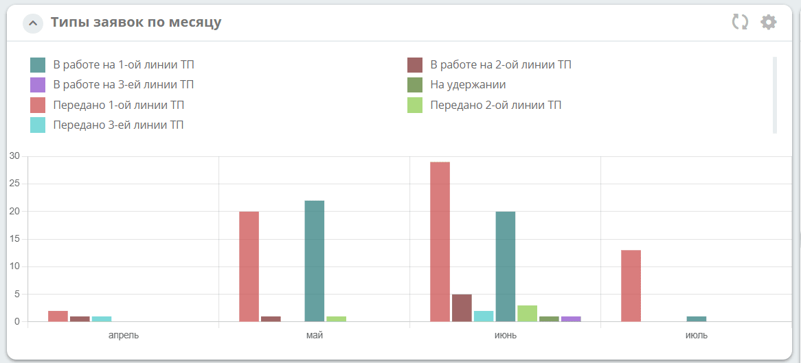

**Столбчатый график** — диаграмма, представленная прямоугольными зонами (столбцами), высоты или длины которых пропорциональны величинам, которые они отображают.

Настройка:

.. list-table::
      :widths: 10 40
      :name: Настройки столбчатого графика
      :class: tight-table

      * - **Минимальное вертикальное значение**
        - Минимальное значение, отображаемое на вертикальной шкале
      * - **Максимальное вертикальное значение**
        - Максимальное значение, отображаемое на вертикальной шкале
      * - **Соотношение сторон x/y**
        - Отношение ширины области графика к её высоте. По умолчанию 2. При увеличении значения график становится шире относительно высоты.

С помощью параметра **Соотношение сторон x/y** и подбора пропорций график можно выровнять по высоте. Примеры различных величин соотношений сторон:

.. list-table::
      :widths: 5 30
      :align: center

      * - **2:**
        - |

            .. image:: ../_static/widgets/chart_6.png
                  :width: 600
                  :align: center

      * - **4:**
        - |

            .. image:: ../_static/widgets/chart_7.png
                  :width: 600
                  :align: center

Линейный
~~~~~~~~

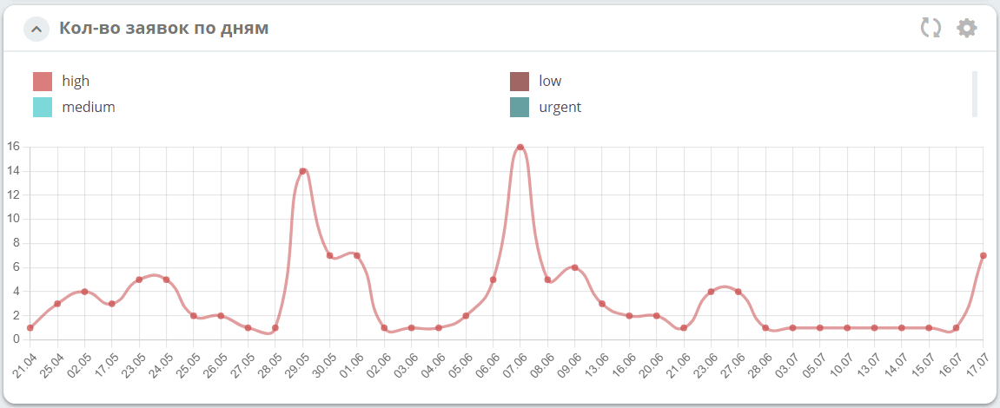

**Линейный график** позволяет размещать данные в виде точек на линии. Используется для того, чтобы отразить изменение показателей с течением времени, или же для сравнения двух наборов данных.

Настройка:

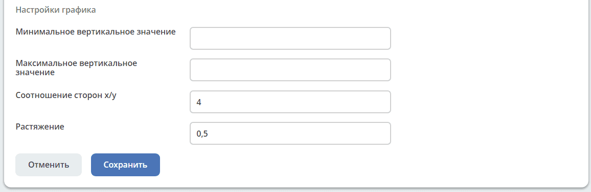

.. list-table::
      :widths: 10 40
      :name: Настройки линейного графика
      :class: tight-table

      * - **Минимальное вертикальное значение**
        - Минимальное значение, отображаемое на вертикальной шкале
      * - **Максимальное вертикальное значение**
        - Максимальное значение, отображаемое на вертикальной шкале
      * - **Соотношение сторон x/y**
        - Отношение ширины области графика к её высоте. По умолчанию 2. При увеличении значения график становится шире относительно высоты.
      * - **Растяжение**
        - Параметр сглаживания линии. В форме исходное значение — 0; в текущей реализации при отрисовке задано значение 0,4, поэтому изменение поля может не влиять на вид линии.

Круговой
~~~~~~~~

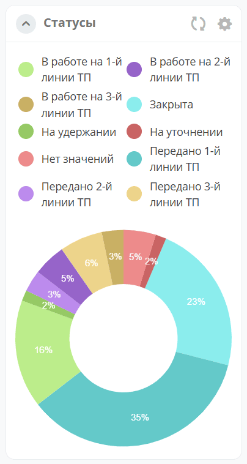

**Круговой график** представляет данные в виде круга, разделенного на сектора. Каждый сектор — категория данных, которая составляет долю от общей суммы.

Настройка:

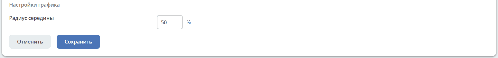

.. list-table::
      :widths: 10 40
      :name: Настройки кругового графика
      :class: tight-table
      :align: center

      * - **Радиус середины**
        - Радиус центрального круга, в процентах от радиуса основного. По умолчанию 50 %.

Воронка
~~~~~~~

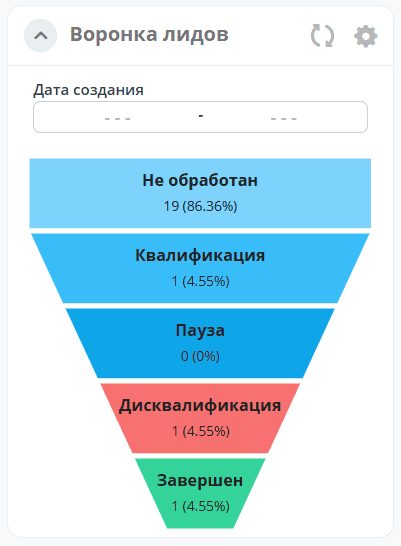

**Воронка** показывает значения выбранного агрегата по стадиям: количество записей или сумму числового поля. Процент рассчитывается от суммы значений видимых стадий с учётом выбранных фильтров. Форма воронки сужается по числу стадий; ширина уровня не пропорциональна значению агрегата.

Такое представление позволяет сравнивать стадии, но само по себе не показывает, что одни и те же записи последовательно прошли все этапы, и не рассчитывает конверсию между ними.

При нажатии на уровень открывается выбранный журнал с фильтром по этой стадии.

Настройка:

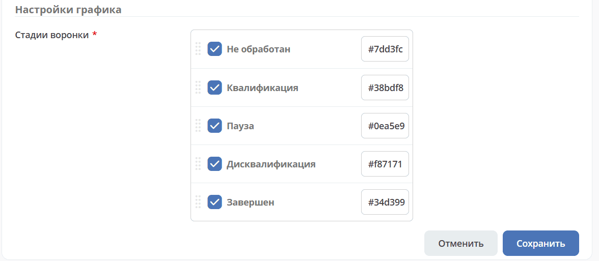

.. list-table::
      :widths: 10 40
      :name: Настройки воронки
      :class: tight-table
      :align: center

      * - **Стадии воронки**
        - Выбор видимых стадий, их порядка и цветов отображения.

Список стадий определяется первым атрибутом группировки: ``_stage`` — стадии типа данных, ``_status`` — статусы. В текущей реализации отображение значений обращается к ``_stage``; вариант с ``_status`` требует проверки на используемой версии.

Остальные атрибуты группировки определяют дополнительные фильтры: для дат — диапазон, для других атрибутов — выбор значения. Например, при соответствующей настройке доступны:

.. grid:: 2
   :gutter: 2

   .. grid-item::

      Выбор ответственного с функцией поиска:

      .. image:: ../_static/widgets/chart_15.png
         :width: 280
         :align: center

   .. grid-item::

      Выбор периода дат:

      .. image:: ../_static/widgets/chart_16.png
         :width: 350
         :align: center

Что полезно знать при настройке
---------------------------------

**Агрегация — количество или сумма.** В ручной форме доступны количество записей и сумма числового поля: например, суммы договора или расходов. Среднее, минимум и максимум отдельными вариантами в этой форме не представлены.

**Период группировки по дате задаётся в самом виджете.** Для колонки с датой можно выбрать день, неделю, месяц, квартал или год и ограничить диапазон дат. Отдельное поле «день» или «месяц» в типе данных для графика заводить не нужно.

**Ссылка на дашборд с графиками.** Дашборд открывается адресом ``/v2/dashboard?dashboardId=<идентификатор дашборда>``. Такую ссылку можно добавить в :ref:`меню <menu>` пунктом типа **Произвольный**, чтобы график открывался из любого раздела.

Настройка виджета в артефакте дашборда
----------------------------------------

Дашборд можно не только собрать в интерфейсе, но и поставить артефактом ``ui/dashboard``. В этом случае настройки виджета задаются в конфигурации вручную, а значения, которые в интерфейсе выбираются списком, приходится указывать точными идентификаторами.

Виджет описывается элементом с именем ``charts``; в ``props.config`` задаются:

.. list-table::
      :header-rows: 1
      :widths: 25 75
      :class: tight-table

      * - Свойство
        - Значение
      * - ``title``
        - Название виджета: строка или объект с переводами по кодам языков
      * - ``graphicTypeId``
        - Тип графика: ``vertical-bar`` (столбчатый), ``doughnut`` (круговой), ``line`` (линейный), ``funnel`` (воронка)
      * - ``journalId``
        - Ссылка на журнал, например ``uiserv/journal@deals-journal``
      * - ``typeRef``
        - Тип данных, записи которого показывает журнал
      * - ``groupByParams``
        - Список атрибутов группировки; у атрибута с датой указываются ``isDateColumn: true`` и период в ``dateParam``
      * - ``aggregationParam``
        - Выражение агрегации, например ``count(*)`` или ``sum(amount)``
      * - ``selectedPreset``
        - Выбранный шаблон журнала. Ручная форма сохраняет его идентификатор; AI-сервис для нового графика задаёт объект ``{"id": "default"}``
      * - ``journalPredicate``
        - Исходные условия отбора журнала, сохраняемые вместе с настройками
      * - ``isHideLegends``
        - Скрытие легенды столбчатого, линейного или кругового графика
      * - ``vertical-bar``, ``line``, ``doughnut`` или ``funnel``
        - Объект индивидуальных настроек соответствующего типа графика. Для воронки включает список ``stages``

.. important::

   Идентификатор типа графика должен в точности совпадать с одним из четырёх значений выше. При другом значении виджет отображается пустым — заголовок есть, графика нет, сообщения об ошибке тоже.

.. note::

   Собственный идентификатор дашборда задаётся именно в артефакте: при создании записи через API идентификатор назначает платформа, а попытка указать свой приводит к ошибке ``Dashboard with id … is not found``.

Настройка графиков через AI-ассистента
--------------------------------------

Если пользователь явно просит дашборд с графиками, AI-ассистент добавляет на него один или несколько виджетов «Графическая статистика». Для каждого графика ассистент задаёт заголовок, вид графика, группировку и агрегат. Примеры запросов:

* «Сделай дашборд для типа Сделка с графиком количества записей по статусам».
* «Добавь на дашборд линейный график суммы договоров по месяцам даты заключения».
* «На одной вкладке покажи два графика: количество по статусам и сумму по ответственным».

Ассистент соблюдает следующие правила:

* **Вид графика** — одно из четырёх значений ``graphicTypeId``, перечисленных выше: столбчатый, круговой, линейный или воронка.
* **Агрегат** — количество записей, сумма или среднее. Для количества числовое поле не требуется, а сумма и среднее строятся только по числовому атрибуту.
* **Группировка** — по часу, дню, неделе, месяцу, кварталу или году допускается только для атрибута с датой. Для такой группировки можно дополнительно ограничить диапазон дат.
* **Ссылки на тип данных** (``typeRef``) и **журнал** (``journalId``) — ассистент не указывает: их подставляет сам AI-сервис при сборке артефакта.

Структура конфигурации проверяется до развёртывания. При проверке по опубликованной модели типа дополнительно отклоняются несуществующие атрибуты, группировка по времени для атрибута без даты и сумма или среднее для нечислового атрибута.

AI-конфигурация допускает среднее и группировку по часу, хотя в ручной форме эти варианты отсутствуют. Для одного графика задаётся один диапазон дат. Если нужны отдельные интервалы, например «до 30», «30–60» и «60–90 дней», ассистенту следует запросить несколько графиков с разными диапазонами.

При добавлении графика на существующий дашборд остальные графики сохраняются вместе со своими настройками, включая выбранный шаблон журнала. Явный запрос на удаление графика допускает его удаление. Перед публикацией ассистент показывает карточку подтверждения, в которой для каждого графика указаны название, вид, агрегат и группировка; публикацию можно отменить.
