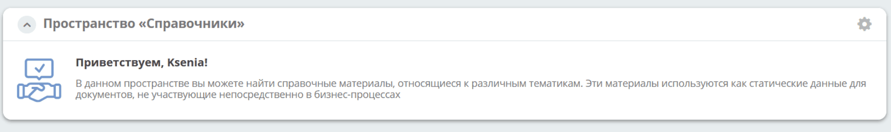

.. _widget_html:

Виджет «HTML»
===============================================

Ключ ``html``

.. note::

   Редактирование виджета доступно **менеджеру** текущего рабочего пространства или пользователю с правом его изменения, в том числе **администратору**.

Виджет позволяет разместить на дашборде информационный блок с HTML-разметкой. Содержимое можно подготовить в :ref:`WYSIWYG-редакторе <wysiwyg_editor>` или в редакторе исходного HTML.

В настройках задаются:

* **Название виджета** — заголовок информационного блока.
* **Включить режим WYSIWYG** — переключение между визуальным редактором и исходным HTML.
* **Содержимое** — текст и оформление для выбранного языка.

Название и содержимое заполняются отдельно для русского и английского языков. Автоматического перевода нет. Если содержимое для текущего языка интерфейса не задано, виджет показывает сообщение **«Настройте контент для данного виджета»**.

После редактирования нажмите **«Сохранить»**, чтобы применить изменения, или **«Отменить»**, чтобы закрыть редактор без сохранения.

.. list-table::
      :widths: 5 40
      :class: tight-table

      * - | **Настройка**

        - |  с использованием редактора:

            .. image:: ../_static/widgets/html_3.png
                 :width: 600
                 :align: center

          |  без использования редактора:

            .. image:: ../_static/widgets/html_4.png
                 :width: 600
                 :align: center

      * - | **Настроенный вид**

        - |

            .. image:: ../_static/widgets/html_1.png
                 :width: 600
                 :align: center

Пример использования:

**Приветственный блок** — информация для знакомства пользователя с функциональностью рабочих пространств:

