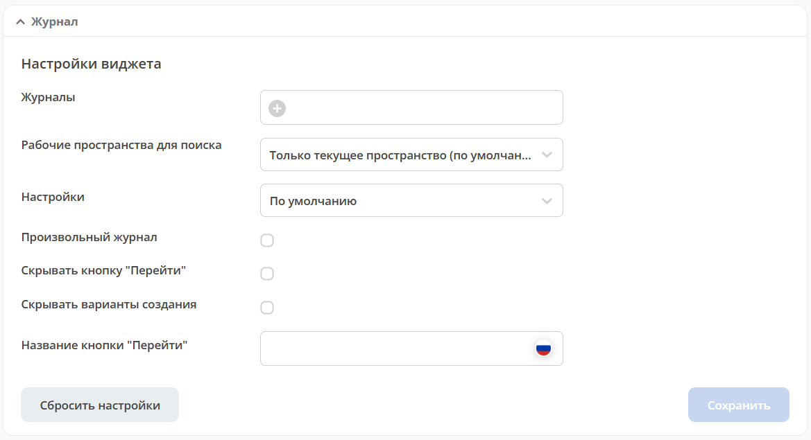
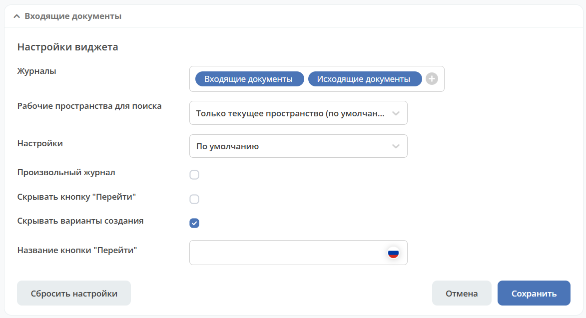
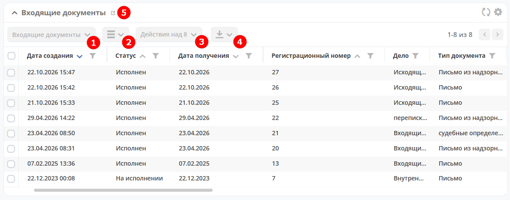

.. _widget_journal:

Виджет «Журнал»
================================================================================

Ключ ``journal``

Виджет отображает записи выбранного журнала на дашборде или в карточке записи. Можно настроить несколько журналов и переключаться между ними внутри виджета.

Описание сверено с исходниками ``ecos-ui:2.32.0-snapshot``.

Настройка
--------------------------------------------------------------------------------

.. list-table::
   :widths: 20 60
   :class: tight-table
   :header-rows: 1

   * - Поле
     - Описание
   * - **Журналы**
     - Выберите один или несколько журналов. Если выбрано несколько, в виджете появляется переключатель; записи разных журналов не объединяются в одну таблицу.
   * - **Рабочие пространства для поиска**
     - Политика выбора пространств, в которых выполняется поиск. По умолчанию в редакторе выбрано **Только текущее пространство**. Поле доступно при включённом механизме рабочих пространств. Варианты описаны ниже.
   * - **Дополнительные рабочие пространства для поиска**
     - Список пространств для политик **Текущее и дополнительные пространства** и **Только дополнительные пространства**. При других политиках поле не отображается.
   * - **Настройки**
     - Шаблон настроек, применяемый к журналу. В режиме **Произвольный журнал** это поле скрыто.
   * - **Произвольный журнал**
     - Переключает форму на ввод идентификатора журнала вместо выбора из списка. В контексте записи поддерживается шаблон с подстановками её атрибутов. Отображаемое название журнала не заменяет его идентификатор.
   * - **Скрывать кнопку "Перейти"**
     - Принудительно скрывает переход к полной странице журнала. При выключенном флаге доступность перехода также зависит от ширины и режима виджета.
   * - **Скрывать варианты создания**
     - Скрывает кнопку или меню создания записей. При выключенном флаге они отображаются только при наличии вариантов создания у журнала.
   * - **Название кнопки "Перейти"**
     - Многоязычное название кнопки перехода. Текст отображается в соответствии с текущим языком интерфейса.

Поиск по рабочим пространствам
--------------------------------------------------------------------------------

В поле **Рабочие пространства для поиска** доступны следующие политики:

.. list-table::
   :widths: 35 65
   :class: tight-table
   :header-rows: 1

   * - Политика
     - Область поиска
   * - **Только текущее пространство**
     - Текущее рабочее пространство. Значение по умолчанию при настройке виджета в редакторе.
   * - **Все пространства**
     - Все доступные рабочие пространства с учётом серверных ограничений доступа.
   * - **Текущее и дополнительные пространства**
     - Текущее пространство и пространства из дополнительного списка.
   * - **Только дополнительные пространства**
     - Пространства, явно выбранные в дополнительном списке.

Для поиска во всех пространствах выберите соответствующую политику. Пустой список дополнительных пространств сам по себе не задаёт область поиска: она зависит от выбранной политики. Для ранее сохранённых конфигураций без явной политики могут действовать правила совместимости.

Произвольный журнал
--------------------------------------------------------------------------------

Включите **Произвольный журнал** и укажите ID нужного журнала. В этом режиме обычный выбор журналов, шаблона настроек и политики пространств скрыт. Переключение режима очищает выбор журналов и значение поля произвольного журнала; заполните нужное поле заново перед сохранением.

Если виджет размещён в контексте записи, идентификатор может содержать подстановки вида ``${attribute}``, где ``attribute`` — атрибут текущей записи. Без контекста записи такие подстановки не разрешаются.

Связанные записи
--------------------------------------------------------------------------------

При размещении виджета в карточке записи доступны дополнительные настройки:

* Для журналов, выбранных из списка, можно включить **Отображать только связанные записи** отдельно для каждого журнала и выбрать атрибуты связи. Если ограничение включено, атрибуты необходимо заполнить для сохранения настройки.
* В режиме **Произвольный журнал** доступен общий флаг **Отображать только связанные записи**. При построении обратного фильтра используются доступные для поиска ассоциативные колонки журнала.

На дашборде без контекста записи эти настройки не отображаются.

Настроенный вид
--------------------------------------------------------------------------------

- **1** - Выбор журнала
- **2** - Шаблоны настроек журнала
- **3** - Действия над выбранными записями журнала
- **4** - Экспорт содержимого журнала
- **5** - Перейти к журналу

При наличии нескольких выбранных журналов используйте переключатель **(1)** для выбора текущего журнала. Доступность групповых действий определяется настройками журнала, выбором записей и возможностью выполнения действия по запросу.

Меню экспорта **(4)** содержит просмотр и скачивание HTML, а также выгрузку в Excel и CSV. При наличии выбранных записей они передаются в экспорт.

