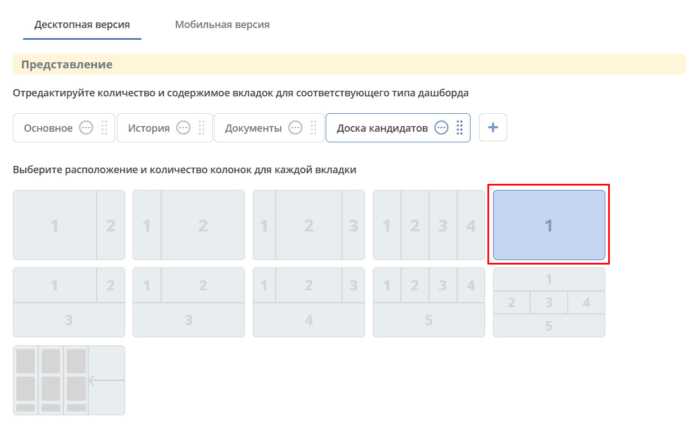

.. _widget_kanban:

Виджет «Канбан»
===============================================

Ключ ``kanban-board``

Виджет добавляет в карточку кейса :ref:`канбан-доску <kanban_board>` с выбором журнала, атрибутов связи и шаблона отображения. Записи журнала представлены карточками, распределёнными по колонкам доски.

Виджет размещается в области на всю ширину строки: в одноколоночном :ref:`представлении дашборда <dashboard_view>` либо в соответствующей области составного макета, например в общей нижней области. Пример одноколоночного размещения:

У выбранного журнала должна быть создана хотя бы одна :ref:`канбан-доска <kanban_board>`. Без неё сохранить настройки нельзя: появится сообщение **«Журнал должен иметь как минимум одну доску»**. Если журнал ещё не выбран, виджет предлагает перейти в настройки.

.. list-table::
      :widths: 5 40
      :class: tight-table

      * - | **Настройка**
        - |

            .. image:: ../_static/widgets/kanban_2.png
                 :width: 500
                 :align: center

          | **Заголовок** виджета можно задать для разных языков. Отображается значение для текущего языка интерфейса. Если оно не заполнено, при сохранении формируется заголовок **«Доска <название журнала>»**.
          | Выберите **журнал**, для которого создана хотя бы одна канбан-доска.
          | Чтобы отображать записи, связанные с текущей карточкой, включите **«Отображать только связанные записи»** и выберите хотя бы один атрибут в поле **«Связанные по атрибутам»**. Можно выбрать несколько атрибутов. При отключении опции список выбранных атрибутов очищается.

            .. image:: ../_static/widgets/kanban_4.png
                 :width: 300
                 :align: center

          | Выберите ранее созданную **канбан-доску** и при необходимости сохранённый **шаблон журнала**. Выбор шаблона необязателен. Колонки и содержимое карточек настраиваются в конфигурации самой доски.

            .. image:: ../_static/widgets/kanban_5.png
                 :width: 500
                 :align: center

      * - | **Настроенный вид**
        - |  Виджет используется в модуле **"Офферы"**. В карточке заявки, по которой уже идет подбор кандидата, доступна вкладка **Канбан-доска**, на которой отображены кандидаты по данной заявке в различных статусах:

            .. image:: ../_static/widgets/kanban_3.png
                 :width: 700
                 :align: center

.. note::

   При первом сохранении настроек для текущего типа карточки введённый заголовок может замениться автоматически сформированным. Чтобы задать собственный заголовок, откройте настройки повторно и сохраните его для нужного языка.

Фильтрация связанных записей
----------------------------

Фильтр **«Отображать только связанные записи»** отбирает записи, связанные с текущей карточкой через выбранные атрибуты. Самого наличия этих полей в модели записи недостаточно.

Если выбранные атрибуты текущей карточки содержат ссылки на записи, доска отбирает их по идентификаторам. Если таких ссылок нет, используется обратная связь: отбираются записи, в выбранных атрибутах которых есть ссылка на текущую карточку. Для нескольких атрибутов обратной связи достаточно совпадения хотя бы по одному из них.

Фильтр связей применяется совместно с остальными фильтрами доски. При изменении значений выбранных атрибутов текущей карточки список связанных записей обновляется.

Работа с карточками
-------------------

Перенос карточек между колонками и смена статуса доступны с учётом режима доски и прав пользователя. На доске в режиме только чтения перетаскивание недоступно. Доступ к настройкам виджета определяется отдельно от прав на изменение записей.

Подробности настройки колонок, карточек и действий см. в статье :ref:`«Канбан-доска» <kanban_board>`.
