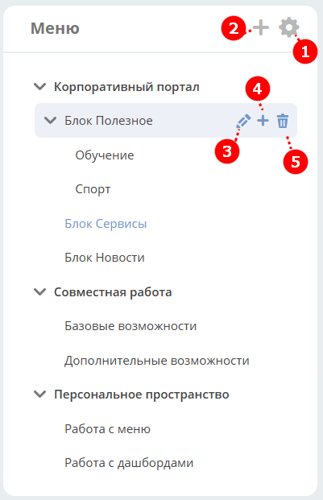
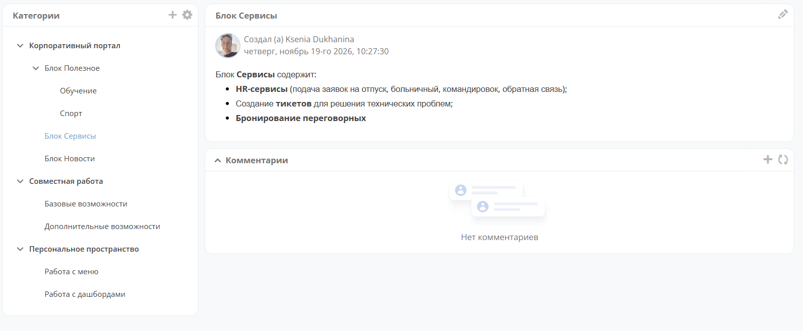
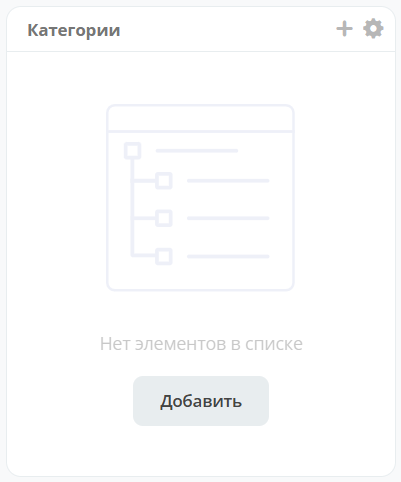
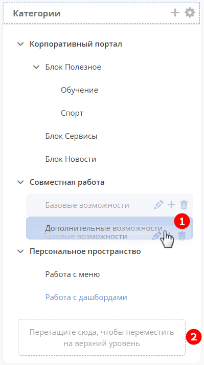

.. _widget_knowledge_base:

Виджет «Категории»
===============================================

Ключ ``hierarchical-tree``

Виджет отображает иерархическую структуру страниц базы знаний или категорий журнала. В списке доступных виджетов он называется **«Категории»**; заголовок на странице можно изменить в настройках.

Для доступности виджета требуются включённые рабочие пространства и подключённый плагин ``HierarchicalTreeWidget``. Кнопки управления отображаются для администратора либо при наличии рассчитанного права изменения корневой записи дерева. Сохранение и удаление узлов дополнительно проверяются сервером.

Виджет работает в двух режимах:

- **База знаний** — дерево статей типа ``wiki`` текущего рабочего пространства. Подробнее: :ref:`База знаний <wiki_base>`.
- **Категории журнала** — дерево категорий, связанных с текущим журналом. Подробнее: :ref:`Дерево категорий <tiles_categories>`.

В базе знаний дерево используется для навигации по разделам и публикациям:

В базе знаний выбор узла открывает статью в :ref:`виджете публикации <widget_publication>`, если он добавлен в раскладку. В журнале выбор категории фильтрует список карточек по её иерархии; остальные фильтры и права доступа продолжают действовать:

Управление разделами
---------------------

- Изменить заголовок виджета — нажмите **(1)**, введите непустое **Название виджета** и сохраните. Эта настройка не переименовывает статьи или категории.

  .. image:: ../_static/widgets/kb_06.png
         :width: 250
         :align: center

- Добавить узел 1-го уровня — нажмите большой **+** **(2)**. В базе знаний создаётся статья или раздел, в журнале — категория:

  .. image:: ../_static/widgets/kb_03.png
         :width: 700
         :align: center

- Добавить дочернюю статью или подкатегорию — нажмите маленький **+** **(4)** у выбранного узла.
- Редактировать — нажмите **(3)**.
- Удалить — нажмите **(5)** и подтвердите действие. Удаляется сама статья или категория; последствия для дочерних записей определяются серверной моделью.

В стандартной форме статьи wiki обязательно поле **Заголовок**. **Текст** заполняется в визуальном :ref:`редакторе Lexical <wysiwyg_editor>` и может быть пустым, например для раздела с дочерними статьями. В форме категории требуется только **Название**.

Плюс в дереве категорий создаёт категорию, а не запись журнала. Чтобы отнести уже существующую карточку к категории, выберите карточку и используйте кнопку со стрелкой у нужного узла либо перетащите карточку на него. Это изменяет атрибут ``has-category:category`` и требует прав изменения записи.

Пустой виджет выглядит следующим образом:

При наличии прав управления нажмите **+** или **Добавить**, чтобы создать первый дочерний узел. Пустое дерево базы знаний означает отсутствие дочерних статей; корневая страница пространства при этом может уже существовать.

Перемещение статей и категорий
---------------------------------

При наличии прав управления перетащите статью или категорию **(1)** на другой узел, чтобы изменить её родителя. Перенос на корень **(2)** возвращает узел на первый уровень.

Нельзя переместить узел в самого себя или в своего потомка. Эта операция меняет иерархию, а не задаёт произвольный порядок соседних узлов. Её следует отличать от перетаскивания карточки журнала на категорию.
