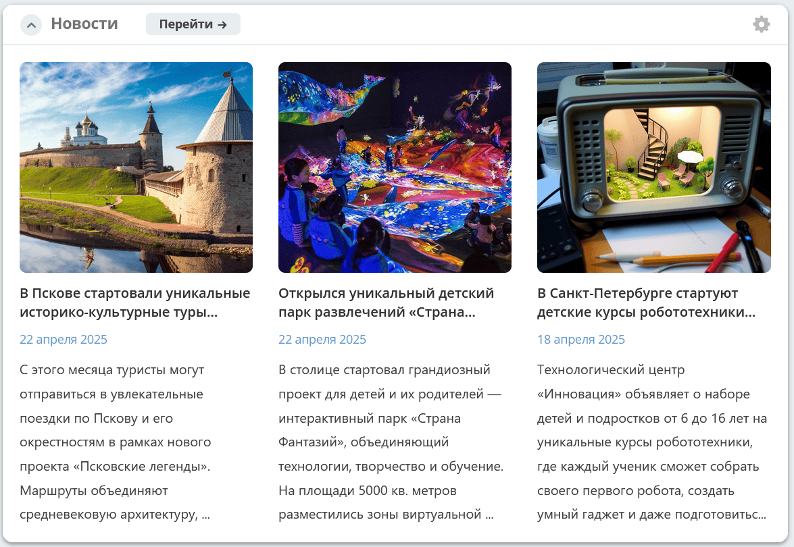
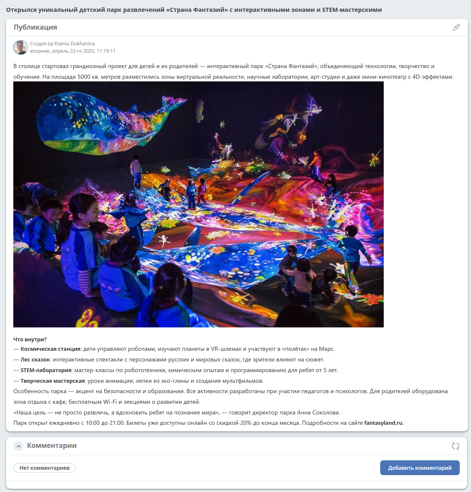
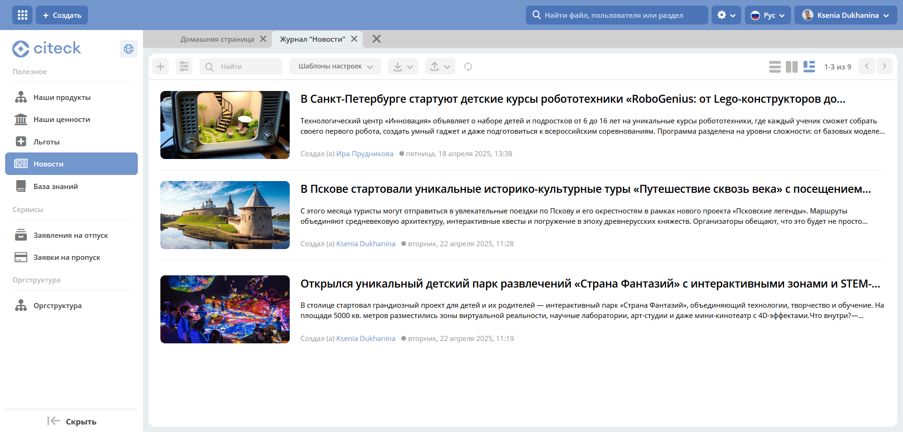
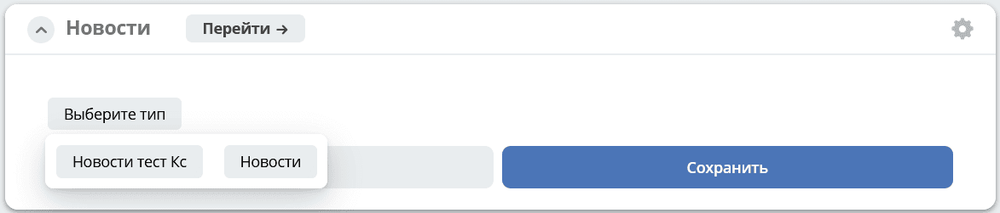

.. _widget_news:

Виджет «Новости»
===============================================

Виджет показывает анонсы трёх последних новостей выбранного типа в текущем рабочем пространстве. По умолчанию используется тип **«Новость»** (``news``). Записи сортируются по дате создания: сначала новые.

По клику на карточку новость будет доступна подробно:

По клику на **Перейти** можно перейти в журнал **"Новости"**:

Для выбора источника новостей нажмите **шестеренку**, выберите тип ``news`` или один из его наследников и сохраните настройки:

См. как создать журнал :ref:`Новости <news>`:
