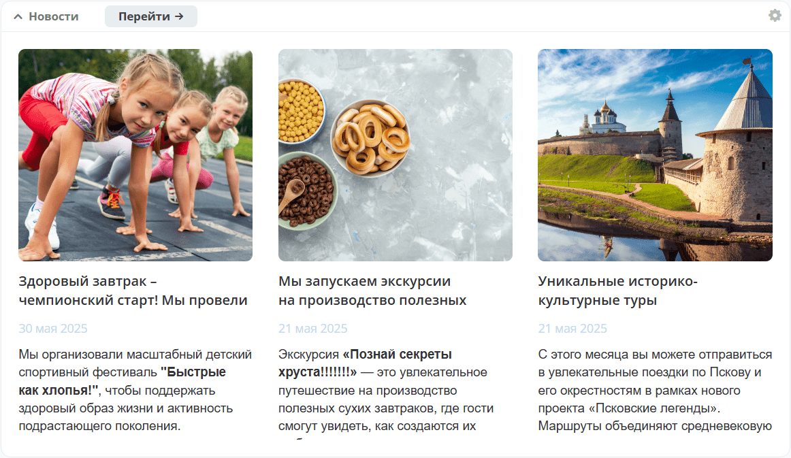
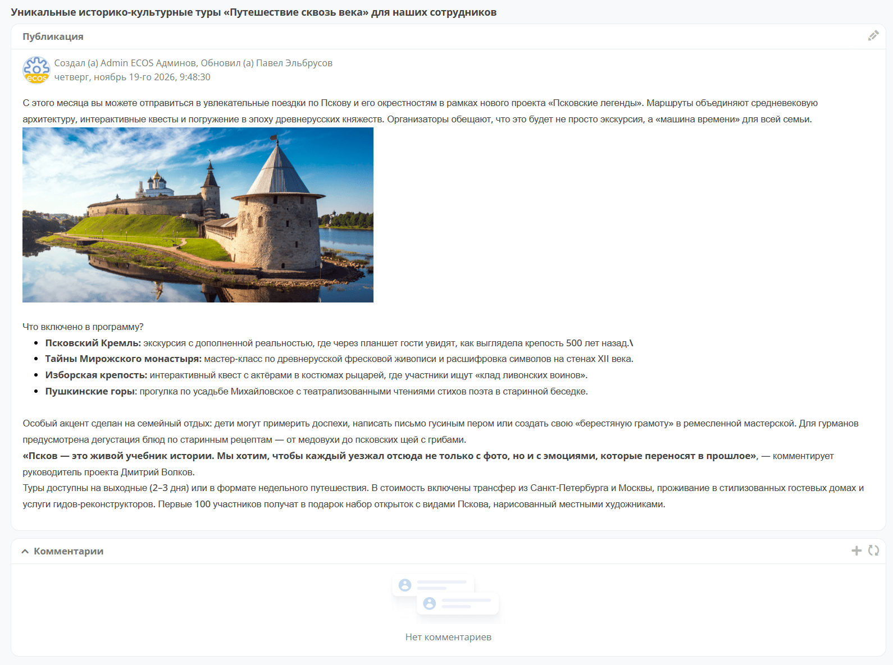
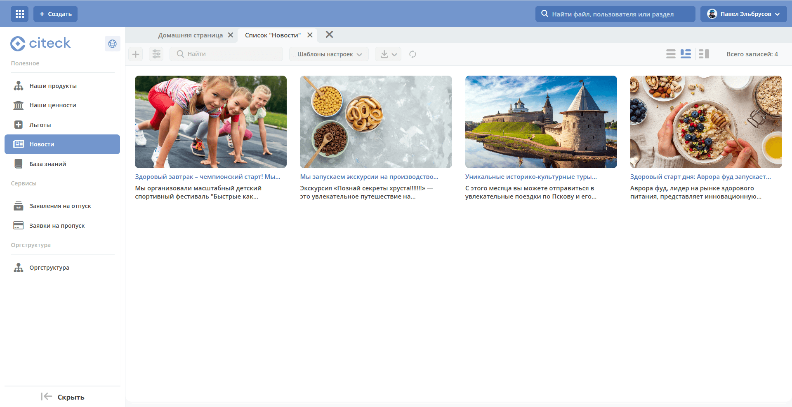
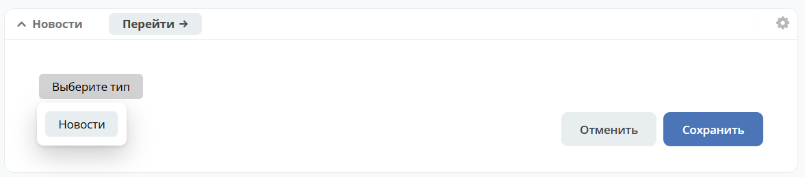

.. _widget_news:

Виджет «Новости»
===============================================

Ключ ``news``

Виджет показывает анонсы до трёх последних новостей выбранного типа в текущем рабочем пространстве. По умолчанию используется тип **«Новости»** (``news``). Записи сортируются по дате создания: сначала новые. Отображаются записи, доступные пользователю.

Для работы требуется подключённый плагин ``NewsWidget``. Каждый анонс содержит изображение, заголовок, дату создания и текст. Если изображение-превью отсутствует, используется доступное превью записи либо стандартная картинка.

Нажмите заголовок новости, чтобы открыть её карточку:

Кнопка **Перейти** открывает журнал выбранного типа в представлении списка и текущем рабочем пространстве. Для стандартного типа ``news`` это журнал **«Новости»**. Кнопка отображается, если виджет загрузил хотя бы одну запись:

Для выбора источника новостей нажмите **шестеренку**, выберите тип ``news`` или один из его наследников и сохраните настройки:

Количество карточек и порядок сортировки в этой форме не настраиваются. Добавление журнала в меню не является условием отображения новостей в виджете.

Если доступных записей нет, отображается **«Нет новостей»**. При невыбранном источнике виджет предлагает выбрать тип новостей; при ошибке загрузки показывает сообщение об ошибке.

Создание и редактирование новостей выполняются отдельно и зависят от прав пользователя. Подробнее см. :ref:`Новости <news>`.
