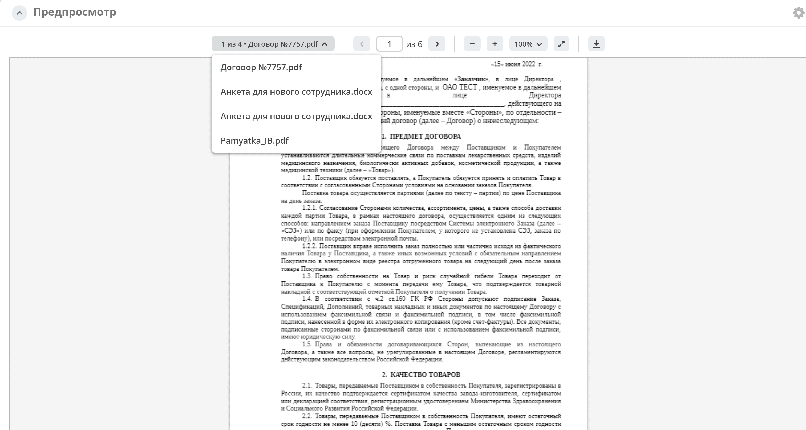
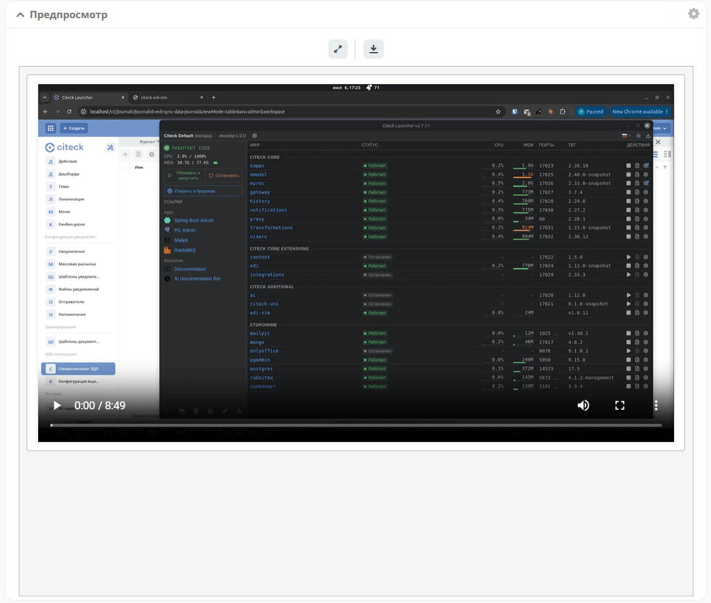

.. _widget_doc_preview:

Виджет «Предпросмотр»
===============================================

Ключ ``doc-preview``

Виджет показывает основной файл записи и, при включённой настройке, связанные документы. Кнопка скачивания сохраняет оригинал текущего открытого файла, даже если на экране отображается его PDF-представление.

Доступны просмотр изображений, PDF, текста и Markdown, а также воспроизведение видео и аудио. Способ отображения определяется данными предпросмотра, полученными от сервера. Для офисных документов может использоваться сгенерированное PDF-представление; его доступность зависит от сервиса преобразования.

Чтобы добавить связанные документы в список, включите настройку **«Показывать все документы»**:

Первым в список добавляется основной файл. Его предпросмотр может быть задан настройками содержимого типа данных. Затем добавляются документы из ассоциации ``docs:documents``, относящиеся к типу ``user-base`` и его наследникам, например загруженные через виджет документов.

Если у основной записи нет ни предпросмотра, ни скачиваемого содержимого, первым становится связанный документ. Если оригинал основного файла можно скачать, но предпросмотр недоступен, файл остаётся в списке с соответствующим сообщением.

Для перехода между документами используйте раскрывающийся список; в нём указано количество файлов. В области просмотра с прокруткой также доступен переход к следующему документу внизу содержимого:

Содержимое виджета обновляется при получении изменений основного документа и списка связанных документов.

Для PDF доступны переходы по страницам. Изображения, PDF, текст и Markdown можно масштабировать; для аудио и видео используются элементы управления проигрывателя.

Основные форматы предпросмотра:

.. list-table::
   :header-rows: 1
   :class: tight-table

   * - Тип
     - Расширения
   * - PDF
     - ``pdf``
   * - Офисный документ
     - Например, ``doc``, ``docx``, ``xlsx``, ``pptx`` — при наличии серверного преобразования в PDF
   * - Изображение
     - ``png``, ``jpg``, ``jpeg``, ``gif``, ``bmp``, ``webp``, ``svg``, ``ico``
   * - Текст и данные
     - ``txt``, ``log``, ``har``, ``csv``, ``xml``, ``html``, ``json``, ``yaml``, ``yml``
   * - Markdown
     - ``md``, ``markdown``
   * - Видео
     - ``mp4``, ``webm``, ``mov``, ``m4v``, ``mkv``
   * - Аудио
     - ``mp3``, ``wav``, ``ogg``, ``oga``, ``m4a``, ``aac``, ``flac``, ``opus``

.. note::

   Расширение файла само по себе не гарантирует успешный предпросмотр. Для аудио и видео браузер и операционная система должны поддерживать контейнер и используемые кодеки. При ошибке воспроизведения можно скачать оригинал файла.

Текстовый просмотр показывает содержимое как текст, включая HTML. Markdown отображается с форматированием; встроенный HTML не исполняется. Относительные пути к изображениям в Markdown могут не разрешаться.

Для текста и Markdown отображаются первые **2 МиБ** содержимого. Если файл больше, появляется уведомление об усечении; полный файл можно скачать.

Подготовка и недоступность предпросмотра
-----------------------------------------------

В зависимости от состояния файла виджет показывает сообщения **«Предпросмотр готовится»**, **«Не удалось сформировать предпросмотр»** или **«Предпросмотр недоступен для этого формата»**.

Пока предпросмотр готовится, виджет автоматически проверяет его готовность с увеличивающимся интервалом примерно в течение двух минут. Затем автоматические проверки прекращаются и появляется кнопка **«Обновить»**. Это время проверок, а не гарантированный срок преобразования файла.

Если доступна ссылка на оригинал, его можно скачать и при отсутствии предпросмотра.
