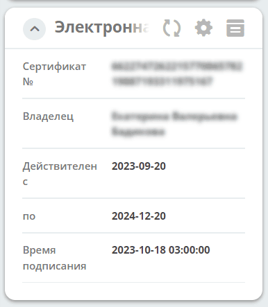
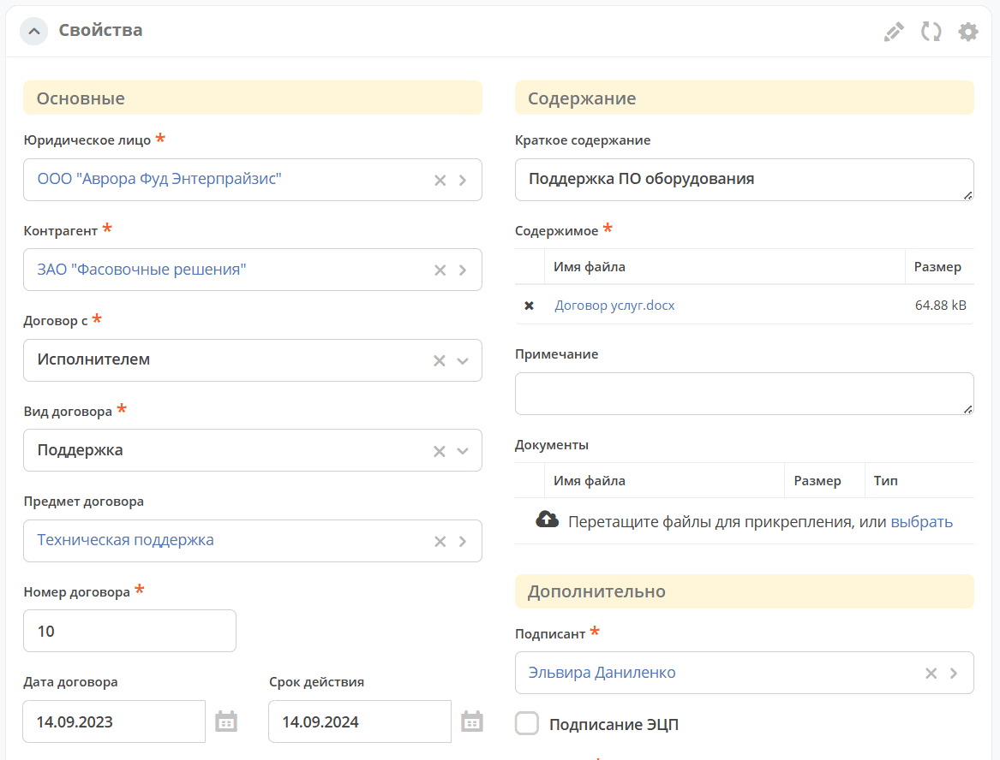
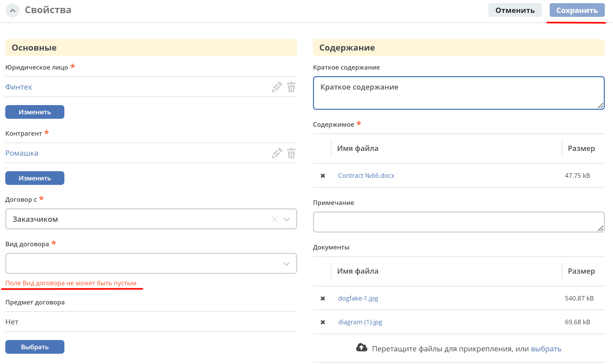

.. _widget_properties:

Виджет «Свойства»
===============================================

.. contents::
   :depth: 2

Ключ ``properties``

Виджет отображает поля выбранной формы и значения атрибутов записи. Доступны просмотр с inline-редактированием отдельных полей и редактирование всей формы внутри виджета. Возможность изменения зависит от прав пользователя, компонентов формы и ограничений, заданных формой и сервером.

Настройка
---------

В настройках выбирается форма, доступная для типа текущей записи. Вариант **«По-умолчанию»** использует форму, определяемую платформой для записи.

Опция **«Использовать имя формы в качестве заголовка виджета»** позволяет заменить заголовок названием выбранной формы. Если ранее сохранённая форма отсутствует в списке, показывается предупреждение.

.. grid:: 2
   :gutter: 2

   .. grid-item::

      .. image:: ../_static/widgets/Properties_1.png
         :width: 400
         :align: left

   .. grid-item::

      .. image:: ../_static/widgets/Properties_2.png
         :width: 500
         :align: left

Настроенный вид
----------------

Для типа дашборда :ref:`Case-details <dashboard_types>` реализовано 2 режима (см. настройки ниже):

.. tab-set::

   .. tab-item:: Просмотр с inline-редактированием

      .. image:: ../_static/widgets/Properties_3.png
         :width: 500
         :align: center

   .. tab-item:: Режим формы

      .. image:: ../_static/widgets/Properties_4.png
         :width: 500
         :align: center

Если выбранная форма содержит поле **«Электронная подпись»**, его представление может включать сведения о сертификате и времени подписания. Пример:

Для дополнительной настройки полей доступен переход в конструктор формы с учётом прав на управление формами. Право изменять запись само по себе не означает право изменять определение формы. См. подробную статью :ref:`Формы <forms>`.

.. grid:: 2
   :gutter: 2

   .. grid-item::

      .. image:: ../_static/widgets/form_builder_icon.png
         :width: 200
         :align: center

   .. grid-item::

      .. image:: ../_static/widgets/form_builder_form.png
         :width: 500
         :align: center

Настройка режима редактирования виджета для типа дашборда Case-details
----------------------------------------------------------------------

Для типа дашборда Case-details доступна настройка режима просмотра с возможностью inline редактирования значений атрибутов или редактирования в режиме "формы".
По умолчанию выставлен режим просмотра.

Для режима редактирования требуется право **Write** на запись. Без него виджет использует режим просмотра независимо от выбранной настройки. В режиме просмотра inline-редактирование доступно только для поддерживающих его полей с учётом прав и настроек формы.

При наличии права изменения записи также доступно отдельное действие редактирования, открывающее форму в модальном окне.

.. dropdown:: Как изменить режим
   :color: secondary

   1. В карточке нажмите **шестеренку -> «Настроить страницу»**:

      .. image:: ../_static/widgets/case_edit_1.png
         :width: 400
         :align: center

   2. В настройке карточки перейдите в раздел **"Виджеты"**, у **виджета "Свойства"** нажмите:

      .. image:: ../_static/widgets/case_edit_2.png
         :width: 600
         :align: center

   3. В настройках выберите **"Режим редактирования"** и нажмите **"Применить"**:

      .. image:: ../_static/widgets/case_edit_3.png
         :width: 400
         :align: center

   4. В настройке карточки нажмите **"Применить"**.

Особенности режима редактирования
~~~~~~~~~~~~~~~~~~~~~~~~~~~~~~~~~~

В виджете при открытии страницы дашборда доступны свойства документа в режиме редактирования, аналогично открытию документа в модальном окне редактирования:

Если пользователь вносит изменения, то в шапке виджета становятся доступны кнопки **"Отмена"** и **"Сохранить"**.

Если изменений нет - кнопки в шапке виджета отсутствуют.

Для обычной записи при невалидных данных кнопка **«Сохранить»** становится недоступна. Для записи-черновика используется отдельный режим сохранения без этой проверки валидности. Во время сохранения повторный запуск блокируется.

Кнопка **«Отмена»** сбрасывает несохранённые изменения и обновляет форму.

