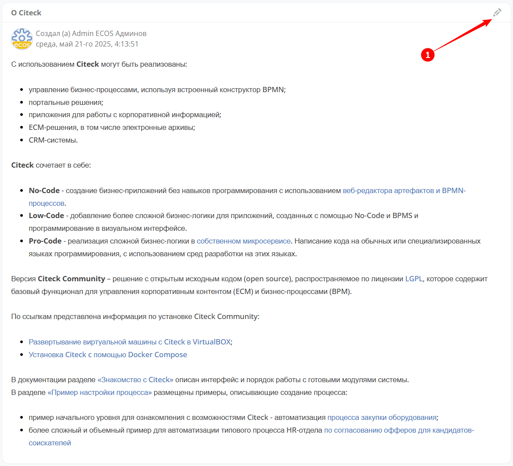

.. _widget_publication:

Виджет «Публикация»
===============================================

Ключ ``publication``

.. note::

   Редактирование доступно при наличии права изменения текущей публикации. Сохранение проверяется сервером. Администратор или менеджер рабочего пространства может получать необходимые права согласно серверным правилам; доступ не ограничивается только этими ролями.

Виджет отображает содержимое текущей записи — например, :ref:`публикации <publication>`, новости или статьи :ref:`базы знаний <wiki_base>`. Для его доступности требуются включённые рабочие пространства и подключённый плагин ``PublicationWidget``.

Запись определяется параметром ``recordRef`` страницы либо контекстом дашборда. В базе знаний выбор статьи в дереве обновляет содержимое виджета. Само дерево и комментарии являются отдельными виджетами.

Помимо текста отображаются автор, пользователь последнего изменения, если он отличается от автора, и дата изменения. Для статьи wiki заголовком виджета служит название статьи; в остальных случаях — **«Публикация»**:

Редактирование публикации
--------------------------------

1. Нажмите кнопку редактирования **(1)** в виджете. Она отображается при наличии права изменения записи.
2. В открывшейся форме измените нужные поля. В стандартных формах текст оформляется с помощью визуального :ref:`редактора Lexical <wysiwyg_editor>`.
3. Сохраните изменения — виджет обновит содержимое.

В стандартных формах публикации и новости обязательны заголовок и текст. Для статьи wiki обязателен заголовок, а текст может быть пустым.

Создание и удаление записей выполняются через соответствующие действия журнала или дерева базы знаний и зависят от прав пользователя. Собственных кнопок создания и удаления в виджете публикации нет.
