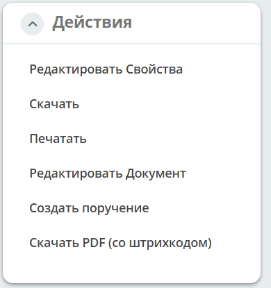

.. _widget_record_actions:

Виджет «Действия»
==================

Ключ ``record-actions``

Виджет показывает действия с текущей записью, доступные с учётом условий действия, прав пользователя и контекста дашборда. Статус записи может учитываться в условиях, но не является единственным критерием доступности.

Набор действий задаётся в :ref:`типе данных <data_types_main>` с учётом наследования от родительского типа. Условия и поведение настраиваются в самих действиях. Собственной формы выбора действий у виджета нет. См. подробную статью :ref:`Действия <ui_actions>`.

Для выполнения нажмите название действия. Если действие представлено группой вариантов, выберите нужный вариант внутри группы. Открытие формы, запрос подтверждения, переход на другую страницу или изменение записи определяются конфигурацией выбранного действия.

Если доступных пунктов нет, отображается **«Нет доступных действий»**. Это может означать, что действия не заданы или не подходят для текущей записи и пользователя.

Список обновляется при получении событий изменения записи и задач, в том числе при изменении статуса.
