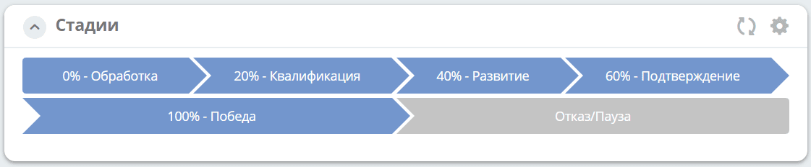

.. _widget_stages:

Виджет «Стадии»
=================

Ключ ``stages``

Виджет визуализирует прохождение :ref:`стадий <stages>` документа:

Список стадий, их порядок и соответствующие им статусы задаются в типе данных документа. Текущей считается первая стадия, в список статусов которой входит текущий статус документа.

.. list-table::
      :widths: 5 40
      :class: tight-table

      * - | **Настройка**

        - |

            .. image:: ../_static/widgets/stages_2.png
                 :width: 400
                 :align: center

          | Если флажок включён, выделяются текущая стадия и все предшествующие ей стадии в порядке, заданном в типе данных.
          | Если флажок выключен, выделяется только текущая стадия. Остальные стадии остаются видимыми:

      * - | **Настроенный вид**

        - |

            .. image:: ../_static/widgets/stages_3.png
                 :width: 600
                 :align: center

Выделение предыдущих стадий определяется их порядком в типе данных и не подтверждает, что документ фактически прошёл каждую из них. Виджет отображает стадии; изменение статуса по нажатию на стадию не предусмотрено.

Данные загружаются при открытии виджета и обновляются при изменении статуса документа. Также доступно ручное обновление через действие обновления виджета.

Если в типе данных нет стадий, виджет выводит предупреждение вместо списка.
