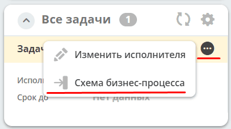
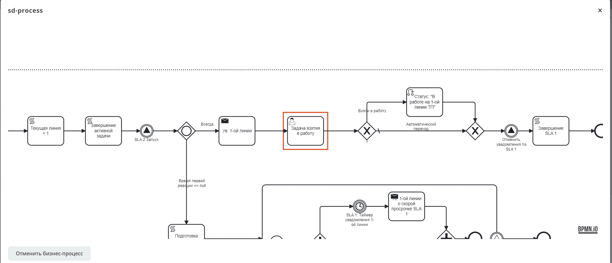

.. _widget_tasks:

Виджет «Все задачи»
===============================================

Ключ ``current-tasks``

Виджет отображает все активные задачи по данному кейсу и их исполнителей.

.. list-table::
      :widths: 5 40
      :class: tight-table

      * - | **Настройка**

        - |

            .. image:: ../_static/widgets/all_tasks_1.png
                 :width: 300
                 :align: center

      * - | **Настроенный вид**

        - |

            .. image:: ../_static/widgets/all_tasks_2.png
                 :width: 300
                 :align: center

При нажатии на:

отображается схема выбранного бизнес-процесса с выделенной текущей задачей:

.. note::

       Действие доступно при наличии права на просмотр определения выбранного бизнес-процесса.
