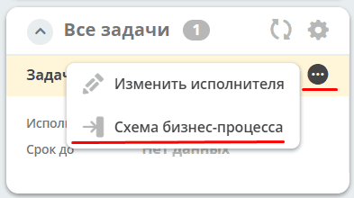
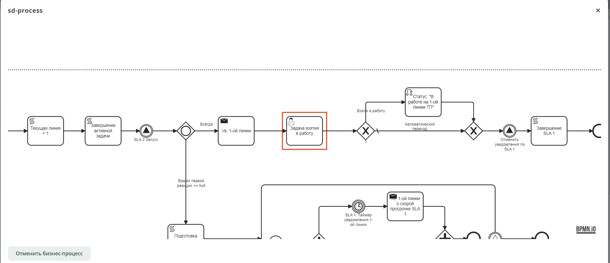

.. _widget_tasks:

Виджет «Все задачи»
===============================================

Ключ ``current-tasks``

Виджет отображает все активные задачи по данному кейсу и их исполнителей.

В карточке задачи показаны название, исполнитель и **«Срок до»**. При групповом или множественном назначении список участников можно раскрыть значком пользователей. В заголовке виджета отображается количество задач.

В настройках задаётся **«Формат даты»** для отображения срока. По умолчанию используется ``DD.MM.YYYY HH:mm``. Изменение формата не меняет срок самой задачи. В форме доступна справка по обозначениям даты и времени; для сохранения примените настройки, для выхода без сохранения нажмите **«Отмена»**.

.. list-table::
      :widths: 5 40
      :class: tight-table

      * - | **Настройка**

        - |

            .. image:: ../_static/widgets/all_tasks_1.png
                 :width: 300
                 :align: center

      * - | **Настроенный вид**

        - |

            .. image:: ../_static/widgets/all_tasks_2.png
                 :width: 300
                 :align: center

В меню задачи при наличии соответствующих прав доступны переназначение и просмотр бизнес-процесса. Выберите действие просмотра бизнес-процесса:

Откроется схема процесса выбранной задачи с выделенным текущим элементом. Для BPMN используется определение ревизии, связанной с экземпляром процесса:

.. note::

       Для современного BPMN-процесса действие просмотра схемы предлагается при наличии права на чтение определения процесса. Для интеграции с Alfresco применяется отдельная логика доступности. Переназначение требует соответствующего разрешения задачи.

Для повторной загрузки списка используйте действие обновления в меню виджета. После выполнения действия над задачей данные документа и связанные виджеты задач обновляются.
