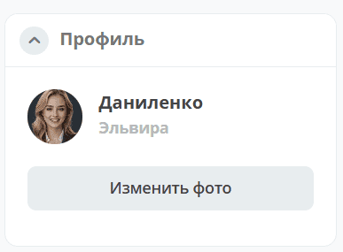

.. _widget_user_profile:

Виджет «Профиль»
===============================================

Ключ ``user-profile``

Виджет показывает фотографию, фамилию, имя и отчество пользователя, чья карточка открыта. Он используется в профиле пользователя и в карточке сотрудника организационной структуры.

Изменение фотографии
--------------------

Владелец профиля и администратор могут нажать **«Изменить фото»** и выбрать изображение. После успешного сохранения фотография обновляется и появляется уведомление. Если загрузка или сохранение не удались, выводится сообщение об ошибке.

Смена пароля
------------

Кнопка **«Изменить пароль»** показывается владельцу профиля или администратору, если для записи разрешена смена пароля и доступно соответствующее действие. Нажмите кнопку и заполните открывшуюся форму.

Возможность смены пароля зависит от настроек аутентификации. В поставляемой реализации действие использует интеграцию с Keycloak; при других способах входа доступность этой функции определяется конфигурацией системы.

Редактирование ФИО и других свойств пользователя в этом виджете не предусмотрено.
