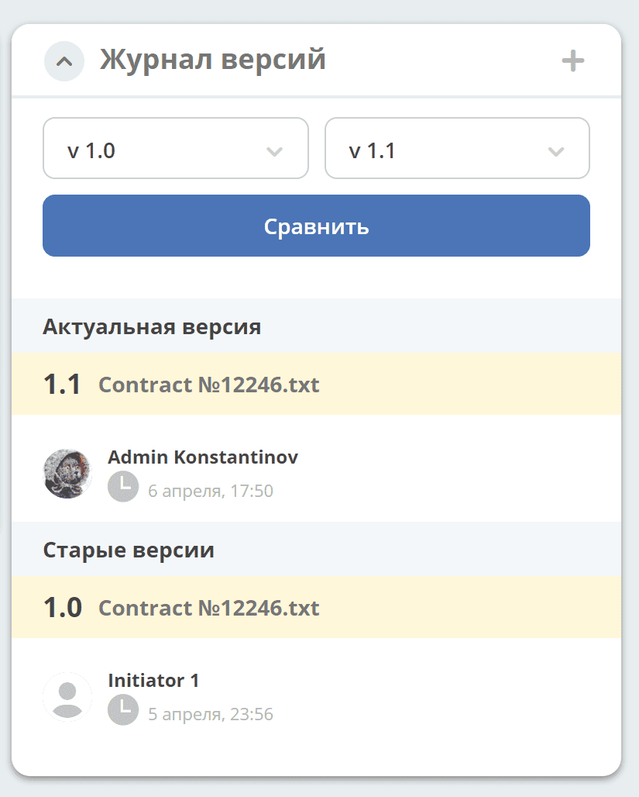
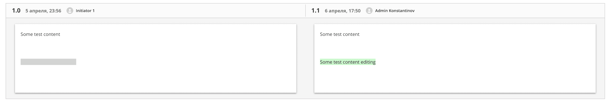
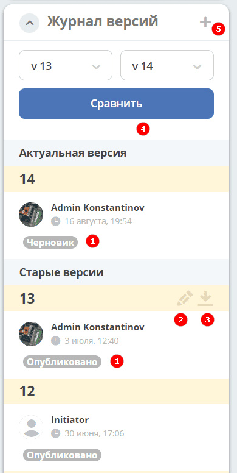
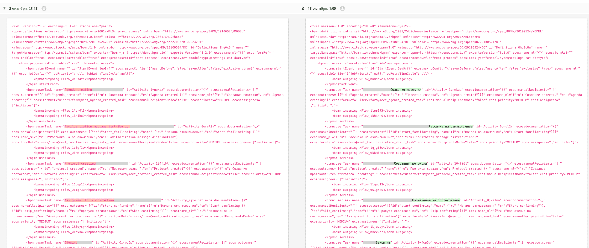
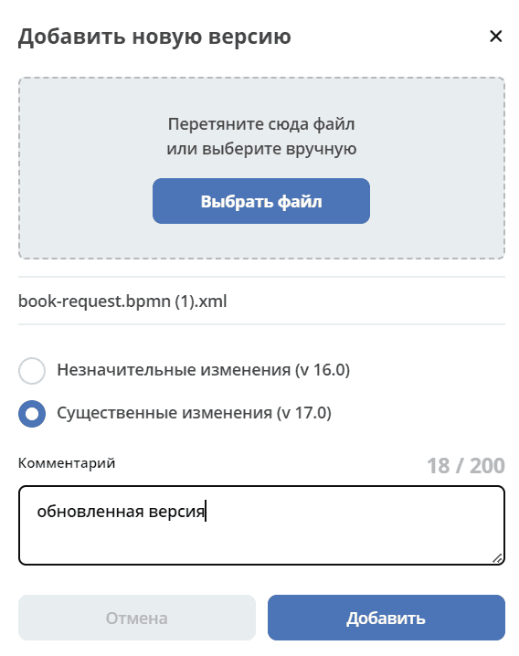

.. _widget_versions_journal:

Виджет «Журнал версий»
===============================================

Ключ ``versions-journal``

Виджет содержит актуальную и предшествующие версии документа.

В карточке версии отображаются её номер, название, автор, дата и комментарий, если он указан. Список разделён на **«Активные версии»** и **«Старые версии»**.

Служит для **загрузки** новой версии документа по кнопке **(1)**, а также для сравнения файлов.

Для загрузки нужны право изменения документа и доступное для изменения содержимое. Выберите или перетащите в форму один непустой файл, укажите вид изменений и при необходимости комментарий длиной до 200 символов, затем нажмите **«Добавить»**. По умолчанию выбраны **«Незначительные изменения»**; также доступны **«Существенные изменения»**. При ошибке загрузки в форме появляется сообщение.

Панель сравнения доступна при наличии хотя бы двух версий. Выберите две разные версии и нажмите **«Сравнить»** **(2)**. Вставки и удаления будут подсвечены:

Возможность сравнения зависит от формата и источника версий. Виджет показывает результат серверного сравнения и не гарантирует визуальное сравнение любых бинарных файлов. Если данные для сравнения не получены, в окне выводится **«Нет данных документа»**. Из окна сравнения можно скачать каждую из выбранных версий.

В карточках старых версий доступно скачивание. Кнопка редактирования появляется, если источник версий предоставил ссылку на редактор. В карточке текущей версии эти действия не отображаются.

.. _widget_versions_journal_bpmn:

Для BPMN-процесса
------------------

Для версии процесса с зарегистрированной публикацией показывается тег **«Опубликовано»**, для черновой ревизии — **«Черновик»** **(1)**. Метки относятся к конкретной версии.

Текущей в журнале считается первая версия в списке, отсортированном по времени создания или обновления черновика. Она может отличаться от версии, опубликованной в движке: например, после сохранения нового черновика.

Кнопка редактирования **(2)** в карточке старой версии открывает BPMN-редактор выбранной версии в новой вкладке. При сохранении изменения применяются к исходному процессу с указанием версии, на основе которой они сделаны.

При нажатии на кнопку скачать **(3)** происходит скачивание конкретной версии процесса.

При изменении определения процесса создаётся новая ревизия. Однако повторное сохранение собственного последнего черновика может обновлять его без увеличения номера. При отсутствии различий в данных определения новая ревизия не создаётся.

Для сравнения выберите две разные версии и нажмите **«Сравнить»** **(4)**. Сравнивается текст BPMN XML с подсветкой различий:

Для загрузки новой версии нажмите **(5)**:

Выберите файл, укажите вид изменений и комментарий при необходимости, нажмите **«Добавить»**. Для BPMN используются последовательные номера ревизий: выбор **«Незначительные изменения»** в общей форме не означает дробного увеличения номера версии процесса.

При изменении определения добавленная ревизия становится текущей в журнале. Загрузка файла не публикует процесс автоматически: публикация выполняется отдельно и требует соответствующего права.
