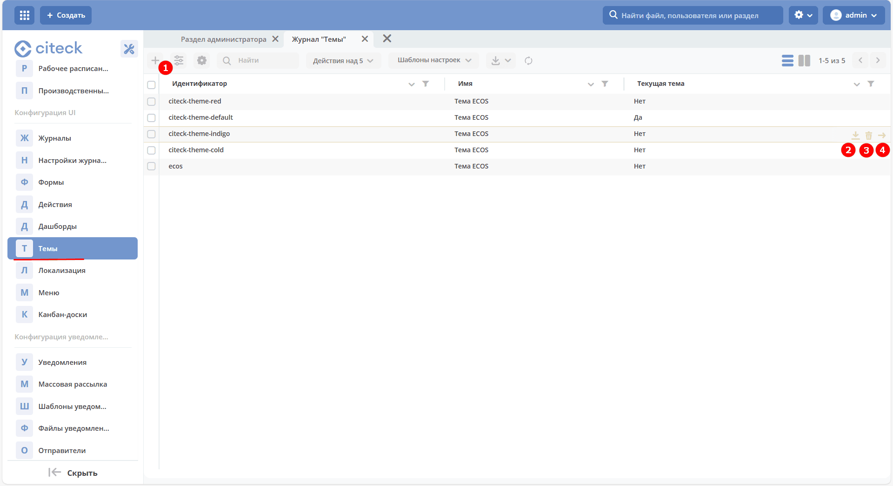
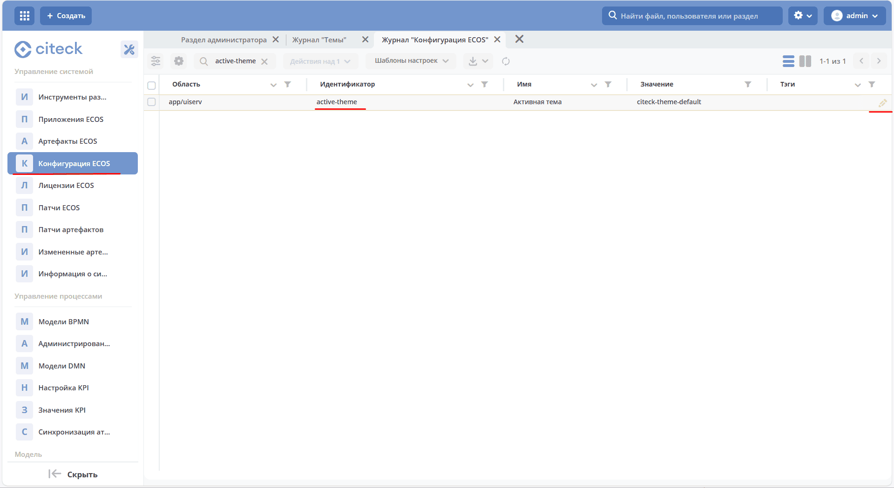
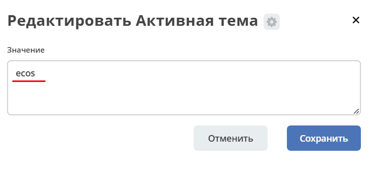
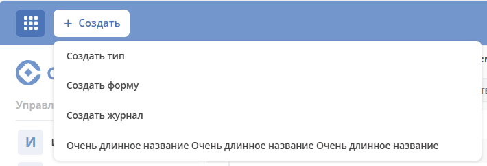

.. _interface_themes:

Настройка темы интерфейса
============================

.. contents::
    :depth: 3

**Тема интерфейса** — набор логотипов, favicon и CSS-стилей для визуальной кастомизации Citeck под фирменный стиль организации. Тема представляет собой zip-архив, который загружается через интерфейс или API и применяется ко всему приложению.

Статья описывает формат и структуру архива темы, порядок загрузки и применения, API для работы со стилями и изображениями, механизм кэширования, а также примеры CSS-настроек.

Основной источник данных: **uiserv/theme**

Просмотр существующих тем, их редактирование, применение, загрузка новых осуществляется в журнале **Темы (Рабочее пространство "Раздел администратора" - Конфигурация UI)**.

Журнал доступен по адресу: ``/v2/journals?journalId=ecos-theme&viewMode=table&ws=admin$workspace``



На иллюстрации показаны операции: загрузка новой темы **(1)**, скачивание **(2)**, удаление существующей **(3)**, применение темы **(4)**. Состав доступных действий и права на них определяются серверной конфигурацией журнала.

Действие **Применить тему** выбирает активную тему через серверную конфигурацию. Условия его отображения, в том числе для уже активной темы, задаются на сервере.

.. note::

   Через интерфейс на данный момент не предусмотрена настройка темы — только через скачивание, изменение и загрузку обратно.

При загрузке темы через интерфейс **zip-архив** загружается в **uiserv**.

Пример структуры архива. При изменении существующей темы сохраняйте структуру выгруженного архива: правила его разбора определяются версией сервиса uiserv.

.. code-block:: text

 root:
   theme:
     image:
       apple-touch-icon.png
       apple-touch-icon-precomposed.png
       favicon.ico
       login-logo.png
       logo.png
       menu-left-logo-large.png
       menu-left-logo-small.png
     meta.json
     main.css

где:

* **root** — корень архива
* **theme** — идентификатор темы
* **image** — произвольная папка для изображений. Связь между реальным файлом и его идентификатором осуществляется в meta.json
* **meta.json** — метаданные темы
* **main.css** — главный файл со стилями

Пример **meta.json**, согласованный с файлами выше:

.. code-block:: json

  {
    "name": {
      "ru": "Тема ECOS",
      "en": "ECOS theme"
    },
    "parentRef": null,
    "images": {
      "favicon": "/image/favicon.ico",
      "logo": "/image/logo.png",
      "login-logo": "/image/login-logo.png",
      "menu-left-logo-large": "/image/menu-left-logo-large.png",
      "menu-left-logo-small": "/image/menu-left-logo-small.png",
      "apple-touch-icon": "/image/apple-touch-icon.png",
      "apple-touch-icon-precomposed": "/image/apple-touch-icon-precomposed.png"
    }
  }

* **name** — имя темы. Справочная информация;
* **parentRef** — серверное поле метаданных родительской темы; в примере родитель не задан. Правила наследования определяет uiserv;
* **images** — ссылки на изображения:

    * **favicon** — значок сайта. В текущем HTML приложения он подключается с типом ``image/vnd.microsoft.icon``; в примере используется файл ICO;
    * **logo** — изображение, представляющее тему;
    * **login-logo** — изображение для страницы входа, если его использует соответствующая поставка страницы аутентификации;
    * **menu-left-logo-large** — логотип в левом развернутом меню
    * **menu-left-logo-small** — логотип в левом свернутом меню; при включённых рабочих пространствах текущий компонент скрывает его;
    * **apple-touch-icon** и **apple-touch-icon-precomposed** — изображения для соответствующих значков iOS, если они подключены страницей. Текущий ``index.html`` приложения не содержит ссылок на эти ресурсы.

Все пути в ``images`` должны указывать на файлы, действительно включённые в архив. Клиент отображает логотипы через ```` без отдельного фильтра расширений. Допустимые форматы, MIME-типы и размер загружаемых файлов определяются серверным загрузчиком; проверяйте их для используемой версии uiserv.

Размер файла и размер отображения различаются: в левом меню для логотипа заданы ``max-width: 170px`` и ``max-height: 30px``. Поэтому большое исходное изображение не будет показано в натуральную величину.

Кроме логотипов можно менять стили в файле **main.css**. Клиент подключает основной файл темы как таблицу стилей; наличие других CSS-файлов в архиве не означает их автоматического подключения. Для настройки интерфейса используйте ``main.css`` и проверяйте результат на нужных страницах и размерах экрана.

.. note::

   Подготовьте готовый CSS. Правила обработки архива и наследования темы определяются сервером; клиент не компилирует стили и не объединяет все CSS-файлы темы.

Конфигурация active-theme
----------------------------

Для хранения выбранной темы используется конфигурация uiserv **active-theme**. Значение по умолчанию — ``ecos``.

При запуске интерфейс получает идентификатор активной темы через API:

.. code-block:: text

 GET /gateway/uiserv/api/theme/current

Ответ — строка с идентификатором. При ошибке запроса клиент использует ``ecos``. После аутентификации имя и изображения темы дополнительно загружаются из ``uiserv/theme@<themeId>``.

Пример чтения настройки через Records, соответствующий текущему клиентскому механизму конфигураций:

.. code-block:: javascript

 await Records.get('uiserv/meta@').load('$cfg.active-theme');

Клиентский ConfigService сохраняет серверные конфиги через источник ``uiserv/cfg``. Его метод ``setValue`` меняет только локальное значение; для серверного сохранения предусмотрен ``setServerValue``. Простого локального изменения значения недостаточно для выбора глобальной темы.

Информация о настройке доступна в журнале **Конфигурация ECOS** (``/v2/journals?journalId=ecos-configs&viewMode=table&ws=admin$workspace``) в **active-theme**:



Для изменения темы укажите ее новое значение в настройке и сохраните:



После серверного сохранения обновите страницу. При загрузке клиент записывает идентификатор в ``window.Citeck.config.theme``, добавляет элементу ``body`` класс ``body_theme_<themeId>`` и подключает основной CSS через ``<link rel="stylesheet">``. Автоматического наблюдения за изменениями серверной настройки и замены всех ресурсов в уже открытой странице в этой ветке нет.

API
----

Получение основного файла стилей активной темы:

.. code-block:: text

 /gateway/uiserv/api/theme/active/style/main

Клиент использует имя ``main`` без расширения ``.css``. Дополнительные стили не загружаются автоматически; правила обращения к ним и наследования определяет сервер.

Получение изображения:

.. code-block:: text

 /gateway/uiserv/api/theme/active/image/menu-left-logo-large

Последний сегмент — идентификатор изображения из ``images`` в ``meta.json``, например ``logo`` или ``menu-left-logo-large``. Клиент обращается к ``active``, чтобы сервер выбрал активную тему. Для обращения к конкретной теме используется путь ``/gateway/uiserv/api/theme/<themeId>/...``; разрешение её ресурсов выполняет uiserv.

Кэш
---

HTTP-заголовки кэширования и срок хранения ресурсов задаются сервером. Клиент дополнительно включает ключ версии темы в URL основного CSS и изображений бокового меню.

Ключи ресурсов загружаются через API:

.. code-block:: text

 GET /gateway/uiserv/api/ui-cache?types=theme,images,i18n,menu

Для стилей и изображений темы селекторы интерфейса используют значение ``theme`` из ответа в параметре ``cacheKey``:

.. code-block:: text

 /gateway/uiserv/api/theme/active/style/main?cacheKey=<theme-key>
 /gateway/uiserv/api/theme/active/image/menu-left-logo-large?cacheKey=<theme-key>

Несмотря на наличие отдельного ключа ``images``, URL изображения темы в текущем клиенте использует ключ ``theme``. Favicon подключён непосредственно в ``index.html`` по адресу ``/gateway/uiserv/api/theme/active/image/favicon`` без ``cacheKey``; его кэширование следует проверять отдельно.

Стили
-------

В активную тему можно добавить кастомный css.

.. dropdown:: Как добавить кастомный CSS
   :color: secondary

   1. Скачайте артефакт готовой темы:

   .. image:: _static/themes/css/custom_01.png
          :width: 700
          :align: center

   2. Распакуйте архив:

   .. image:: _static/themes/css/custom_02.png
          :width: 400
          :align: center

   3. Откройте **main.css**.

   4. Внесите в него изменения.

   5. Упакуйте в архив (с такой же структурой как был выгружен) и загрузите на стенд:

   .. image:: _static/themes/css/custom_03.png
          :width: 700
          :align: center

   6. Обновите страницу.

Настройка ширины выпадающего списка у кнопки Создать
~~~~~~~~~~~~~~~~~~~~~~~~~~~~~~~~~~~~~~~~~~~~~~~~~~~~~~

Чтобы снять ограничение максимальной ширины меню у кнопки «Создать», используйте его текущий класс и класс вложенных каскадных меню:

.. code-block:: css

  .ecos-header-create__menu,
  .ecos-header-create__menu .ecos-dropdown__menu_cascade {
      max-width: unset !important;
  }

Правило снимает ограничение ширины, в том числе ограничение меню в узкой шапке. Проверьте результат с длинными названиями в групповом и каскадном режиме и на мобильном экране. Класс ``.ecos-dropdown__menu_new`` относится к другому компоненту и не выбирает текущее меню кнопки «Создать».

Пример результата:



Изменение цветовой гаммы темы
~~~~~~~~~~~~~~~~~~~~~~~~~~~~~~~~~~~~

.. code-block:: css

  :root {
    --main-bg-color: #fafafa; /*основной фон страницы*/
    --header-bg-color: #002F6C; /*основной фон хедера страницы*/
    --header-component-color: #1e4272dd; /*цвет элементов хедера*/

    --primary-color: #002F6C; /*основной цвет темы*/
    --dark-primary-color: #002350; /*производная от основного цвета*/
    --light-primary-color: #D8E5F8; /*производная от основного цвета*/
  }

  .ecos-sidebar {
    background: #f8fafc; /*фон боковой панели*/
  }

  .ecos-journal_new .ecos-grid__row_new:not(.ecos-grid__tr_selected):nth-child(odd) {
    background-color: #d8e5f86b !important;  /*чередование строк в таблице*/
  }

Все перечисленные CSS-переменные используются интерфейсом. Селектор ``.ecos-sidebar`` меняет фон соответствующей боковой панели; фон вложенных элементов может задаваться собственными правилами. Аналогично, изменение фона строки журнала не переопределяет автоматически фон каждой ячейки и встроенного элемента.

Чтобы ограничить правила конкретной темой, используйте класс ``body_theme_<themeId>`` на элементе ``body``, например ``body.body_theme_ecos .ecos-sidebar``. В этом примере ``ecos`` нужно заменить идентификатором нужной темы.

Пример результата:

.. grid:: 2
   :gutter: 2

   .. grid-item::

      Базовая тема:

      .. image:: _static/themes/css/custom_05.png
         :width: 500
         :align: left

   .. grid-item::

      Обновленная тема:

      .. image:: _static/themes/css/custom_06.png
         :width: 500
         :align: left

