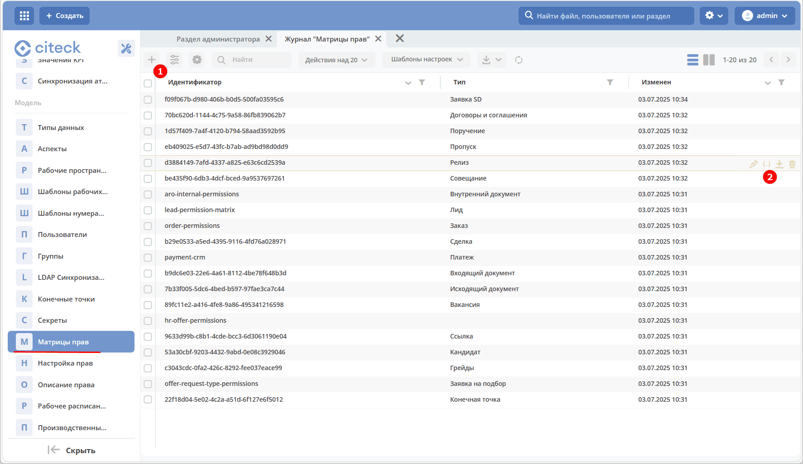

.. _permissions_journal:

Матрицы прав
=============

**Матрица прав** — инструмент управления доступом, позволяющий гибко настраивать права пользователей и ролей на объекты системы: документы и их отдельные атрибуты.

Матрицы привязываются к :ref:`типам данных <data_types>` и задают доступ к объекту и его атрибутам для сочетаний роли и статуса документа.

Возможности
-----------

С помощью матрицы прав можно:

- настраивать уровни доступа к записи: NONE, READ и WRITE;
- задавать права чтения и изменения отдельных атрибутов для конкретных ролей;
- задавать разные наборы прав в зависимости от статуса документа.

Создание и удаление записей также зависят от серверных проверок соответствующего источника данных. Матрицу доступа к бизнес-объектам следует отличать от :ref:`прав на описания типов <data_type_rights>` и настроек доступности действий интерфейса.

Работа с матрицей
------------------

Журнал **«Матрицы прав»** содержит :ref:`матрицы прав <permissions>`, созданные для типов данных, с учётом доступных пользователю рабочих пространств. Источник записей — ``emodel/perms``, идентификатор журнала — ``type-perms``.

Матрицу прав можно загрузить через вариант **«Загрузить матрицу»**, нажав **(1)**:

Для матрицы доступны действия **(2)**:

- редактирование через JSON;
- скачивание в формате YAML;
- удаление.

Импорт и рабочие пространства
-----------------------------

Описание матрицы содержит ``id``, ссылку на тип ``typeRef``, настройки объекта ``permissions`` и настройки атрибутов ``attributes``. Например:

.. code-block:: yaml

   id: example-matrix
   typeRef: emodel/type@example
   permissions:
     matrix:
       reader:
         draft: READ
   attributes: {}

Тип ``example`` должен существовать в целевой системе и содержать роль ``reader`` и статус ``draft``. В примере участникам этой роли разрешено чтение в статусе draft. Артефакт матрицы имеет тип ``model/permissions``.

Матрица и её тип должны относиться к одному рабочему пространству. Локальный ID матрицы уникален внутри пространства; при создании он не должен содержать двоеточие. Префикс пространства в полной ссылке отличается от локального ID.

При переносе матрицы ссылки на тип могут содержать плейсхолдер ``CURRENT_WS``, который при импорте разрешается в контексте пространства назначения.

Доступ к матрицам
-----------------

Права на изменение самой матрицы проверяются отдельно от прав объектов, заданных в её содержимом. Сохранение, загрузка и удаление требуют права изменения артефактов **type-perms** в соответствующем рабочем пространстве либо системного контекста с нужными полномочиями.

Матрицы рабочего пространства доступны на чтение его участникам, администраторам и соответствующим системным контекстам. Наличие доступа к журналу само по себе не разрешает редактировать или удалять все матрицы.
