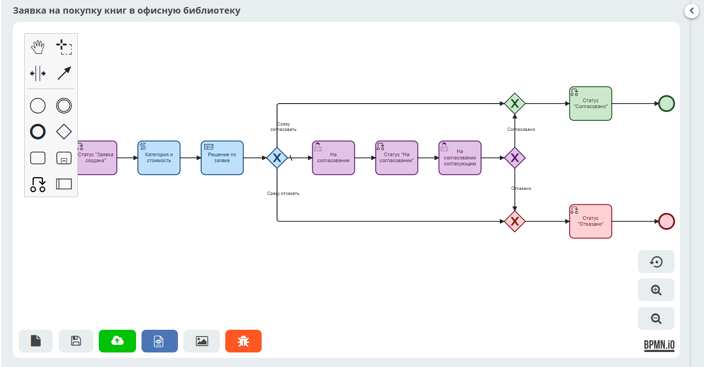

.. _ecos-bpmn_platform:

Платформа бизнес-процессов (Citeck BPMN)
================================================================

**Citeck BPMN** — low-code платформа для моделирования и исполнения бизнес-процессов в нотации **BPMN 2.0** (Business Process Model and Notation). Для моделирования используется библиотека **bpmn-js**, для исполнения — движок **Camunda 7**. Доступные элементы и расширения Citeck, их настройки и ограничения описаны в :ref:`библиотеке компонентов <ecos_bpmn_components>`.

Встроенный визуальный редактор позволяет настраивать маршруты согласования, ветвления, параллельное выполнение, таймеры и обработку событий. Типовые процессы создаются без написания кода; для дополнительной логики и интеграций используются выражения, скрипты, сервисные и внешние задачи.

Сохранение модели и публикация в движок — отдельные операции. Для запуска изменённой схемы её необходимо опубликовать, настроить права доступа и используемые сервисы. Публикация новой версии сама по себе не переносит на неё уже запущенные экземпляры: для этого используется :ref:`миграция версий <actions_migration>`.

Все модели процессов хранятся в едином журнале (:ref:`реестре бизнес-процессов <bpmn_process_registry>`) с метаданными, связью с оргструктурой и автоматическим формированием описания процесса.

Раздел описывает моделирование, запуск, работу с задачами и администрирование BPMN-процессов в Citeck:

.. grid:: 1
   :gutter: 3

   .. grid-item-card:: Общее описание
      :link: ecos_bpmn
      :link-type: ref

      Назначение платформы, используемый движок и поставляемые назначения прав группам пользователей.

   .. grid-item-card:: Редактор
      :link: modeller_bp
      :link-type: ref

      Интерфейс конструктора, проверка схемы, библиотека компонентов и свойства элементов процесса.

   .. grid-item-card:: Базовые операции
      :link: ecos_bpmn_base_operations
      :link-type: ref

      Создание и редактирование моделей, сохранение черновиков и ревизий, публикация и запуск процессов.

   .. grid-item-card:: Права доступа
      :link: bpmn_permissions
      :link-type: ref

      Права на разделы и модели процессов, наследование разрешений и правила рабочих пространств.

   .. grid-item-card:: Задачи
      :link: tasks_options
      :link-type: ref

      Получение задачи на себя, назначение и смена исполнителя, возврат в пул реципиентов и комментарии.

   .. grid-item-card:: Внешние задачи
      :link: ecos_bpmn_external_task
      :link-type: ref

      Обработка задач внешними приложениями: получение и блокировка задач, завершение, ошибки и повторные попытки.

   .. grid-item-card:: Администрирование
      :link: bpmn_admin
      :link-type: ref

      Опубликованные версии и экземпляры процессов, инциденты, управление выполнением и миграция.

   .. grid-item-card:: KPI
      :link: bpmn_kpi
      :link-type: ref

      Настройка счётчиков и длительности выполнения, условий применения и отображения KPI.

.. toctree::
    :maxdepth: 3
    :hidden:

    ecos_bpmn/ecos_bpmn_overview
    ecos_bpmn/ecos_bpmn_editor
    ecos_bpmn/ecos_bpmn_base_operations
    ecos_bpmn/ecos_bpmn_permissions
    ecos_bpmn/ecos_bpmn_tasks
    ecos_bpmn/ecos_bpmn_external_task
    ecos_bpmn/ecos_bpmn_administration
    ecos_bpmn/ecos_bpmn_kpi

.. _bpmn_process_registry:

Реестр бизнес-процессов
------------------------

Модели бизнес-процессов хранятся в едином централизованном реестре — журнале **«Модели BPMN»** (рабочее пространство **«Раздел администратора» → «Управление процессами»**). В разделе администратора отображаются глобальные модели — общие для всей системы. Модели, созданные в отдельном рабочем пространстве, отображаются только в разделе **«Модели BPMN»** этого пространства. В интерфейсе реестр представлен страницей разделов BPMN: модели сгруппированы по разделам и подразделам и отображаются плитками или списком (см. :ref:`Базовые операции <ecos_bpmn_base_operations>`).

**Метаданные модели.** Для каждой модели в реестре хранятся:

- идентификатор и имя;
- раздел, в котором размещена модель (поле **Раздел**; если не указан — «По умолчанию»);
- тип данных (ECOS Type), к которому привязан процесс, и форма запуска;
- признаки «Включен», «Автоматический старт процесса», «Автоматическое удаление процесса»;
- ревизии модели и опубликованные версии (:ref:`журнал версий <widget_versions_journal_bpmn>`);
- история изменений с автором, временем и комментарием (:ref:`история событий <widget_events-history>`);
- комментарии, статистика исполнения и показатели :ref:`KPI <bpmn_kpi>`.

**Связь с организационной структурой.**

- Права назначаются на разделы — группам и пользователям оргструктуры — и наследуются подразделами и моделями раздела (см. :ref:`Права доступа <bpmn_permissions>`). По умолчанию права на корневом разделе назначены группам администраторов, менеджеров, разработчиков и читателей бизнес-процессов (``bp-administrator``, ``bp-manager``, ``bp-developer``, ``bp-viewer``).
- Исполнители задач задаются через роли типа данных или вручную. В роль включаются группы и конкретные пользователи оргструктуры; вручную указывается пользователь, группа или выражение (см. :ref:`Пользовательская задача <user_task>`). Дорожки (lanes) на схеме могут использоваться в том числе для отражения ответственных исполнителей и их ролей в процессе (см. :ref:`Дорожки <pool_lanes>`). Сама дорожка исполнителя не назначает: он задаётся в реципиентах задачи.

**Автодокументирование.**

- Действие **«Скачать описание БП»** формирует по сохранённой модели Excel-таблицу с элементами процесса и связями между ними (см. :ref:`Выгрузка БП в виде Excel таблицы <bp_to_excel>`).
- Действие **«Скачать»** выгружает модель в формате BPMN 2.0 XML.
- AI-ассистент составляет техническую документацию по приложению, включая его бизнес-процессы, типы данных и формы (см. :ref:`Документация приложения <AI_app_documentation>`; Enterprise).
