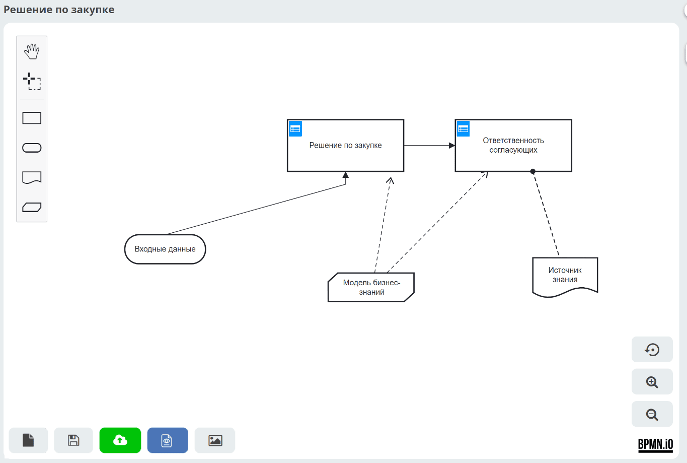

.. _ecos-dmn:

Модели принятия решений (Citeck DMN)
=========================================================

**Citeck DMN** — инструмент моделирования бизнес-правил и принятия решений в формате **DMN 1.3** (Decision Model and Notation). Для визуального редактирования используется редактор на базе **dmn-js**, для выполнения опубликованных решений — движок **Camunda**.

В редакторе можно строить диаграммы требований к решениям (DRD) и таблицы решений: задавать входные выражения, условия правил и выходные значения. Бизнес-правила хранятся в отдельных моделях, которые можно изменять и публиковать независимо от схемы процесса.

Опубликованные решения используются в следующих сценариях:

- :ref:`Задача бизнес-правило BPMN <business_rule_task>` — решение получает переменные процесса; версия решения определяется настройкой связи в задаче.
- :ref:`Динамическая роль <dmn_role>` — решение определяет участников роли по данным документа.
- :ref:`Условие применения KPI <dmn_result_kpi>` — результат решения определяет, применяется ли настройка KPI к документу.

Для динамических ролей и условий KPI входные переменные задаются через свойство **«Модель»** на схеме DMN, используется последняя опубликованная версия решения. Источники входов и требования к результату различаются между сценариями; подробнее — :ref:`Входные и выходные данные решения <dmn_decision_data>`.

.. important::

   Сохранение модели и публикация в движок — отдельные операции. Чтобы использовать изменения при выполнении решения, модель необходимо опубликовать. Если BPMN-задача привязана к конкретной версии или тегу версии, новая публикация сама по себе не меняет эту привязку. Порядок работы описан в разделе :ref:`Базовые операции <new_dmn>`.

Материалы раздела:

.. grid:: 1
   :gutter: 3

   .. grid-item-card:: Общее описание
      :link: ecos_dmn
      :link-type: ref

      Назначение Citeck DMN, способы применения решений и навигация по журналу моделей.

   .. grid-item-card:: Редактор
      :link: modeller_dmn
      :link-type: ref

      Конструктор DMN и компоненты Citeck DMN — типы элементов нотации и правила их соединения.

   .. grid-item-card:: Входные и выходные данные решения
      :link: dmn_decision_data
      :link-type: ref

      Переменные процесса, модель входов из атрибутов документа и требования к результату для BPMN, динамических ролей и KPI.

   .. grid-item-card:: Базовые операции
      :link: new_dmn
      :link-type: ref

      Создание, редактирование, версионирование и публикация решений.

   .. grid-item-card:: Права доступа
      :link: dmn_permissions
      :link-type: ref

      Настройка разрешений на уровне разделов и отдельных моделей.

.. toctree::
    :maxdepth: 3
    :hidden:

    ecos_dmn/ecos_dmn_overview
    ecos_dmn/ecos_dmn_editor
    ecos_dmn/ecos_dmn_decision_data
    ecos_dmn/ecos_dmn_base_operations
    ecos_dmn/ecos_dmn_permissions
