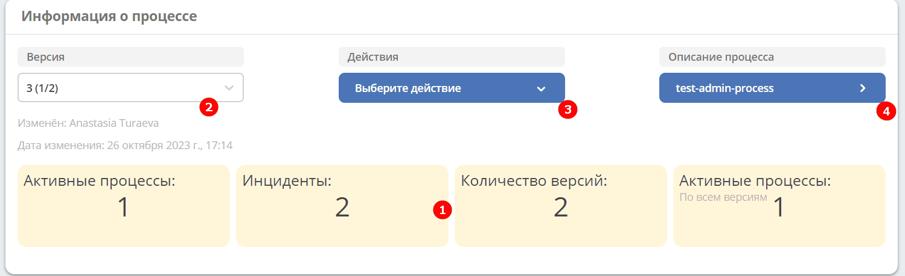
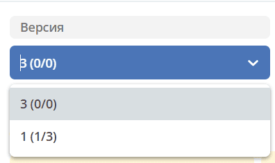
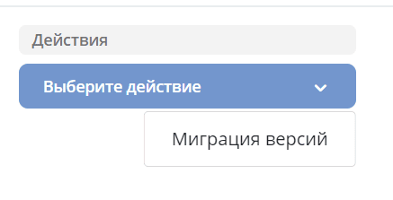
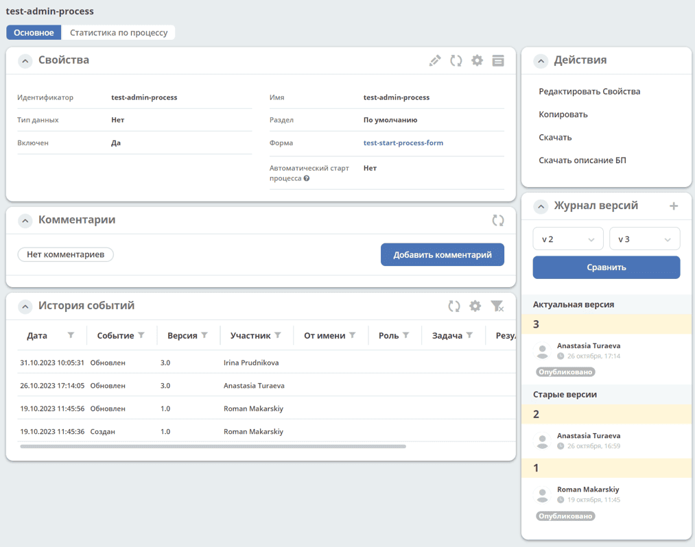
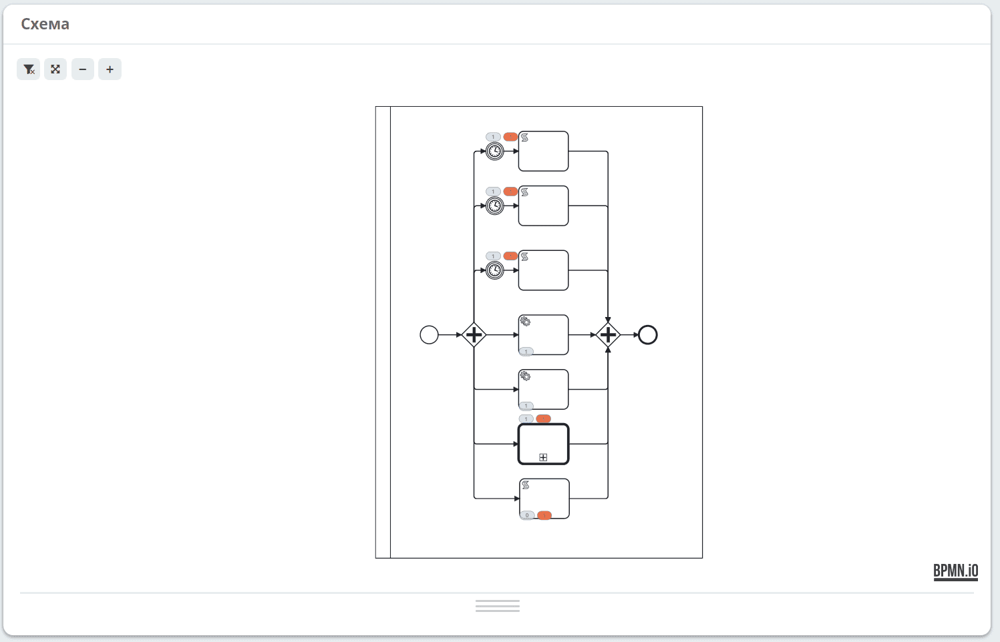
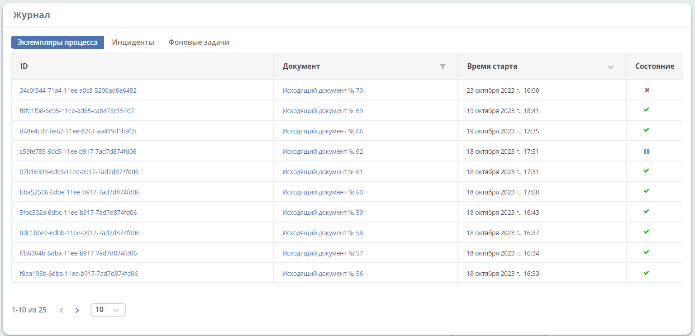
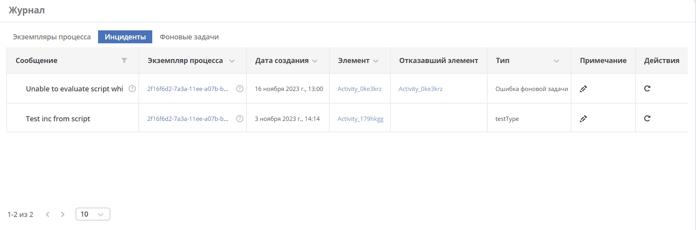
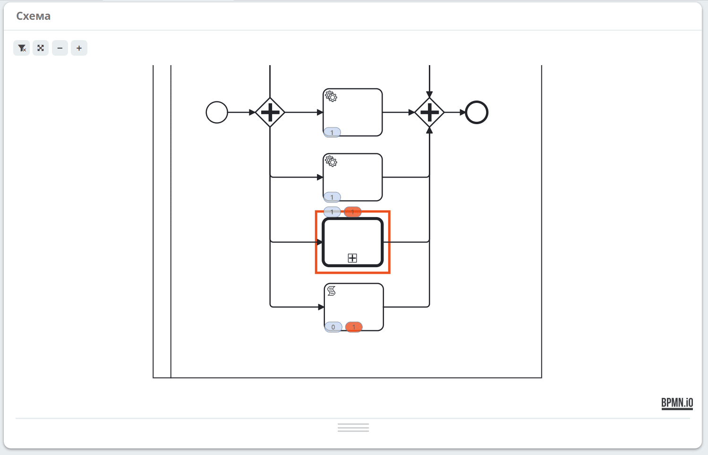
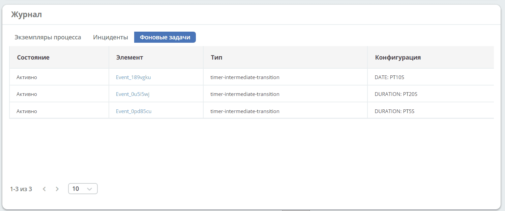
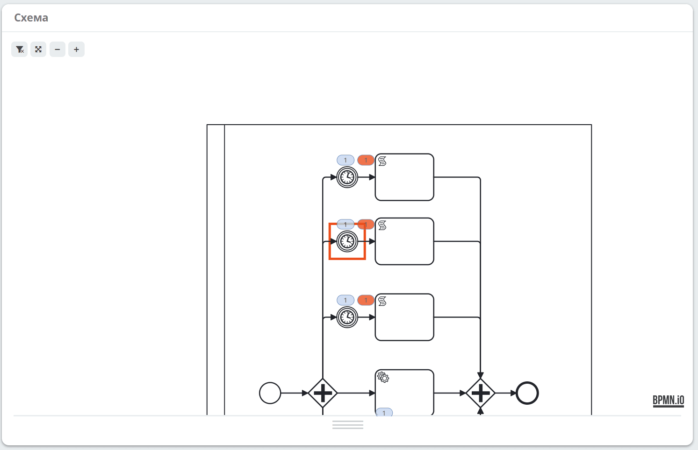

.. _process_information:

Информация о процессе
==========================================

.. contents::

Представлена обобщенная информация о процессе **(1)**:

    -	количество незавершённых экземпляров процесса по текущей версии, включая приостановленные;
    -	количество инцидентов по текущей версии;
    -	общее количество опубликованных версий;
    -	количество незавершённых экземпляров процесса по всем версиям, включая приостановленные.

Для просмотра данных экземпляров процесса необходимо право ``bpmn-process-instance-read``.

Доступен выбор версии процесса **(2)** из опубликованных:

В скобках указано количество незавершённых экземпляров процесса (включая приостановленные)/количество инцидентов. Для выбранной версии процесса откроется подробная информация.

Действия с процессом **(3)**:

Доступен переход к карточке процесса с подробной информацией **(4)**:

Действия
----------

.. _actions_migration:

.. dropdown:: Миграция версий
   :color: secondary

   Вы можете перенести запущенные экземпляры процесса из текущей версии в другую версию, используя действие **Миграция версий**.

   Для генерации плана и выполнения миграции необходимо право ``bpmn-process-instance-migrate`` на исходную и целевую версии процесса.

   .. image:: _static/migration_01.png
      :width: 600
      :align: center

   По нажатию на действие открывается отдельный экран миграции процесса. Указан процесс, из которого выбрано действие.

   .. image:: _static/migration_02.png
      :width: 700
      :align: center

   По нажатию на:

   .. list-table::
         :widths: 5 10
         :class: tight-table
         :align: center

         * -
             .. image:: _static/migration_02_1.png
                 :width: 30
                 :align: center

           - открывается карточка процесса с подробной информацией.

   На схеме исходной версии процесса отмечены счётчики текущих экземпляров элементов и инцидентов для выбранной версии процесса:

   .. image:: _static/migration_02_element.png
      :width: 400
      :align: center

   Выберите **начальную** (исходную) версию процесса из списка и **конечную** (целевую) версию процесса. Выберите **элементы процесса**, кликнув на них на схеме.

   .. image:: _static/migration_03.png
      :width: 600
      :align: center

   Нажмите **«Сгенерировать план»**. Сформированный план отображается в JSON-редакторе и доступен для редактирования целиком. Секция ``processInstanceQuery`` задаёт выборку экземпляров процесса для миграции:

   .. image:: _static/migration_04_1.png
      :width: 600
      :align: center

   ...

   .. image:: _static/migration_04_2.png
      :width: 600
      :align: center

   Нажмите **«Запустить миграцию»**. Подтвердите действие:

   .. image:: _static/migration_05.png
      :width: 600
      :align: center

   Миграция будет запущена в фоновом режиме. Если миграция не сможет запуститься — будет показана ошибка.

Схема
------

Схема процесса, на которой отмечены:

.. list-table::
      :widths: 5 10
      :class: tight-table
      :align: center

      * -
          .. image:: _static/adm_11.png
              :width: 30
              :align: center

        - количество текущих экземпляров элемента в экземплярах процесса выбранной версии.
      * -
          .. image:: _static/adm_12.png
              :width: 30
              :align: center

        - количество инцидентов.

Журнал
-------

Экземпляры процесса
~~~~~~~~~~~~~~~~~~~~~

В первой вкладке представлен список запущенных экземпляров процесса для выбранной версии процесса:

По клику на **ID** открывается подробная информация о нем. См. подробно :ref:`Экземпляр процесса <process_instance>`.

По клику на **Документ** открывается карточка документа.

Возможные состояния процесса:

.. list-table::
      :widths: 5 10
      :class: tight-table
      :align: center

      * -
          .. image:: _static/adm_14.png
              :width: 30
              :align: center

        - Экземпляр активен.
      * -
          .. image:: _static/adm_15.png
              :width: 30
              :align: center

        - Экземпляр приостановлен.
      * -
            .. image:: _static/adm_16.png
                :width: 30
                :align: center

        - В экземпляре обнаружены инциденты.

Инциденты
~~~~~~~~~~~~~~~~~~~~~

**Список инцидентов** в запущенных экземплярах процесса для выбранной версии процесса:

Фильтрация инцидентов по сообщению работает только для тех инцидентов, которые произошли в текущей области видимости. Например, если из процесса А через callActivity вызывается процесс B и инцидент произошёл внутри процесса B, связанный инцидент будет показан в списке процесса А, но фильтрация по сообщению его корневой причины работать не будет.

Для добавления комментария к инциденту и изменения количества попыток выполнения задания необходимо право ``bpmn-process-instance-edit``.

По клику на **Экземпляр процесса** открывается подробная информация о нем. См. :ref:`подробно Экземпляр процесса <process_instance>`.

По клику на **Элемент**, **Отказавший элемент** — элемент будет подсвечен на схеме:

.. list-table::
      :widths: 5 10
      :class: tight-table

      * -
          .. image:: _static/adm_37_1.png
              :width: 30
              :align: center

        - Ввести комментарий к инциденту:

          .. image:: _static/adm_39.png
              :width: 500
              :align: center

      * -
          .. image:: _static/adm_37_2.png
              :width: 30
              :align: center

        - | Изменить количество попыток выполнения неуспешной задачи:

          .. image:: _static/adm_40.png
              :width: 500
              :align: center

          | Введите положительное количество оставшихся попыток (не менее 1) и нажмите **«Сохранить»**.
          | Введённое значение устанавливает количество оставшихся попыток выполнения задания. Положительное значение позволяет исполнителю повторно получить задание при соблюдении остальных условий выполнения. Сохранение количества попыток само по себе не запускает задание немедленно.

Фоновые задачи
~~~~~~~~~~~~~~~~~~~~~

Список определений фоновых заданий (job definitions) для выбранной версии процесса. Определение содержит сведения об элементе процесса, типе и конфигурации задания. Конкретные фоновые задания (jobs) представлены в карточке :ref:`экземпляра процесса <process_instance>`:

По клику на **Элемент** элемент будет подсвечен на схеме:

