.. _process_instance:

Экземпляр процесса
====================================

.. contents::

Карточка выбранного экземпляра процесса — дашборд со следующими виджетами.

Для просмотра данных экземпляра процесса необходимо право ``bpmn-process-instance-read``.

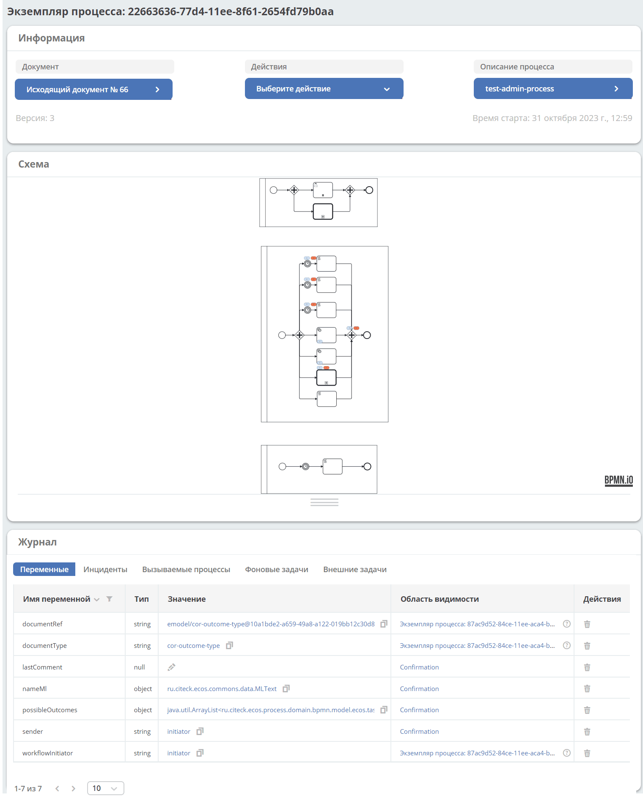

Рассмотрим каждый виджет отдельно.

Информация
-----------

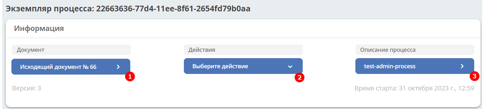

- **1** — Переход в карточку документа.
- **2** — Действия с экземпляром процесса:

    .. image:: _static/adm_23_1.png
        :width: 300

- **3** — Переход в карточку процесса.

.. _process_instance_actions:

Описание действий
~~~~~~~~~~~~~~~~~~~

Для приостановки, возобновления и удаления экземпляра, а также изменения его переменных необходимо право ``bpmn-process-instance-edit``. Для миграции токенов требуется право ``bpmn-process-instance-migrate``.

Приостановить экземпляр процесса
""""""""""""""""""""""""""""""""""""

Приостанавливает экземпляр процесса. Прочтите внимательно описание и подтвердите:

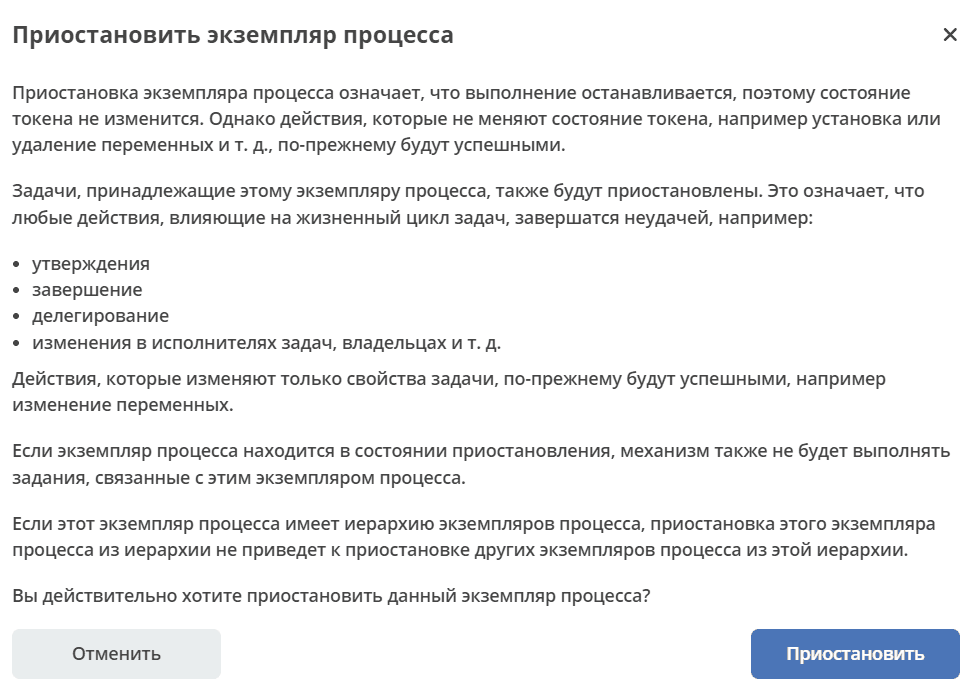

Возобновить экземпляр процесса
""""""""""""""""""""""""""""""""""""

Возобновляет приостановленный экземпляр процесса. Прочтите внимательно описание и подтвердите:

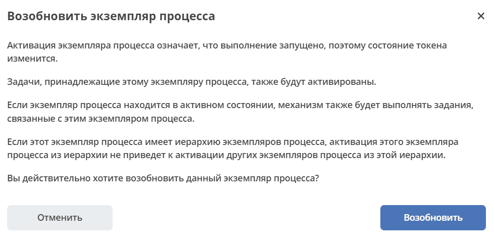

Удалить экземпляр процесса
"""""""""""""""""""""""""""

Удаляет экземпляр процесса. После успешного удаления пользователь информируется об этом и перенаправляется на страницу **Информация о процессе**.

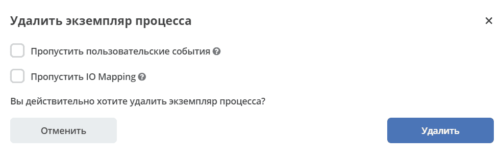

.. list-table::
    :widths: 5 10
    :class: tight-table

    * - **Пропустить пользовательские события**
      - Будут уведомлены только встроенные слушатели событий.
    * - **Пропустить IO Mapping**
      - IO Mapping будет пропущен при удалении.

Добавить переменную в экземпляр процесса
"""""""""""""""""""""""""""""""""""""""""

В форме введите название переменной и выберите тип из представленных.

Поддерживаются типы ``string``, ``date``, ``integer``, ``boolean``, ``double``, ``long``, ``object`` и ``null``. Для типа ``object`` необходимо указать имя Java-типа в поле ``objectTypeName``.

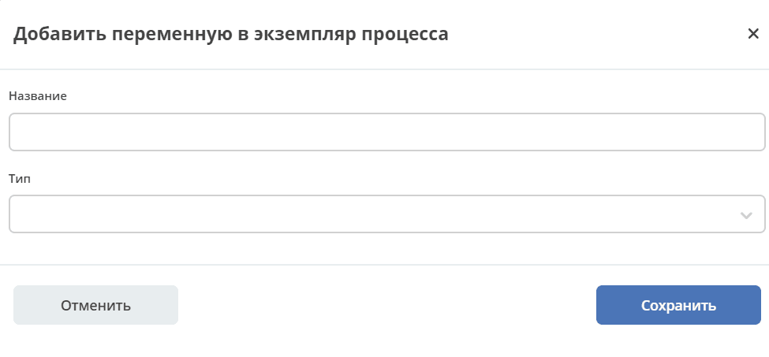

.. _token_migration:

Миграция токенов
""""""""""""""""""

Миграция токенов используется для ручного управления ходом экземпляра процесса: отката на предыдущий шаг, пропуска ошибочного шага и повторного выполнения шага. Токен показывает, на каком элементе схемы сейчас находится экземпляр процесса.

Все действия выполняются в окне **«Миграция токенов»**, которое открывается из действий экземпляра процесса.

.. rubric:: Откат на предыдущий шаг

1. Нажмите на схеме на элемент, на котором сейчас находится экземпляр процесса (он отмечен счётчиком), и выберите **«Начальный токен»**.
2. Нажмите на ранее пройденный элемент, к которому нужно вернуться, и выберите **«Целевой токен»**.
3. Нажмите **«Мигрировать»** и подтвердите действие.

Текущий шаг будет отменён, экземпляр процесса продолжит выполнение с выбранного элемента.

.. rubric:: Пропуск ошибочного шага

1. Нажмите на схеме на элемент, на котором экземпляр процесса остановился, и выберите **«Начальный токен»**. Для инцидента этот элемент указан в колонке **Элемент** на вкладке :ref:`Инциденты <process_instance_incidents>`.
2. Нажмите на элемент, следующий за ошибочным шагом, и выберите **«Целевой токен»**. Ошибочный шаг указан в колонке **Отказавший элемент**.
3. Нажмите **«Мигрировать»** и подтвердите действие.

Ошибочный шаг выполнен не будет, экземпляр процесса продолжит выполнение со следующего элемента.

.. rubric:: Повторное выполнение шага

1. Нажмите на схеме на элемент, который нужно выполнить заново, и выберите **«Начальный токен»**.
2. Нажмите на этот же элемент ещё раз и выберите **«Целевой токен»**.
3. Нажмите **«Мигрировать»** и подтвердите действие.

Шаг будет запущен заново.

.. rubric:: Что учитывать при миграции

- Переменные процесса сохраняются. Удаляются только локальные переменные отменённого элемента.
- Целевой элемент запускается сразу после подтверждения. Если нужно исправить значения переменных, сделайте это до миграции (см. :ref:`Переменные <process_instance_variables>`).
- Действия, которые процесс уже выполнил, не отменяются: например, изменение статуса и атрибутов документа, отправленные уведомления.

Чтобы остановить выполнение экземпляра, используйте действие **«Приостановить экземпляр процесса»**, чтобы продолжить — **«Возобновить экземпляр процесса»**. Прекратить выполнение полностью можно действием **«Удалить экземпляр процесса»**.

Для миграции токенов необходимо право ``bpmn-process-instance-migrate``, для просмотра экземпляра процесса — ``bpmn-process-instance-read``. Права выдаются группам и пользователям на раздел, в котором находится модель процесса (см. :ref:`Права доступа <bpmn_permissions>`). Поэтому откат может выполнять ответственный за процесс без прав администратора системы.

.. dropdown:: Как выполнить миграцию токенов
   :color: secondary

   По нажатию на действие открывается схема текущего экземпляра процесса со счётчиками текущих экземпляров элементов и инцидентов:

   .. image:: _static/adm_28.png
      :width: 600
      :align: center

   Для увеличения схемы используйте сочетания **Ctrl + скролл мыши**.

   Кликом на элемент из схемы процесса выберите **Начальный токен** (активная задача/этап — он будет снят/отменен) и **Целевой токен** (задача/этап, который будет запущен).

   .. image:: _static/adm_29.png
      :width: 600
      :align: center

   На схеме начальный токен будет отмечен зеленой рамкой, целевой — красной. Также выбранные токены отражены в нижней части:

   .. image:: _static/adm_30.png
      :width: 600
      :align: center

   Нажмите **«Мигрировать»**. Подтвердите действие:

   .. image:: _static/adm_30_1.png
      :width: 600
      :align: center

   .. list-table::
      :widths: 5 10
      :class: tight-table

      * - **Пропустить пользовательские события**
        - Будут уведомлены только встроенные слушатели событий.
      * - **Пропустить IO Mapping**
        - Маппинги входных и выходных данных будут пропущены при модификации экземпляра процесса.

   Миграция токенов выполняется в рамках текущего запроса. Если выполнить миграцию не удастся — будет показана ошибка.

Схема
-----

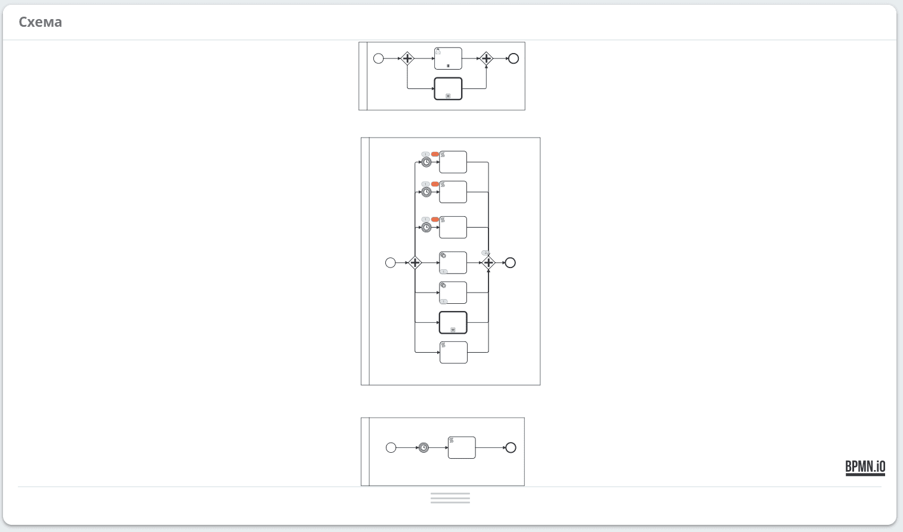

Схема процесса, на которой отмечены:

.. list-table::
      :widths: 5 10
      :align: center
      :class: tight-table

      * -
          .. image:: _static/adm_11.png
              :width: 30
              :align: center

        - Количество текущих экземпляров элемента в данном экземпляре процесса.
      * -
          .. image:: _static/adm_12.png
              :width: 30
              :align: center

        - Количество инцидентов.

Журнал
-----------

.. _process_instance_variables:

Переменные
~~~~~~~~~~~~~~~~~~

На вкладке представлен список переменных данного экземпляра процесса:

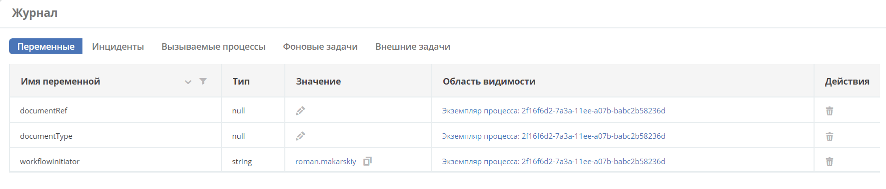

По клику на **Область видимости** список переменных фильтруется по выбранной области видимости.

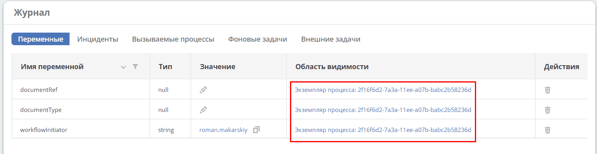

Элемент выделяется на схеме бизнес-процесса:

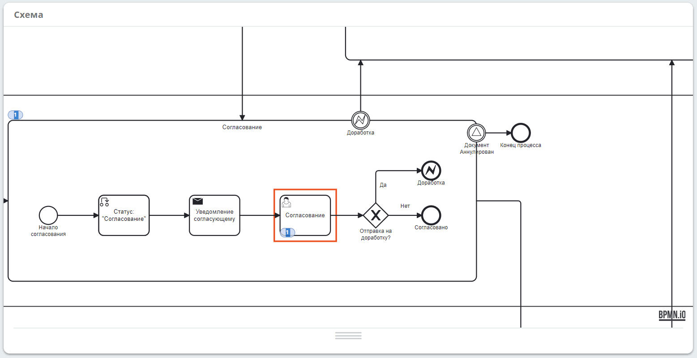

Для отключения фильтра:

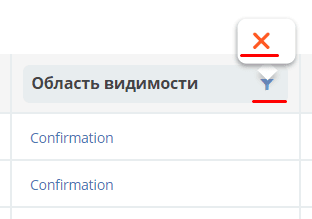

.. list-table::
      :widths: 5 10
      :align: center
      :class: tight-table

      * -
          .. image:: _static/adm_33_2.png
              :width: 30
              :align: center

        - | Копировать значение переменной экземпляра процесса.

      * -
          .. image:: _static/adm_33_3.png
              :width: 30
              :align: center

        - | Удалить переменную.

Редактирование переменной
""""""""""""""""""""""""""

Редактировать переменную экземпляра процесса:

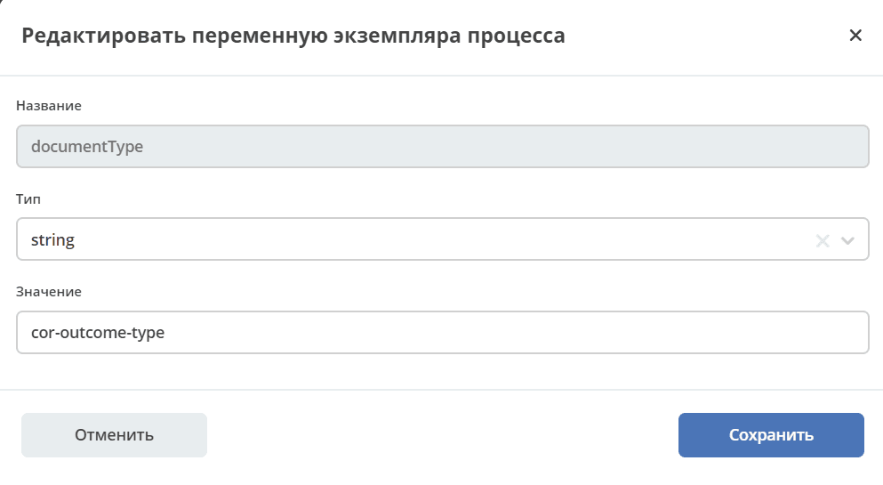

Если переменная заполнена, кликните **Значение** для изменения. Внесите изменения и сохраните.

Редактирование поддерживается для тех же типов, что и добавление переменной. Переменные типов ``json`` и ``xml`` могут отображаться в списке, но изменение значения с сохранением этих типов через данное действие не поддерживается. Имя существующей переменной при редактировании не изменяется.

.. _process_instance_incidents:

Инциденты
~~~~~~~~~~~~~~~~~~

На вкладке представлен список неразрешенных инцидентов (возникших ошибок) данного экземпляра процесса:

Для каждого инцидента показаны текст ошибки (**Сообщение**), экземпляр процесса, дата и время возникновения (**Дата создания**), шаг процесса, на котором произошла ошибка (**Элемент** и **Отказавший элемент**), тип инцидента и примечание. Входные данные шага доступны на вкладке :ref:`Переменные <process_instance_variables>` с фильтром по области видимости элемента.

Действия по исправлению: комментарий к инциденту, :ref:`изменение количества попыток <process_instance_retries>` (повторный запуск задания), :ref:`изменение переменных <process_instance_variables>` и :ref:`миграция токенов <token_migration>` (повтор или пропуск шага).

Для добавления комментария к инциденту и изменения количества попыток выполнения задания необходимо право ``bpmn-process-instance-edit``.

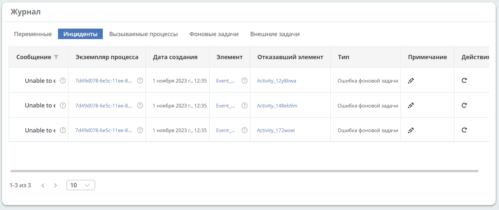

По клику на **Экземпляр процесса** открывается подробная информация о нем (карточка соответствующего экземпляра процесса). См. :ref:`Экземпляр процесса <process_instance>`.

По клику на **Элемент**, **Отказавший элемент** — элемент будет подсвечен на схеме:

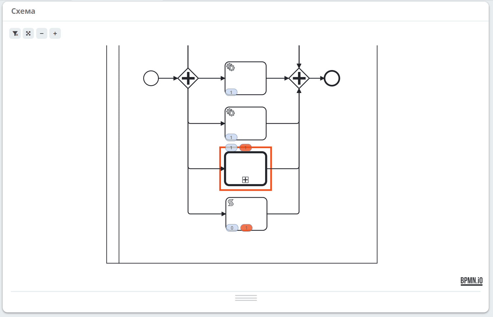

.. list-table::
      :widths: 5 10
      :align: center
      :class: tight-table

      * -
          .. image:: _static/adm_37_1.png
              :width: 30
              :align: center

        - Ввести комментарий к инциденту:

          .. image:: _static/adm_39.png
              :width: 500
              :align: center

.. _process_instance_retries:

Изменение количества попыток
""""""""""""""""""""""""""""""

Изменить количество попыток выполнения неуспешной задачи:

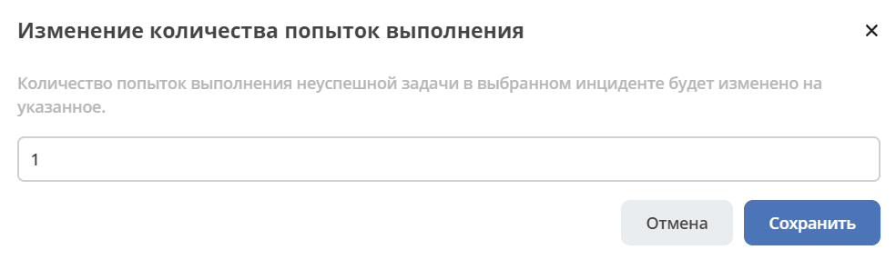

Введите положительное количество оставшихся попыток (не менее 1) и нажмите **«Сохранить»**. Введённое значение устанавливает количество оставшихся попыток выполнения задания. Положительное значение позволяет исполнителю повторно получить задание при соблюдении остальных условий выполнения. Сохранение количества попыток само по себе не запускает задание немедленно.

Вызываемые процессы
~~~~~~~~~~~~~~~~~~~~

На вкладке представлен список вызываемых :ref:`call activity <call_activity>` данного экземпляра процесса и их состояний:

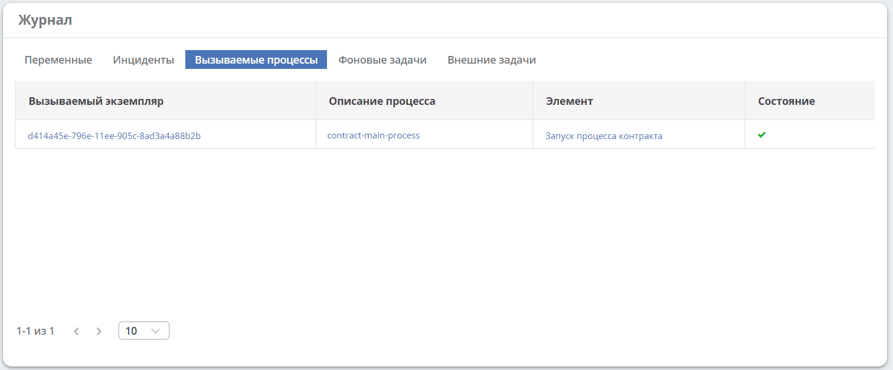

По клику на **Вызываемый экземпляр** открывается подробная информация о нем (карточка вызываемого экземпляра процесса). См. :ref:`Экземпляр процесса <process_instance>`.

По клику на **Описание процесса** открывается информация об определении вызываемого процесса.

По клику на **Элемент** элемент будет подсвечен на схеме.

Фоновые задачи
~~~~~~~~~~~~~~~~~~

На вкладке представлен список фоновых заданий движка (jobs) данного экземпляра процесса, например заданий таймеров и асинхронного выполнения.

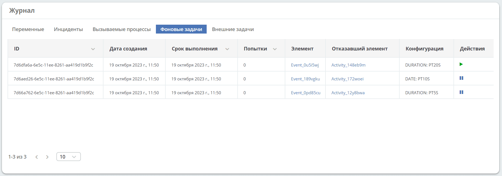

По клику на **Элемент**, **Отказавший элемент** — элемент будет подсвечен на схеме.

Фоновую задачу можно приостановить или возобновить, нажимая соответствующие кнопки в колонке **Действия**. Возобновление разрешает дальнейшее выполнение задачи движком, но само по себе не запускает её немедленно. Для этих действий необходимо право ``bpmn-process-instance-edit``.

Внешние задачи
~~~~~~~~~~~~~~~~~~

На вкладке представлен список :ref:`Внешних задач <ecos_bpmn_external_task>` данного экземпляра процесса:

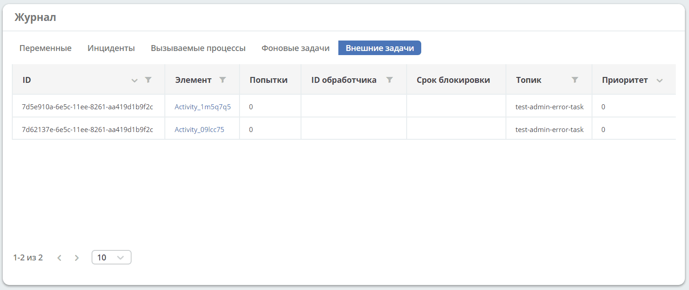

По клику на **Элемент** элемент будет подсвечен на схеме.
